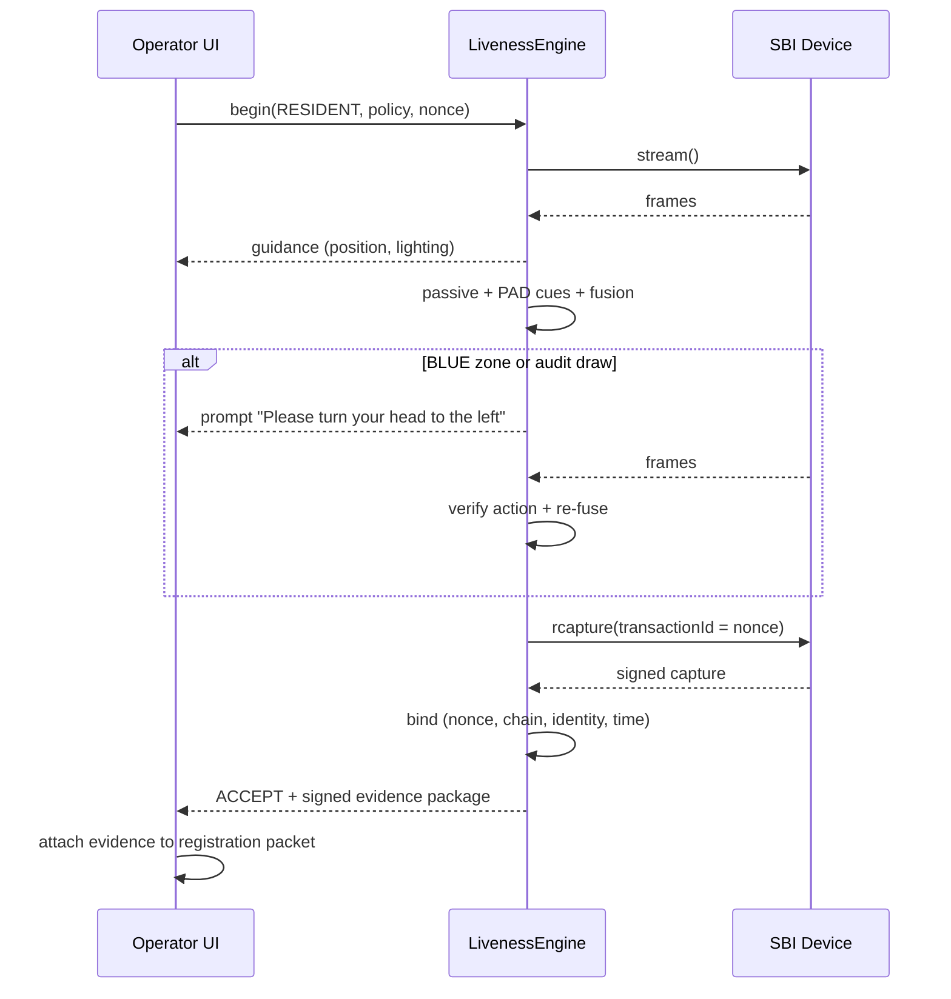

# PRAMAAN — The Complete Technical Bible
### Face Liveness Detection & Presentation Attack Detection for the MOSIP Registration Client (Decode PS04)

*Written so someone with zero prior context can read this end to end and understand exactly what the system does, why every design decision was made, the math behind every module, worked numerical examples, every edge case and how it's handled, and how to independently test each piece.*

*PRAMAAN (प्रमाण) is Sanskrit for "proof" or "evidence." The name is the thesis: a liveness decision is worthless unless it can be proven — to the client at capture time, to the server at sync time, and to an auditor years later.*

---

## Part 0 — What Problem Is This Solving, In Plain English

MOSIP is an open-source platform countries use to build national ID systems. The **Registration Client** is the app an operator in a registration centre uses to enrol a resident — it captures their photo, fingerprints and iris, and packages them into a registration packet that is sent to the server.

The face photo is the weak spot. Anyone can put something in front of a camera that *looks* like a face:

1. **A printed photo** of someone else.
2. **A phone or tablet screen** showing someone's photo or a video of them.
3. **A mask** (paper, resin, silicone).
4. **Nothing physical at all** — a fake video stream injected into the software, bypassing the camera entirely (a "virtual camera," a hacked driver, a real-time deepfake).

And the same trick works against the **operator and supervisor logins**, which use face authentication: a corrupt operator could log in with a photo of their supervisor and approve their own fraudulent enrolments.

The problem statement asks for **liveness detection** ("is this a live human?") and **Presentation Attack Detection, PAD** ("is someone presenting a fake?"), with a hybrid approach: check silently first (passive), and only if unsure, ask the person to do something (active challenge — blink, smile, turn).

A naive system — webcam → blink detector → "liveness confirmed" — is defeated by a phone playing a video of the person blinking, and by every modern real-time deepfake tool, which blinks and smiles on command.

PRAMAAN is built around answering **seven questions, in order, before it ever accepts a face**:

1. **Is this frame stream really coming from a real camera sensor?** (source integrity — Layer 0)
2. **Is there exactly one usable face, of adequate quality?** (face gate — Layer 1)
3. **Without asking anything, does this face look alive?** (passive liveness — Layer 2)
4. **Does it carry the fingerprints of an attack instrument — paper, screen, flat plane, mask?** (PAD cue bank — Layer 3)
5. **Putting all the evidence together: accept, reject, or ask for more?** (fusion & three-zone decision — Layer 4)
6. **If we asked, did a live person respond correctly to a challenge nobody could have predicted?** (challenge generator + verifier — Layers 5–6)
7. **Is the face we finally store provably the same face that passed — and can we prove all this later?** (capture binding + evidence package — Layers 8–9)

Everything below is organised as a stack of layers, each answering a narrower slice of these seven questions, feeding explicit result objects to the next.

---

## Part 1 — Background Primer (everything the problem statement assumes you know)

### 1.1 MOSIP and the Registration Client

| Thing | What it is | Why it matters to us |
|---|---|---|
| **Registration Client (Desktop)** | JavaFX desktop app used in registration centres | Primary integration target; Java |
| **Android Registration Client** | Flutter app with native Java/Kotlin plugins | Second target; the heavy frame processing must live in native code, not Dart |
| **Registration packet** | Encrypted, signed bundle of demographics + biometrics sent to the server | Where our Liveness Evidence Package (Part 14) travels |
| **Registration Processor** | Server-side pipeline that processes packets in stages (validation, deduplication, etc.) | Where server-side liveness re-verification (Part 14) plugs in |
| **ABIS** | Automated Biometric Identification System — server-side 1:N deduplication | Catches a resident enrolling twice; *not* a liveness check |
| **BioSDK** | MOSIP's pluggable biometric SDK interface (quality, match, extract) | A natural home for a vendor-pluggable liveness engine |

### 1.2 SBI — how MOSIP talks to biometric devices

MOSIP defines the **Secure Biometric Interface (SBI)**. A device-provider service runs on the host (localhost HTTP) and exposes calls such as device discovery, device info, **stream** (live preview) and **rcapture** (registration capture). Key facts:

- The **stream** is a preview feed (MJPEG-style). It is **not signed**.
- **rcapture** returns the final biometric, **signed** by the device key, with a request-supplied `transactionId`, a timestamp, quality score, and device identity (`digitalId`) inside the signed data. *(Verify exact field names against the SBI spec version you target — see Part 30.)*
- **L0 device:** the signing key lives in host software. Whoever owns the host can, in principle, reach the key.
- **L1 device:** the signing key lives in secure hardware on the device (secure element / TEE). Much harder to forge.

**The single most important consequence:** a naive hybrid flow runs liveness on the unsigned preview, then stores the signed capture. Nothing ties the two together. Part 13 fixes this.

#### Research update R1 — what is now confirmed about SBI (see Part 47)

| Fact | Status | Consequence for PRAMAAN |
|---|---|---|
| rcapture request carries a client-supplied `transactionId` (4–50 characters) | Confirmed (MDS spec 0.9.5 onward) | Our 128-bit nonce, encoded as 32 hex characters, fits (base64url would not — `_` is not allowed) |
| The `transactionId` is echoed **inside the device-signed JWT** | Confirmed | Nonce lock (Part 13, lock 1) works on standard SBI — no spec change needed |
| `previousHash` chains successive captures (first = SHA-256 of the empty string; then hash of the previous capture) | Confirmed; CTK 1.4.0 clarified the first-capture rule | Our frame hash chain links into the SBI capture chain (Part 13, lock 5) |
| Preview stream is **not signed**, no per-frame integrity | Confirmed | The SBI Liveness Profile (Part 41) remains valuable |
| **Desktop:** the stream API sends an unsigned M-JPEG stream as HTTP chunks to the Registration Client, "minimum frames 3 per second" | **Confirmed** (MDS spec 1.2.0, round 2) | Mode C works on desktop, but only ~3 fps is guaranteed → fps-aware cue gating (below) |
| **Android:** "a separate stream intent is not raised"; "on receiving rCapture request MDS must show the stream within its UI in the foreground"; the result returns via intent extras | **Confirmed** (MDS spec 1.2.0, round 2) | The Android Registration Client **never sees preview frames** → on Android, liveness must run **inside the SBI app** (Mode D) |
| The chained `hash` sits *beside* the signed JWT, not inside it | Confirmed | Not a weakness: the verifier recomputes it from the signed `bioValue` and the previous hash |
| SBI 2.0 changes (certificate API GET→POST, JWT header `typ`, optional stream timeout) add **no liveness, PAD, illuminator or capability fields** | Confirmed (round 2) | The SBI Liveness Profile proposal (Part 41) fills a real gap |
| L0 allowed only for Registration purpose; L1 for all, including authentication | Confirmed | L0 risk prior in fusion (Part 9) stays; operator/supervisor auth prefers L1 |

**Deployment modes (new).** Because frame access differs between device services, PRAMAAN is packaged so the same engine can run in three places:

| Mode | Where the engine runs | Frames it sees | Liveness result reaches the packet via |
|---|---|---|---|
| **C — Client** | Registration Client (desktop/Android) | SBI stream frames delivered to the client | Evidence package in BIR `others` (Part 14) |
| **D — Device** | Inside the device service (vendor integrates the PRAMAAN library) or device firmware (L1) | Raw sensor frames, before compression | Signed rcapture fields (SBI Liveness Profile `onDevicePad`, Part 41) + evidence |
| **H — Hybrid** | Device computes passive/physics cues; client runs challenges, binding, fusion | Both | Both, cross-checked |

Mode D is the strongest (raw frames, inside the trust boundary, rPPG possible — Part 8.5) and it is the only mode that works if the client never sees preview frames.

**Platform verdict (round 2):** **Desktop = Mode C or H. Android = Mode D.** On Android, PRAMAAN ships as a library (AAR) that SBI device apps embed — the Mock SBI Android app is our reference implementation — and the result travels back inside the signed rcapture response plus the evidence package.

#### Frame-rate reality — the 3 fps floor (round 2)

The SBI stream guarantees only 3 fps; many devices deliver more, but the engine must not assume it. PRAMAAN **measures the actual frame rate during the first second** and gates every cue on it:

| Cue / challenge | Minimum fps | At 3–5 fps PRAMAAN does |
|---|---|---|
| Passive CNN, colour-texture, moiré | 1 | Runs normally (fewer samples → longer window, ~3 s) |
| Flatness during a head turn | 3 | Runs; asks for a slower turn |
| Blink (70–400 ms event) | ~10 | Replaced by **"close your eyes for one second, then open"** — a slow, fps-robust action |
| Flash challenge | ~2 per colour step | Colour steps lengthened to 700–1000 ms, K = 5 (6⁵ ≈ 7,800 sequences) |
| Response-latency check | ~10 | Coarse only (±300 ms); onset-too-early rule disabled |
| rPPG | ~10 and uncompressed | Abstains (already abstains on compressed streams) |
| Saccade / pursuit | ≥ 30 / ≥ 15 | Disabled |
| Stereo (aux camera, Part 38) | Aux camera's own rate | Unaffected |

In Mode D (inside the device app) the engine sees the sensor's native rate, which is one more reason Mode D is the strongest deployment.

### 1.3 The standards landscape

| Standard | What it covers | How PRAMAAN uses it |
|---|---|---|
| **ISO/IEC 30107-1:2023** | PAD framework and vocabulary (PAI, PAIS, bona fide, attack potential) | Terminology throughout |
| **ISO/IEC 30107-3:2023** | How to test and report PAD: APCER, BPCER, non-response rates | Our evaluation harness report format (Part 21) |
| **ISO/IEC 30107-4** | PAD testing profile for mobile devices | Android evaluation profile |
| **ISO/IEC 19794-5:2011** | Face image data interchange format (ICAO-style photo rules) | Output capture format; successor is ISO/IEC 39794-5 |
| **ISO/IEC 29794-5** | Face image quality metrics; **OFIQ** (by Germany's BSI) is its open reference implementation | Quality gate (Part 6) |
| **ISO/IEC 19795-10** | Measuring demographic differentials in biometric performance | Fairness reporting (Part 16) |
| **CEN/TS 18099:2024** | Biometric **injection** attack detection — the gap 30107 leaves | Layer 0 design (Part 5) |
| **ISO/IEC 25456** | International follow-on for injection attack detection (in development; verify status) | Future alignment |
| **ISO/IEC 20059** | Morphing attack detection (verify status) | Stretch: morph check on the enrolled image |
| **FIDO Face Verification certification** | Certification programme that tests PAD, injection and demographic bias | External benchmark to cite |
| **iBeta PAD Level 1 / Level 2** | Commercial lab testing to 30107-3 at two attack-potential levels | External benchmark to cite |
| **NIST FATE PAD evaluation (2023)** | NIST's large evaluation of passive PAD algorithms | Evidence that no single passive model covers all attack types |

### 1.4 The vocabulary you need

- **PAI (Presentation Attack Instrument):** the physical thing used to attack — a printed photo, a phone, a mask.
- **PAIS (PAI Species):** a category of PAI made the same way — "glossy A4 print," "iPhone screen replay," "silicone mask."
- **Bona fide presentation:** a real, live person using the system normally.
- **APCER:** Attack Presentation Classification Error Rate — fraction of attacks wrongly accepted as live. **Computed per PAIS**; the headline is the **worst** PAIS.
- **BPCER:** Bona fide Presentation Classification Error Rate — fraction of real people wrongly rejected.
- **Injection attack:** fake data inserted *after* the sensor (virtual camera, hooked driver, replayed signed data). Not a presentation attack; 30107 does not cover it.

---

## Part 2 — The Threat Model (who attacks, how, and where we stop them)

The problem statement lists three attacks (print, screen, video replay). Those are the attacks a *resident* can mount *in front of the lens*. A national-scale adversary does much more.

### 2.1 The attackers

| Attacker | Goal | Capability |
|---|---|---|
| **Impostor resident** | Enrol under a false identity, or a second identity | Prints, screens, videos, masks |
| **Colluding operator** | Create ghost identities; enrol people who aren't present; sell enrolments | Controls the workstation, holds the camera, can edit local files, can run software |
| **Corrupt supervisor** | Rubber-stamp fraud; approve overrides | Same, plus approval authority |
| **Operator impersonating supervisor** | Approve own fraudulent packets | Photo/video of supervisor, or injection |
| **Fraud ring** | Scale any of the above across centres | Deepfake tools, custom hardware, model extraction, patience |

**Key insight (from the council review):** at *resident enrolment*, the resident is usually present and cooperating — their fraud incentive is duplicate identity, which ABIS catches server-side anyway. The highest-value liveness checks are at **operator and supervisor authentication** and against **ghost enrolments** by a colluding operator. So policies are **tiered**: strictest on operator/supervisor auth, most inclusive on residents (backed by server re-verification).

### 2.2 The attack catalogue

| # | Attack | In PS? | Where PRAMAAN stops it |
|---|---|---|---|
| A1 | Printed photo (matte/glossy, cut-out eyes, curved) | Yes | Passive (Part 7), colour-texture + flatness cues (Part 8), challenge (Parts 10–11) |
| A2 | Screen showing a photo | Yes | Moiré/colour cues (Part 8), flatness (Part 8), challenge |
| A3 | Screen replaying a video | Yes | Moiré/colour cues, **unpredictable challenge** (Part 10), flash response (Part 8.6) |
| A4 | 3D mask (paper, resin, silicone) | "Others" | Passive, rPPG (Part 8.5), blink/smile deformation, flash shading |
| A5 | **Virtual camera / injected feed** | **No** | Source integrity (Part 5), flash response, capture binding |
| A6 | **Real-time deepfake / face reenactment** | **No** | Flash response (needs physically correct light), latency checks, deepfake-artefact cue |
| A7 | **Capture swap** — pass on preview, store a different signed image | **No** | Capture binding (Part 13) |
| A8 | **Replay of previously signed SBI data** | **No** | Nonce as `transactionId`, timestamp window (Part 13) |
| A9 | **Challenge pre-recording** (record every possible sequence) | Partly | High-entropy challenges (Part 10) |
| A10 | **Oracle probing** — learn the threshold from retries/step-ups | **No** | Random audit challenges, generic UX, rate limits (Parts 9, 12) |
| A11 | **Config/model tampering** offline — lower thresholds, swap model, roll back clock | **No** | Signed policy & models, anti-rollback (Part 17) |
| A12 | **Adversarial patches / makeup / glasses** against the CNN | **No** | Heterogeneous cue ensemble (Part 8), server re-check (Part 14) |
| A13 | **Operator enrolling own face** as a "resident" / same face across many residents | **No** | Operator-face cross-check + fraud analytics (Part 18) |
| A14 | **Exception-path abuse** — force failures, then use the override | **No** | Dual control, rate limits, analytics on overrides (Parts 12, 18) |

---

## Part 3 — The Full Pipeline, At a Glance

```
L0/L1 device (or Mock Device) ──stream──►  frames + device events
        │
        ▼
LAYER 0 — Source integrity: "is this a real sensor?"          (hard veto: REJECT_INJECTION)
        │
        ▼
LAYER 1 — Face gate & quality: "one face, usable quality?"    (errors: no face / many faces / poor quality)
        │
        ├───────────────────────┬──────────────────────────────┐
        ▼                       ▼                              ▼
   LAYER 2                 LAYER 3 — PAD cue bank         (continuous face
   Passive liveness        colour-texture · moiré ·        tracking + frame
   CNN (every Nth frame)   flatness · rPPG · flash ·       hash chain run the
        │                  deepfake artefacts              whole time → Layer 8)
        └───────────┬───────────┘
                    ▼
        LAYER 4 — Risk fusion & three-zone decision
          P(live) ≥ τ_accept ──► ACCEPT-candidate (+ random audit challenge, prob q)
          P(live) ≤ τ_reject ──► REJECT_PAD
          otherwise          ──► CHALLENGE
                    │
                    ▼
        LAYER 5 — Challenge generator (CSPRNG, high-entropy, policy-aware)
                    ▼
        LAYER 6 — Challenge verifier (blink/smile/turn/gaze/flash, latency, re-runs PAD)
                    ▼
        LAYER 7 — Session state machine (timeouts, retries, lockout, exception routing)
                    ▼
        LAYER 8 — Capture binding: signed rcapture ↔ the frames that passed
                    ▼
        LAYER 9 — Liveness Evidence Package → registration packet → server re-verification
                    ▼
        Workflow: resident capture accepted / operator login / supervisor approval
```

**Two design rules hold everywhere:**

1. **Every layer is a separate, independently testable module** passing explicit, immutable result objects. No hidden shared state.
2. **Every time-dependent function takes an explicit timestamp** instead of reading a clock — so tests can simulate a 30-second challenge timeout in milliseconds. (Same discipline as TamperGuard.)

**Extensions:** fifteen further additions (multimodal liveness, reflex challenges, stereo, SBI Liveness Profile, transparency log, fraud intelligence and more) plug into this pipeline through five plugin interfaces — see Parts 31–46.

### Proposed module map

| Layer | Proposed package | Main types |
|---|---|---|
| 0 | `pramaan.source` | `FaceFrameSource`, `SbiFrameSource`, `MockFrameSource`, `InjectionGuard` |
| 1 | `pramaan.gate` | `FaceGate`, `QualityAssessor`, `FaceTracker` |
| 2 | `pramaan.passive` | `PassiveScorer` |
| 3 | `pramaan.pad` | `ColorTextureCue`, `MoireCue`, `FlatnessCue`, `RppgCue`, `FlashCue`, `DeepfakeCue` |
| 4 | `pramaan.fusion` | `RiskFusion`, `ZoneDecider`, `OperatingPointTable` |
| 5 | `pramaan.challenge` | `ChallengeGenerator`, `Challenge`, `ChallengePool` |
| 6 | `pramaan.challenge` | `ChallengeVerifier`, `ActionDetectors` |
| 7 | `pramaan.session` | `LivenessSessionMachine`, `RetryPolicy`, `RateLimiter` |
| 8 | `pramaan.binding` | `SessionNonce`, `FrameHashChain`, `CaptureBinder` |
| 9 | `pramaan.evidence` | `EvidencePackage`, `EvidenceSigner` |
| — | `pramaan.policy` | `LivenessPolicy`, `SignedBundleLoader`, `AntiRollback` |
| — | `pramaan.audit` | `AuditLog`, `FraudSignals` |
| Server | `pramaan-recheck` (Registration Processor stage) | `LivenessRecheckStage` |
| Harness | `pramaan-harness` | `AttackCorpus`, `Pad30107Scorer`, `ReportGenerator` |

*As built (Phase 11, `pramaan.core.engine`):* one `LivenessEngine` per session turns frames into a decision. It is a `FrameSink`: each frame goes to a `FrameAnalyser` (perception — on desktop `PipelineFrameAnalyser`: decode, YuNet, gate, tracker, quality, passive, then landmarks on every single-face frame and moiré + SFace on the frames the passive model scored), and the engine routes what came back into the session, fusion, generator, detectors, latency rule and binder. It decides nothing itself. Screens receive states, guidance, message ids and prompts through `EngineListener` — never a score. Anything thrown fails the attempt as ENGINE_ERROR; nothing falls through to capture.

---

## Part 4 — The Two Interfaces the Problem Statement Asks You to Define

The PS names two deliverables literally: *"Define the face frame streaming interface"* and *"Define the liveness/PAD processing interface."* Everything hangs off these.

### 4.1 `FaceFrameSource` — the device abstraction

```java
public interface FaceFrameSource {
    DeviceCapabilities discover();                       // resolution, fps, L0/L1, IR/depth?, illuminator?, flash-capable display?
    void start(SessionContext ctx);                      // ctx carries sessionNonce + workflow (RESIDENT|OPERATOR|SUPERVISOR)
    void onFrame(Consumer<Frame> callback);
    void onDeviceEvent(Consumer<DeviceEvent> callback);  // CONNECTED, DISCONNECTED, ERROR, FORMAT_CHANGED
    SignedCapture capture(CaptureRequest req);           // wraps SBI rcapture; req.transactionId = sessionNonce
    void stop();
}

public record Frame(
    byte[] pixels, PixelFormat format, int width, int height,
    long sensorTimestampNs,     // device timestamp if exposed, else -1
    long hostArrivalNs,         // when the host received it
    long frameIndex,
    DeviceMetadata deviceMeta   // digitalId, level (L0/L1), serial, driver/virtual-camera flags
) {}
```

**Why `capture()` is on the same interface:** the signed capture and the preview frames must come from *the same* source object in *the same* session, so Layer 8 can bind them. Splitting them across interfaces is what creates the capture-swap hole.

Real SBI devices (`SbiFrameSource`) and the Mock Device (`MockFrameSource`, Part 21) both implement this — so the evaluation harness exercises exactly the production code path.

### 4.2 `LivenessEngine` — the processing contract

```java
public interface LivenessEngine {
    SessionHandle begin(SessionContext ctx, LivenessPolicy policy);
    FrameAssessment ingest(SessionHandle s, Frame f);         // runs Layers 0–4 incrementally, per frame
    Optional<Challenge> nextChallenge(SessionHandle s);        // Layer 5; empty if none required
    ChallengeResult verify(SessionHandle s, Challenge c);      // Layer 6 over frames since prompt
    BindingResult bind(SessionHandle s, SignedCapture cap);    // Layer 8
    LivenessVerdict finish(SessionHandle s);                   // Layer 7 final state + Layer 9 evidence
}

public record LivenessVerdict(
    Outcome outcome,            // ACCEPT | REJECT_LIVENESS | REJECT_PAD | REJECT_INJECTION | REJECT_BINDING | ERROR
    Tier tier,                  // WHITE | BLUE | RED (see Part 9)
    double pLive,
    EvidencePackage evidence,   // signed; goes into the packet
    Map<String, Object> diagnostics  // NEVER shown to the end user; audit/diagnostic mode only
) {}
```

**Why this shape:**
- `ingest` is incremental, so the UI can show live guidance frame by frame.
- `bind` is a first-class step, not an afterthought — the verdict cannot be `ACCEPT` without a successful binding.
- The engine is **stateless between sessions** and **offline by construction**: no network call exists anywhere in the interface.

---
## Part 5 — Layer 0: Source Integrity & Injection Detection

**Package:** `pramaan.source` (`InjectionGuard`)
**One-line goal:** before judging the face, judge the *pipe* — refuse frames that did not come from a genuine, expected camera sensor.

### Why this needs to exist at all

ISO/IEC 30107 only covers attacks *in front of* the lens. An attacker who controls the host can skip the lens entirely: install OBS / ManyCam / v4l2loopback as a "camera," hook the SBI service, or plug in a USB board that emulates a camera. Real-world precedent: in 2021 researchers bypassed Windows Hello face login with a custom USB device emulating an IR camera (CVE-2021-34466). On an **L0** device the signing key sits in host software — own the host, own the signature.

### The checks (each produces a score or a hard veto)

1. **Device identity (hard veto).** The SBI `digitalId` must be signed by a certificate chaining to a MOSIP-registered device provider, and `deviceMeta` must match the device-info response. Mismatch → `REJECT_INJECTION`.
2. **Virtual-camera enumeration (hard veto on Desktop).** Enumerate video devices (DirectShow/Media Foundation on Windows, V4L2 on Linux) and match driver names/vendor IDs against a signed denylist (OBS Virtual Camera, ManyCam, v4l2loopback, XSplit…). A virtual camera *present* is logged; one *bound to the capture path* is a veto.
3. **Frame-timing statistics (soft score).** Real sensors have characteristic jitter; files and virtual cams are often suspiciously regular — or suspiciously bursty.

$$\Delta_i = t_i - t_{i-1}, \qquad CV_\Delta = \frac{\sigma(\Delta)}{\mu(\Delta)}$$

A 60-frame window with $CV_\Delta < 0.002$ (near-perfect clocking) or duplicated consecutive frames (identical hashes) raises the injection score.
**Honest limit:** on the SBI path, frames cross a localhost HTTP stream, so host-side timing is dominated by transport buffering. Use `sensorTimestampNs` when the device exposes it; otherwise weight this cue low. It is most valuable inside L1 device firmware or the device service itself.

4. **Sensor-noise fingerprint (soft score, STRETCH).** Every physical sensor has a PRNU (photo-response non-uniformity) pattern. Enrol a fingerprint $\hat{K}$ at installation from ~50 flat frames; later frames whose noise residual doesn't correlate with it are suspect. Synthetic and heavily re-encoded frames largely lose PRNU.

$$\rho_{\text{PRNU}} = \text{NCC}\big(W(F),\ \hat{K}\cdot F\big), \qquad W(F) = F - \text{denoise}(F)$$

5. **Physics challenges double as injection detection.** The flash challenge (Part 8.6) is the strongest injection defence: an injected stream can't know the random colour sequence in advance, and a real-time deepfake must render physically correct skin reflectance within ~1–2 frames.

### Research update R3 — the CEN/TS 18099 view of injection

CEN/TS 18099:2024 splits every injection attack into two parts, and PRAMAAN adopts the split everywhere (threat model, harness, reports):

- **IAM — Injection Attack Method:** the pathway. Virtual cameras (OBS, v4l2loopback), OS/API hooking, USB camera emulation (the Windows Hello CVE-2021-34466 device sent one genuine IR frame followed by black frames while the RGB channel carried arbitrary content), Android emulators, runtime hooking of the Camera2 API with Frida/Xposed, network/API interception.
- **IAI — Injection Attack Instrument:** the payload. Deepfake sequences, face swaps (DeepFaceLive), reenactment (LivePortrait — includes eye-openness and gaze retargeting controls), synthetic images, recorded replays.

**Why the split matters:** a deepfake detector can catch one *instrument* while the *method* stays wide open. Layer 0 must block methods; Layer 3 detects instruments. The harness reports both separately (Part 21).

**Extra defences on Android (Mode C):**
- **Platform attestation:** Play Integrity / hardware key attestation (TEE / StrongBox) — prove an unmodified app on an unrooted, genuine device. Caveat: leaked attestation keyboxes are used to spoof it on rooted devices; enforce the strongest integrity verdict and keep revocation current.
- **Runtime self-protection (RASP):** detect Frida/Xposed hooks, debuggers, emulator signatures, unexpected loaded libraries.
- **Camera path sanity:** for the native camera path, compare Camera2 characteristics (sensor size, timestamps source, physical camera IDs) against the device model's known profile.

**PRNU — honest limits confirmed:** H.264/MJPEG compression and digital stabilisation destroy much of the sensor fingerprint in video; practical extraction needs peak-to-correlation-energy (PCE) matching over many frames. It stays STRETCH and works best in Mode D on raw frames.

**Provenance signing (C2PA-style) — a limit that also applies to our SBI profile:** signing proves *which sensor produced these pixels*, not *what was in front of it*. A screen held to a signing camera yields perfectly signed spoof pixels ("first-mile" problem). Signed streams (Part 41) close injection; PAD is still required for presentation attacks.

### Worked example

A colluding operator routes DeepFaceLive output into OBS Virtual Camera and points a patched device service at it.
- Enumeration finds "OBS Virtual Camera" bound as the source → **hard veto**, `REJECT_INJECTION`, audit event with operator ID.
- If the driver is renamed: the `digitalId` signature fails for an L1 profile, or (L0) the flash correlation comes back ρ = 0.08 vs. the required 0.6 → reject.

### Edge cases

| Edge case | What would go wrong | The fix |
|---|---|---|
| Legit USB webcam with an odd driver name | False veto on a real device | Denylist (not allowlist) for driver names; allowlist only for SBI device certificates |
| Virtual camera installed but unused (video calls) | Operator blocked for unrelated software | Log-only unless bound to the capture path |
| No sensor timestamps | Timing cue meaningless | Cue weight 0 via capability discovery |
| Attacker patches out the enumeration code | Check silently disabled | Signed client binary; server re-check sees no flash response / abnormal evidence |

### How to test

`InjectionGuardTest`: `MockFrameSource` with (a) perfect 33.333 ms clocking, (b) duplicated frames, (c) a denylisted device name → score rises / veto. Manual: install OBS Virtual Camera, select it, confirm the veto.

**Built (#84, `pramaan.core.source.InjectionGuard`):** the denylist match — checked once per session against the
SBI device's own reported make/model/code — is wired into `LivenessEngine` as a hard `Veto.INJECTION`, gated by
`vetoOnBoundVirtualCamera`; `InjectionGuardEngineTest` confirms a denylisted device is refused with
`INJECTION_DETECTED` before fusion even runs, and a genuine device is not touched. The frame-timing CV and
duplicate-frame checks are implemented and unit-tested (`InjectionGuardTest`) but **not wired into a veto or cue**:
the honest limit this Part already names (host-side timing on the SBI path is dominated by HTTP buffering) means
their real false-positive rate against genuine device jitter needs a corpus of real timing distributions (#65) to
set safely — the same class of problem as every other provisional threshold in this project. Device-identity
certificate-chain verification, real OS video-device enumeration (as opposed to matching on device-reported
metadata, which a sufficiently capable attacker's driver could misreport), and PRNU remain not built.

---

## Part 6 — Layer 1: Face Gate, Tracking & Quality

**Package:** `pramaan.gate`
**One-line goal:** guarantee exactly one trackable face of usable quality — and separate "bad photo" failures from "spoof" failures.

### What it computes

- **Detection:** YuNet (OpenCV Zoo) or BlazeFace → boxes + 5 landmarks; count faces with confidence ≥ 0.8. 0 faces → `FACE_NOT_DETECTED`; ≥ 2 → `MULTIPLE_FACES` (after a 0.5 s debounce, so a passer-by doesn't reset the session).
- **Tracking:** IoU tracker assigns a `trackId`. Track lost > 300 ms → the session's evidence resets (Part 13 depends on this).
  *As built:* the gap is 300 ms or 1.5 measured frame intervals, whichever is longer (`FaceTracker.gapFor`) — 500 ms at 3 fps. A fixed 300 ms ended the track on **every** frame of a 3 fps stream (frames 333 ms apart), so no desktop session could have left PASSIVE. 1.5 intervals absorbs jitter but not a dropped frame, which still restarts the evidence.
- **Quality (ISO/IEC 29794-5 style, OFIQ-inspired):**
  - Inter-ocular distance (IOD) ≥ 60 px for liveness frames; ≥ 90 px for the stored capture (19794-5 guidance).
  - Pose: |yaw| ≤ 15°, |pitch| ≤ 15° for passive frames.
  - Sharpness: variance of Laplacian on the face crop (TamperGuard Part 4.2's metric).
  - Illumination: mean luminance in [60, 200]; uniformity = |mean(left half) − mean(right half)| / mean ≤ 0.35.
  - Occlusion: landmark visibility confidence.

$$Q = \min\big(q_{\text{size}},\ q_{\text{pose}},\ q_{\text{sharp}},\ q_{\text{illum}},\ q_{\text{occl}}\big) \in [0,1]$$

The **minimum**, not the average — one terrible component (a backlit face) must not be hidden by four good ones.

### Why quality must come before PAD

A blurry, backlit real face looks statistically "spoof-like" to PAD models. Without a quality gate first, bad lighting becomes a **PAD rejection** — the resident gets the generic "could not be completed" message instead of the actionable "improve lighting," and BPCER quietly inflates. Quality failure → **guidance**, never a PAD verdict.

### Worked example

Rural centre, resident in front of a bright doorway: face luminance 48, background 230, uniformity 0.41 → $q_{\text{illum}} = 0.2$ → Q = 0.2 < 0.5 → UI: "Please move away from the bright light behind you." No PAD score is recorded for these frames.

### Edge cases

| Edge case | What would go wrong | The fix |
|---|---|---|
| Operator's face visible behind the resident | `MULTIPLE_FACES` loop | Ignore faces with IOD < 40% of the primary face; debounce |
| Infant: small, moving face | Constant quality failures | Infant policy relaxes IOD/pose (Part 16) |
| Glasses glare | Illumination/occlusion fail | Guidance "tilt your head slightly down"; glare is never a spoof signal |
| 50 Hz fluorescent flicker | Luminance oscillates; rPPG polluted | Detect the flicker band; rPPG abstains (Part 8.5) |

### How to test

`FaceGateTest` with synthetic crops at controlled IOD/pose/brightness; `MultipleFaceDebounceTest`: second face for 200 ms (no error) vs 800 ms (error).

---

## Part 7 — Layer 2: Passive Liveness

**Package:** `pramaan.passive`
**One-line goal:** score "live vs spoof" from ordinary frames with zero user effort.

### Model

- **Baseline:** MiniFASNet from Minivision's *Silent-Face-Anti-Spoofing* (Apache-2.0, ~2 MB), exported to ONNX. It fuses crops at two scales (e.g., 2.7× and 4.0× the face box), seeing both skin texture and context (screen bezels, paper edges, fingers holding a photo).
- **Upgrade path:** fine-tune on the harness corpus (Part 21); research upgrade via domain-generalisation training (SSDG / SSAN-style) or a CLIP/ViT backbone (FLIP, 2023) for robustness to unseen cameras.

#### Research update R2 — model shortlist for PRAMAAN

| Role | Model | Why | Size / latency (reported, **measure ourselves**) | Licence notes |
|---|---|---|---|---|
| Client, every 3rd frame | MiniFASNet (Silent-Face-Anti-Spoofing) | Tiny, proven for print/replay | ~2 MB; ~10–15 ms INT8 on mid-range Android | **Apache-2.0 (confirmed).** Only the smaller model (84 M FLOPs) is open; the higher-accuracy 162 M FLOPs model is not released; training data undisclosed |
| Client keyframes (2–3 per session), desktop and capable Android | PSCF-style unified physical + digital detector (ConvNeXt-v2-Tiny, supervised contrastive) | Catches deepfakes *and* physical attacks | 4.46 GFLOPs; ~50 ms | Code + weights published (repo `xPONYx/iccv2025_deepfake_challenge`) but **no licence file found** → architecture reference only; reimplement and retrain |
| Client/server option | SAFAS (ResNet-18, domain alignment) | Better cross-camera generalisation | ~11 M; ~30 ms | **No licence file found**, no weights released; trained on OULU/CASIA/Replay/MSU (academic) → architecture reference only |
| Server re-check (Part 14) | FLIP (CLIP ViT-B/16) or a DINOv2-based detector | Best cross-domain generalisation; too heavy for every frame on a client | ~86 M; ~150 ms CPU INT8 | Licence not found at repo root in round 2 — verify; weights trained on academic MCIO datasets → retrain |
| Server explainability (adjudicators) | MLLM-style explainable anti-spoofing (I-FAS / FaceShield-type) | Human-readable reasons + localisation for manual review | GPU only | Mostly academic — research use |

**Two licence traps the research surfaced:**
1. **Code licence ≠ weights licence ≠ training-data licence.** A model whose *code* is MIT but whose *weights* were trained on academic-only datasets (OULU-NPU, CASIA, MSU, Replay-Attack) is legally murky for a government deployment. Plan to **retrain** chosen architectures on self-collected, synthetic (Part 45) and properly licensed data.
2. **DINOv2 (confirmed round 2):** "DINOv2 code and model weights are released under the Apache License 2.0" — a safe backbone for a server-side detector. (Cell-DINO and XRay-DINO in the same repo are non-commercial — don't mix them in.)
3. **Datasets need signed agreements:** UniAttackData (and the CASIA family) require a signed licence agreement sent to the dataset authors, framed for academic/challenge use. The practical path for a government deployment is retraining on self-collected + synthetic data (Part 45), using public datasets only for research benchmarking.

**Training recipes worth copying (CVPR 2024 unified-attack challenge winners):** simulated moiré applied to live faces and self-blending of digital-attack artefacts onto genuine images (MTFace) — both are exactly what the synthetic attack factory (Part 45) produces; heavy live-class re-weighting against class imbalance; "micro-disturbance" relabelling of perturbed images as attacks to widen the negative class.

### Temporal aggregation

Score every 3rd frame (≈ 10 scores/s at 30 fps) over a 1.5 s window of quality-passing frames; aggregate with a **trimmed mean of logits** (drop top/bottom 10%):

$$\bar{\ell} = \text{trimmed-mean}\{\text{logit}(p_1), \dots, \text{logit}(p_k)\}, \qquad p_{\text{passive}} = \sigma(\bar{\ell})$$

Logit-space averaging stops one over-confident frame (p = 0.999) from dominating; trimming removes motion-blur outliers.

### Calibration

Raw CNN outputs aren't probabilities. Fit **Platt scaling** ($p = \sigma(a\ell + b)$) or isotonic regression on harness data **per model version and device class**. Calibration is what makes fusion (Part 9) meaningful.

### Worked example

15 frame scores; logits from −0.4 to 2.1; trimmed-mean logit 0.49 → $p_{\text{passive}} = 0.62$. Neither clearly live nor clearly spoof → it goes to fusion.

### Edge cases

| Edge case | What would go wrong | The fix |
|---|---|---|
| Camera domain shift (720p rural webcam) | Real faces scored as spoofs → BPCER spike | Per-device-class calibration; shadow-mode rollout (Part 17) |
| Darker skin under poor light | Demographic BPCER differential | Quality gate first; fairness report (Part 16); fine-tune on diverse data (e.g., CeFA) |
| Adversarial patch / makeup | Single model fooled | Heterogeneous cues (Part 8) + server ensemble (Part 14) |

### How to test

`PassiveScorerTest`: golden set of 50 bona fide + 50 attack crops with fixed expected score ranges — a regression guard on every model change.

---

## Part 8 — Layer 3: The PAD Cue Bank

**Package:** `pramaan.pad`
**One-line goal:** independent, *physically different* evidence of an attack instrument — so an attack that fools one cue is caught by another.

Design principle (from TamperGuard's classical + CNN fusion): **cues must fail differently.** A CNN, a frequency test, a geometry test, a physiology test and a physics test don't share blind spots.

| Cue | Catches | Blind to | Tier |
|---|---|---|---|
| 8.1 Colour-texture | Print, screen | High-end masks | CORE |
| 8.2 Moiré / frequency | Screen photo & replay | Print, mask | CORE |
| 8.3 Flatness (homography) | Print, static screen photo | **Video replay of a real 3D face**, masks | CORE |
| 8.4 Non-rigid deformation | Rigid masks, prints | Video replay, flexible silicone | CORE (via challenges) |
| 8.5 rPPG pulse | Prints, masks | **Video replay** (it carries the real pulse) | CRAZY |
| 8.6 Flash reflection | Replay, injection, deepfake | Prints (they reflect) — caught by 8.1/8.3 | CRAZY |
| 8.7 Deepfake artefacts | Face swap / reenactment | Physical attacks | STRETCH |

Read the "blind to" column: **every cue has a hole, and the holes don't overlap.** That table is the argument for the whole architecture.

### 8.1 Colour-texture cue

Recaptured images distort colour: limited gamut and blue shift on screens, low saturation and halftone dots on prints. Compute **LBP (Local Binary Pattern) histograms in YCbCr and HSV** on the face crop (Boulkenafet et al., colour-texture anti-spoofing), concatenate, and classify with a small SVM/logistic model. Cheap, classical, explainable, fails differently from the CNN.

*Implementation (#30):* uniform LBP(8,1) — 58 uniform patterns plus one catch-all bin — on Y, Cb, Cr, H, S, V of a 64×64 crop: 6 × 59 = 354 features into a logistic model. **Until weights are trained on the corpus (#65), the cue abstains (`UNTRAINED`)** rather than voting with invented numbers.

### 8.2 Moiré / frequency cue

Filming a screen creates interference between its pixel grid and the sensor grid → periodic moiré → sharp off-axis spectral peaks.

$$\text{peakiness} = \frac{\max_{f \in \mathcal{A}} |F(f)|}{\text{median}_{f \in \mathcal{A}} |F(f)|}, \qquad \mathcal{A} = \{ r_1 \le |f| \le r_2 \} \setminus \text{axis-aligned bins}$$

JPEG's 8×8 blocks put energy in *every* image on the axes **and on the whole lattice of frequencies that are multiples of N/8 on both axes** (where the block edges cross). Both are excluded. That exclusion only works if the lattice is where we expect it, so three rules follow (found while building #31, where a synthetic block grid scored 4,754 under the axis-only rule):

1. The 128×128 window is cut from the decoded frame **at native resolution, never resized** — resizing moves the lattice by an unknown factor. A face too small for a native window abstains (`INPUT_TOO_SMALL`): moiré needs resolution anyway.
2. A **periodic** Hann window (÷N, not ÷(N−1)): an on-bin component, which the 8-pixel grid is in a 128-pixel window, then spreads to exactly ±1 bin and stays inside the exclusion bands.
3. Exclusion bands: |f_u| ≤ 2 or |f_v| ≤ 2 (axes); f_u and f_v both within ±1 of a multiple of 16 (block lattice). Annulus 12 ≤ |f| ≤ 60.

Measured on synthetic 128×128 inputs (5 seeds): block grid at arbitrary phase 3.1–3.8; Gaussian noise 3.4–3.7; strong off-axis grating ≈ 610; **a faint grating at 0.2σ of the noise only 7.9–9.5** — below the provisional threshold of 10. That is the cue's detection floor: a well-focused, low-contrast recapture can pass it, which is why it is one cue among several.
**Worked example:** bona fide crop, peakiness ≈ 3–6; phone-screen recapture ≈ 15–40 at a consistent ring radius.

### 8.3 Flatness cue — the planar homography test

A print or a screen is a **plane**; landmarks on a plane seen from two angles are related by one 3×3 homography $H$. A real face is 3D — the nose tip moves relative to the cheeks (parallax) — so no single homography fits.

Take landmarks $\{p_j^{(0)}\}$ from a frontal frame and $\{p_j^{(1)}\}$ after ≥ 10° yaw change; fit $H$ by Hartley-normalised least squares (DLT); measure the IOD-normalised residual. *Not RANSAC (changed in #32):* RANSAC would find the most planar subset of a real face (the cheeks) and hide the nose parallax the test depends on. FaceMesh landmarks rarely have gross outliers; if the corpus shows otherwise, trim the worst 10% rather than fitting to a consensus set.

$$e = \frac{1}{n}\sum_{j=1}^{n} \frac{\big\| p_j^{(1)} - \pi\big(H\,p_j^{(0)}\big) \big\|}{\text{IOD}}$$

**Worked example** (IOD 100 px, yaw change 20°):
- Real face: nose-tip landmarks off the homography by 6–9 px, eyes/mouth 1–3 px → e ≈ 0.04.
- Printed photo rotated 20°: all landmarks on one plane → e ≈ 0.004 (landmark noise).
- Threshold e < 0.012 → "planar" → strong spoof evidence.

**Honest limits:** a *video* of a real person turning, replayed on a screen, contains real parallax *inside the video* — flatness misses it (moiré, flash and unpredictable challenges catch it). A **curved/warped print** gives moderate e (≈ 0.015) — its own PAIS in the harness.

### 8.4 Non-rigid deformation cue

Blinks and smiles deform the face non-rigidly; masks and photos move rigidly. During a smile, fit a similarity transform to *rigid* landmarks (eye corners, nose bridge) and measure the *mouth* landmarks' residual: large for a real smile, small for a tilted photo.

### 8.5 rPPG pulse cue (auxiliary only)

Heartbeats change blood volume in facial skin → tiny colour changes. Take mean RGB of forehead + cheeks per frame, apply the **POS algorithm** (Wang et al., 2017; more robust than green-channel-only), band-pass 0.7–4 Hz (42–240 bpm), and compute spectral SNR around the dominant frequency $f_0$ and its harmonic:

$$\text{SNR} = 10\log_{10}\frac{\sum_{f \in [f_0 \pm 0.1] \cup [2f_0 \pm 0.1]} S(f)}{\sum_{f \in [0.7,\,4] \setminus \text{those}} S(f)}$$

Needs ≥ 6–10 s of stable frames. Real faces in good light ≈ −2 to +5 dB; prints/masks ≈ −10 dB or lower.
**Honest limits:** compression, motion, low light and 50 Hz flicker degrade it, and signal strength varies with skin tone and lighting — so it's a *nudge* to fusion, never a gate, with per-group accuracy reported separately (Part 16). A **video replay carries the real pulse** — useless against A3.

**Research update R4 — rPPG is weaker than hoped, in three specific ways:**
- **Compression kills it.** The pulse is a sub-1-level change on an 8-bit scale; H.264/MJPEG quantisation erases it. The SBI stream is compressed → on the Mode C SBI path rPPG should **abstain by default**. It is viable only on raw frames: Mode D (inside the device service/firmware), Android's native camera path, or the auxiliary camera (Part 38).
- **Skin-tone bias is severe.** Reported heart-rate errors rise from ~2–4 bpm (Fitzpatrick I–II) to ~13–18 bpm (Fitzpatrick VI) with standard POS. As a *negative* signal it would disproportionately reject darker-skinned residents. PRAMAAN therefore treats rPPG as **positive-only evidence** (Part 9, asymmetric cues).
- **It can be spoofed** by projecting faint pulsating light onto a mask, and newer deepfakes can embed synthetic pulse signals.

### 8.6 Flash-reflection challenge — the physics check

**Idea** (Tang et al., "Face Flashing," NDSS 2018; the principle behind commercial screen-illumination liveness): a display facing the subject flashes a random colour sequence; real skin reflects it diffusely with the right timing and 3D shading. An injected stream or recording can't know the sequence; a real-time deepfake must render physically correct lighting with near-zero latency.

**Protocol:**
1. CSPRNG picks K = 8 colours from a palette of 6 (6⁸ ≈ 1.68 M sequences), each shown **350–500 ms** (duration randomised too). **Photosensitivity safety:** at most 3 colour transitions per second (the WCAG 2.3.1 "three flashes" rule), moderate luminance steps, and no saturated-red alternation — the earlier 150–250 ms timing would have exceeded this. The sequence takes ~3–4 s; entropy is unchanged.
2. For interval k, measure mean face-skin chroma shift vs. the pre-flash ambient frame: $r_k$ (normalised rgb).
3. Correlate emitted colours $c_k$ with responses over camera lag $\lambda \in \{0,1,2,3\}$ frames:

$$\rho = \max_{\lambda}\ \text{NCC}\big(\{c_k\},\ \{r_{k+\lambda}\}\big)$$

4. **Shading consistency:** the shift on nose bridge vs. cheeks must follow a 3D face (a flat print shades uniformly).
5. Pass if ρ ≥ 0.6, λ ≤ 2 frames and ambient-to-flash SNR is adequate; otherwise **abstain** (never "fail" for lack of signal).

**Worked example:** live operator at a dim desk: ρ = 0.83 at λ = 1. OBS-injected video: ρ = 0.07. Phone replay: the phone glass reflects the flash as a white specular highlight, not a skin-chroma shift → ρ = 0.21.

**Critical field-reality constraint:** the flash needs a light source **facing the subject**.
- Operator/supervisor auth on desktop: operator faces the monitor → **works**.
- Resident capture on desktop: resident faces the camera, monitor faces the operator → **doesn't work** without a resident-facing display or a device-controlled illuminator (via `DeviceCapabilities`).
- Android, rear camera pointed at the resident: screen faces the operator → doesn't work; front-camera/self-service mode → works.

The flash cue is **capability-gated**, never assumed.

**Research update R4 — flash evidence and its bypass:**
- The original Face Flashing work reported ~98.8% accuracy overall and ~97.3% in its worst tested conditions.
- **Known bypass — projection onto a 3D mask:** an attacker projects a reenacted face onto a real 3D mask with a mini-projector. The mask is 3D and reflects our flash physically in real time, so geometry and timing checks pass (the widely quoted ~97.86% false-accept figure comes from Lin et al.'s lip-motion liveness paper, arXiv 2106.08013, where projection onto a generic silicone face beat a *smile-based* challenge scored by a commercial face API — it was **not** measured against flash-based liveness; against flash the attack is plausible but unquantified). **What the flash really proves is "a real 3D object is in front of this light, now" — not "live skin."**
- **PRAMAAN's answer:** (1) *spectral skin check* — compare the response ratios across the flashed colours; human skin (haemoglobin/melanin subsurface scattering) and silicone/resin respond differently to red vs green vs blue; (2) the projector's own light spills onto neck, hair and background, visible to the scene-consistency cue (Part 43); (3) texture cues for masks; (4) a supervised desk makes projector rigs conspicuous.
- Very bright ambient light (sunlit kiosks) washes the flash out → abstain (already specified).

### 8.7 Deepfake-artefact cue (STRETCH)

Face swap and reenactment leave blending boundaries (the "Face X-ray" idea, CVPR 2020) and temporal flicker at the mask edge. A small model trained on FaceForensics++-style data scores them — the only cue aimed at A6 needing no special hardware.

### Edge cases (cue bank)

| Edge case | What would go wrong | The fix |
|---|---|---|
| A cue can't run (no flash display, no head motion, < 6 s for rPPG) | Missing value treated as "spoof" | Cues return `ABSTAIN`; fusion omits them |
| Bright ambient light at a kiosk | Flash SNR too low | Abstain; fall back to other challenges; log for a site fix |
| Glossy print under flash | Specular highlight mimics a response | Shading-consistency check + colour-texture cue |
| Curved print | Moderate flatness e | Separate PAIS in harness; colour-texture still fires |

### How to test

Per cue on the harness corpus: `MoireCueTest` (screen clips exceed the threshold in ≥ 95% of windows), `FlatnessCueTest` (synthetic planar landmarks rotated 0–30° → e < 0.012; projected 3D face model → e > 0.03), `FlashCueTest` (synthetic responses with injected lag/noise), `RppgCueTest` (synthetic 72 bpm + noise → SNR recovered within ±1 dB).

---

## Part 9 — Layer 4: Risk Fusion & the Three-Zone Decision

**Package:** `pramaan.core.fusion` (the operating-point table lives in `pramaan.core.policy`, beside the policy it serves)
**One-line goal:** turn many calibrated, partly-missing cues into one decision — accept, reject or challenge — without leaking an oracle.

### The math — log-odds fusion

Each available cue gives a calibrated $p_i = P(\text{live} \mid \text{cue}_i)$:

$$L = b + \sum_{i \in \text{available}} w_i \cdot \text{logit}(p_i), \qquad P_{\text{live}} = \sigma(L)$$

- $w_i$, $b$ learned by logistic regression on harness data (hand-set to start: passive 1.0, colour-texture 0.8, moiré 0.8, flatness 1.2, flash 1.5, rPPG 0.3).
- Abstaining cues drop out — **missing ≠ suspicious**.
- **Device prior:** $b$ lower for L0 than L1 (provisional: L0 −0.5, L1 0). The table loader refuses L0 > L1.
- **Hard vetoes bypass fusion:** injection, binding failure, multiple faces.

### The three zones

$$\text{Zone} = \begin{cases} \text{ACCEPT-candidate} & P_{\text{live}} \ge \tau_{\text{accept}} \\ \text{REJECT\_PAD} & P_{\text{live}} \le \tau_{\text{reject}} \\ \text{CHALLENGE} & \text{otherwise} \end{cases}$$

The PS describes one threshold. That's incomplete: a *clear* attack (blazing moiré) should be rejected, not handed a challenge to practise against.

### Tiers (WHITE / BLUE / RED, reused from SecondSense)

| Tier | Meaning | Action |
|---|---|---|
| WHITE | High-confidence live | Accept after binding (+ random audit challenge, probability q) |
| BLUE | Uncertain | 1–3 challenges; difficulty scales with $1 - P_{\text{live}}$ |
| RED | High-confidence attack | Reject, generic message, audit event |

### Asymmetric cues — accessibility built into the math (research update R5)

Some signals are *physiological*: the pupil reflex (32), saccades (35), pursuit (36), rPPG (8.5), blink/smile (11). Their **absence** is ambiguous — it may mean a spoof, or an elderly resident, a medication, a neurological condition, a darker skin tone under poor light. Research on each confirms elevated false rejections in exactly these groups. So each cue has **two weights**:

$$\text{contribution}_i = \begin{cases} w_i^{+}\cdot\text{logit}(p_i) & \text{logit}(p_i) \ge 0 \\ w_i^{-}\cdot\text{logit}(p_i) & \text{logit}(p_i) < 0 \end{cases}$$

- For physiological cues in the **resident** profile: $w_i^{-} = 0$ — they can only *add* evidence of life, never subtract.
- Negative evidence is counted only when it is a **physical impossibility or artefact** rather than a missing reflex: e.g., a saccade median latency of 370 ms with *perfectly consistent* direction (deepfake pipeline delay), pursuit lag > 250 ms at high correlation, a pulse signal that is perfectly periodic (synthetic). These are separate "artefact" outputs with their own weights, active in operator/supervisor profiles.
- Physics and texture cues (moiré, flatness, stereo, flash correlation, colour-texture) keep symmetric weights — a flat plane is a flat plane regardless of who is being enrolled.

### The resident step-up ladder (research update R5)

Accessibility guidance (WCAG 2.2 on authentication without cognitive/motor tests; NIST SP 800-63-4) and the evidence on disability all point the same way: **prefer no-action evidence before asking people to perform.** Resident step-up order:

1. **Passive** (Part 7) + physics/texture cues on ordinary frames.
2. **No-action physics:** flash (if a resident-facing light exists), stereo depth (38), corneal glint (37), pupil reflex during the iris capture (32) — the resident only has to look at the camera.
3. **Motor challenges** (blink/turn/smile), only those the accessibility profile allows, with audio + icon prompts.
4. **Multimodal fallback:** if the face can't be assessed (e.g., face partly covered, severe facial anomaly), rely on iris/fingerprint liveness and the presence monitor (Part 34) — without extra scrutiny of the person.
5. **Exception flow** with central adjudication (Part 12).

Operators and supervisors get the full ladder including reflex challenges (35–36) and artefact-weighted cues, because for them security outweighs friction and they are a small, trained, repeat population.

### Anti-oracle measures

1. **Random audit challenge** even in WHITE (q ≈ 0.15 residents, 0.5 operators): "I got a challenge" stops meaning "I nearly failed."
2. **No score-dependent UI** — never scores or score-driven wording.
3. **Timing jitter:** result shown after a random 200–600 ms so latency doesn't reveal the path.

### Decision order (as built, #35–#40)

| Step | Rule | Why |
|---|---|---|
| 1 | Any hard veto → RED, score not consulted | Injection, binding failure, multiple faces are not matters of degree |
| 2 | P ≥ τ_accept → accept; P ≤ τ_reject → reject; else challenge | The three zones |
| 3 | Fewer than `minCues` contributing → a would-be accept **or reject** becomes a challenge | One model's opinion is not a *clear* attack; a challenge unlocks more cues (a turn unlocks flatness) |
| 4 | Logit gap > 4 **between cues of opposite sign** → a would-be accept becomes a challenge | Conflict means one cue says live and another says attack. Two cues that both say live are not in conflict, so a weakly positive reflex cannot force a resident into a challenge. A reject is never softened into a challenge |
| 5 | WHITE accept → challenge with probability q (reason AUDIT, still tier WHITE) | Anti-oracle |
| — | Every verdict gets a uniform 200–600 ms display delay | Anti-oracle timing |

A cue *contributes* only if its evidence carried a non-zero weight: an abstention does not, and nor does a resident's missing reflex (w⁻ = 0), so neither counts towards `minCues` or the gap. The `w⁻ = 0` rule is enforced in code, not configuration — no table can switch it off. A voting cue with no weight in the table fails closed.

### Operating points, not raw thresholds

Config stores a **target** — "APCER ≤ 1% on the worst PAIS" (operators), "BPCER ≤ 3% at APCER ≤ 5%" (residents) — not "τ = 0.73." A signed **operating-point table**, produced by the harness per model version and device class, maps targets to τ. Update the model and the table updates with it; thresholds can't silently drift.

*As built (#37):* `config/operating-points.json` holds **every** fusion number — cue weights (w⁺, w⁻, physiological flag), the device bias, the disagreement gap, and τ pairs per device class (a `default` class is required; a class without its own entry falls back to it). It lists the SHA-256 of each model it was measured with; the loader refuses to run if the loaded models differ in any way — changed hash, missing, or extra. The checked-in table is hand-written from this Part's numbers and marked `"provisional": true` until the harness (#69) generates it. Signing the table (Part 35) is still to do.

### Worked example

Resident, L1 device: $p_{\text{passive}} = 0.62$ (logit 0.49), colour-texture 0.40 (logit −0.41), moiré 0.70 (logit 0.85); flatness abstains (no head motion yet); flash abstains (no resident-facing display); b = 0.

$$L = 1.0(0.49) + 0.8(-0.41) + 0.8(0.85) = 0.84 \ \Rightarrow\ P_{\text{live}} = \sigma(0.84) = 0.70$$

Resident operating point τ_reject = 0.20, τ_accept = 0.85 → **CHALLENGE** (BLUE). The generator picks a head turn, which *unlocks* flatness: 0.93 (logit 2.59) → $L = 0.84 + 1.2 \times 2.59 = 3.95$ → $P_{\text{live}} = 0.98$ → accept, pending binding.

### Edge cases

| Edge case | What would go wrong | The fix |
|---|---|---|
| Only passive is available | Decision rests on one model | Policy `minCues` (e.g., 2 for operators); else force a challenge |
| Cues strongly disagree (passive 0.95, moiré 0.05) | Averaging hides a real conflict | Opposite-sign logit gap > 4 → an accept becomes BLUE; a reject stays RED |
| Model updated, thresholds not | Silent APCER/BPCER shift | Operating-point table bound to model hash; mismatch → refuse, keep last good bundle |

### How to test

`RiskFusionTest` (cue sets → expected zone), `OperatingPointTableTest` (hash mismatch → refusal), `AuditChallengeRateTest` (10,000 simulated WHITE sessions → rate within q ± 1%).

---

## Part 10 — Layer 5: The Challenge Generator

**Package:** `pramaan.challenge`
**One-line goal:** a challenge sequence nobody could have prepared for.

### Why "pick a random action" isn't enough

5 types, 2 per session → 5 × 4 = **20** ordered sequences (4.3 bits). Record 20 clips, play the right one. "Dynamic and unpredictable" must mean **high entropy**.

### Entropy by design (CSPRNG: `SecureRandom` / Keystore-seeded on Android)

| Challenge | Parameters | Options |
|---|---|---|
| Turn head | {L, R} × target {15°, 20°, 25°, 30°} | 8 |
| Look at point | 3×3 on-screen grid | 9 |
| Blink | count {1, 2, 3} | 3 |
| Smile | — | 1 |

≈ 21 options per step; 3 steps → 21³ = **9,261** sequences (≈ 13.2 bits) + random onset delays (0.3–1.2 s) + the **flash sequence** where capable (≈ 20.7 bits). Pre-recording becomes infeasible, forcing a real-time attack — exactly what flash and latency checks target.

**Correction found while building #41 (see 47.8): count only what a verifier can tell apart.** A turn *past* the target satisfies every smaller target, three blinks satisfy "blink once", and a 2 s closure satisfies a 1 s hold. So a clip library needs one clip per *verifiable outcome*, not per parameter: a turn contributes only its direction, blink counts and hold lengths contribute nothing, gaze cells count in full. Parameters are still drawn (they vary the experience), but entropy is reported honestly:

| Session | Options drawn from | Verifiable bits per step | 3 steps | + flash | Verdict |
|---|---|---|---|---|---|
| Kiosk / operator desk, 30 fps, resident-facing display | 24 | 3.52 | 10.6 | 31.2 | OK — the flash carries it |
| Same, no FLASH in pool | 24 | 3.52 | 10.6 | — | **low entropy**, flagged |
| Desktop resident, 3 fps, no resident-facing display | 12 (turn 8, eyes-closed 3, smile 1) | 1.86 | 5.6 | — | **low entropy**, flagged |

The last row is the common MOSIP desktop case. There, a 64-clip library covers every outcome sequence, so challenges alone do not stop a prepared, puppeted replay; the defence rests on passive + moiré + flatness (unlocked by the turn), capture binding, the latency rule and the supervising operator. `ChallengePlan.lowEntropy()` flags these sessions for server re-check.

*Proposed next step (not built):* **cue-gated release** — "close your eyes until you hear the tone", "hold the turn until the tone" — with the tone at a random time 1–3 s after the action starts. The release must follow the tone within human reaction time, which turns hold length into a timing secret a clip cannot know. At 3 fps a 1–3 s window in 333 ms slots gives ≈ 2.6 bits per step.

**Implementation (#41):** a 32-byte seed from `SecureRandom`; every draw derived from it by HMAC-SHA256 in counter mode with rejection sampling, so the server regenerates the sequence from the seed revealed after the session and checks it against the SHA-256 commitment recorded before. A build check forbids `java.util.Random`, `Math.random`, `ThreadLocalRandom` and `SplittableRandom` anywhere in core.

### Policy-aware selection

- **Accessibility profile** filters the pool (Part 16).
- **Cue-unlocking:** prefer challenges that enable abstaining cues (turn → flatness; smile → deformation; flash → physics).
  *As built (Phase 11):* "prefer" became "require one": when the pool allows a turn or a smile, one step at a uniformly drawn position is drawn from those options only (`ChallengeGenerator.plan(..., unlocking)`); the other steps are drawn from the whole pool. The forced step counts only its own entropy (a forced turn: 1 bit, its direction). The unlocking set is a recorded plan parameter (`ChallengePlan.unlockingKinds()`, evidence `challenges.unlocking`), so the server regenerates the same plan from the revealed seed. Without it, a plan of blinks added no evidence and re-fusion could not move a borderline score: about one genuine borderline resident in five, and about one genuine operator attempt in eight (operators need 3 cues; passive + moiré give 2), ended inconclusive.
- ~~**Difficulty scaling:** $P_{\text{live}}$ near τ_reject → 3 steps; near τ_accept → 1.~~ **Dropped (47.8):** a step count that tracks the score tells an attacker how close they came, and would make a 1-step challenge mean "audit or near-accept" — undoing the anti-oracle measures of Part 9. The count is drawn uniformly from [minSteps, maxSteps].
- **Commitment:** the seed's hash goes into the evidence package so the server can verify the sequence.

### Edge cases

| Edge case | What would go wrong | The fix |
|---|---|---|
| Accessibility filter leaves 1–2 options | Entropy collapses | Compensate with flash + parameter/timing randomisation; raise `minCues`; flag for server re-check |
| Non-secure RNG slips in | Predictable sequences | CSPRNG only; a test forbids `java.util.Random`/`Math.random` in the package |

### How to test

`ChallengeGeneratorTest`: 100,000 draws → chi-square uniformity; filters never emit forbidden types; the seed commitment reproduces the sequence.

---

## Part 11 — Layer 6: The Challenge Verifier (facial action detection)

**Package:** `pramaan.challenge` (`ChallengeVerifier`, `ActionDetectors`)
**One-line goal:** was the requested action performed, by a live face, at a humanly plausible moment?

Landmarks: MediaPipe Face Landmarker (478 points incl. iris + 52 blendshape scores) — native on Android; on Desktop Java via an ONNX-converted landmark model or a shared C++ core (Part 20).

### 11.1 Blink — Eye Aspect Ratio (EAR)

Six eye landmarks (corners $p_1, p_4$; upper lid $p_2, p_3$; lower lid $p_6, p_5$):

$$\text{EAR} = \frac{\|p_2 - p_6\| + \|p_3 - p_5\|}{2\,\|p_1 - p_4\|}$$

Open ≈ 0.25–0.35, closed ≈ 0.05–0.15. Thresholds are per eye. **Per-person adaptive threshold** $\theta = 0.7 \times \text{median}(\text{EAR over the passive window})$ — this makes blink detection work for naturally narrow eyes or ptosis. Blink = EAR < θ for 2–12 frames at 30 fps (≈ 70–400 ms), then recovery.

**Worked example:** baseline median 0.22 → θ = 0.154 (a fixed 0.2 would call this person "always blinking"). Frames 0.22, 0.21, 0.12, 0.08, 0.11, 0.20, 0.22 → 3 frames below θ → one blink.

*As built (#43):* durations in time, not frames — blink = closed 50–500 ms; eyes-closed hold measured from the **midpoint** of the onset bracket (last open frame, first closed frame). Measuring from the first closed frame made a real 1 s hold at 3 fps read 999 ms and fail.

### 11.2 Smile

Blendshapes `mouthSmileLeft/Right` ≥ 0.5, **or** mouth width / IOD up ≥ 12% **and** a non-rigid residual (8.4) above threshold. Both sides must move.

### 11.3 Head turn — yaw via solvePnP

Fit six landmarks (nose tip, chin, outer eye corners, mouth corners) to a canonical 3D face with `solvePnP`; rotation → Euler angles. Pass if yaw crosses the commanded angle, **holds ≥ 300 ms**, and returns toward centre. Flatness (8.3) runs during the turn.

**Changed while building #45 — the canonical face is demographically biased.** The PnP solver itself is exact (≤ 0.35° on rendered faces; 0.8 px landmark jitter adds up to ~2°). But a canonical face cannot know a person's proportions, and the error is *multiplicative*: a true 20° turn reads as 13° for wide-set eyes, a short chin and a flatter nose, and as 27° for the opposite. A resident with a flatter face would have to turn ~30° to pass a "20°" challenge.

| Face (vs canonical) | True 20° reads as |
|---|---|
| canonical | 20.1° |
| nose depth ×0.8 | 17.3° |
| eyes ×1.08, chin ×0.9, depth ×0.8 | 13.0° |
| eyes ×0.92, chin ×1.12 | 27.0° |

**Fix:** challenges use `relativeYawDegrees` — the rotation that best aligns the resident's **own** frontal 3-D landmarks (MediaPipe's per-landmark depth) with the current ones, over all 468 points (Horn's quaternion method). No canonical face is involved; on rendered faces with width ×0.85–1.15 and depth ×0.7–1.3 it recovers ±15–30° turns within 2°. It rests on MediaPipe's depth being right, which the corpus must confirm with recordings at known angles (#65). Canonical PnP stays for absolute guidance ("face the camera"). Sign convention, pinned by a test: **positive yaw = nose towards the image's right = the resident turned to their own left** (unmirrored frames).

A turn passes at **75% of the commanded angle**: the exact angle buys no security (see Part 10), so generosity costs nothing and absorbs per-person estimation error.

### 11.4 Gaze to a point

Iris centre normalised within the eye corners → gaze ratios → 3×3 grid, after a 2-point calibration in the passive window.

### 11.5 Response latency — the human-timing check

$$\Delta t = t_{\text{action onset}} - t_{\text{prompt shown}}$$

Accept $\Delta t \in [250\ \text{ms},\ T_{\text{timeout}}]$. Onset < 150 ms is physiologically implausible → the action was already under way (a lucky pre-recorded clip) → fail the step. **Wrong action** (blink when asked to turn) → immediate fail — the classic replay signature.

*As built (#46):*

| Latency | Verdict |
|---|---|
| Action visible before the prompt was shown | TOO_EARLY at **any** frame rate |
| < 150 ms | TOO_EARLY (inert below ~10 fps, and the result says so) |
| 150–250 ms | FAST — passes, counted by fraud analytics |
| 250 ms – timeout | OK |
| Onset after the timeout | TIMEOUT |

The onset is bracketed by frames (last frame without the action, first frame with it); "too early" is judged on the latest possible onset and "too late" on the earliest, so frame-rate uncertainty always favours the resident.

**Wrong action, narrowed:** blinks and smiles are never wrong actions — people blink 15–20 times a minute and smile nervously, and failing them would reject real residents. Only deliberate, different actions count: turning ≥ 10° the wrong way during a turn, or turning ≥ 20° during a step that is not a turn.

### 11.6 PAD keeps running

Layer 2–3 cues keep scoring during the challenge; a "passed" challenge while moiré spikes is **not** a pass — fusion re-runs on the challenge frames.

*As built (engine loop):*

| Rule | Why |
|---|---|
| Per-frame scores become one vote per cue: trimmed mean of logits (10%) over **every** frame of the attempt | Part 7's aggregation; fusion refuses a cue that votes twice. Part 9's worked example re-fuses the window's evidence *plus* what the challenge unlocked, so the window is not thrown away |
| Re-fusion adds the unlocked cues: turn → flatness, smile → deformation (`SmileDetector.deformation`) | Part 10's cue-unlocking. Deformation is physiological, so w⁻ = 0 for residents |
| A step's onset delay counts from a frame where the face is **at rest**: yaw within 5° of frontal, eyes open (≥ 0.7 × baseline EAR), not smiling | Found by the simulated resident: a prompt shown while the eyes were still closed from an eyes-closed step read as an early blink, and a head swinging back from a turn as an early or wrong-way turn — genuine residents failed |
| Verification starts on the frame the prompt is shown on, baselined on the yaw at that moment; the prompt counts as shown 1 ms after that frame | An action already under way at the prompt has its onset before it: the pre-timed replay the random delay exists to catch. Drift before the prompt is neither credited nor blamed |
| GAZE and FLASH are removed from the pool before planning | No verifier exists yet; a step nobody checks can only time out and cost the resident an attempt |
| A second face at decision time is `Veto.MULTIPLE_FACES`; before that it pauses scoring (frames are not hashed) | Part 19 |

**Closed gap:** blink and eyes-closed prove a response but unlock no PAD cue, so a plan made only of them could not move a borderline score. Every plan now contains an unlocking step when one is allowed (Part 10, as built), and `LivenessEngineTest` checks that 30 of 30 borderline genuine residents are accepted. Where no unlocking kind is allowed (an accessibility profile without turn or smile), the gap remains; whether a verified response should carry its own weight in the table is a measurement question for #69.

### Edge cases

| Edge case | What would go wrong | The fix |
|---|---|---|
| Glasses reflections distort EAR | Missed blinks | Blendshape `eyeBlink` as a second vote |
| Tremor / Parkinson's | Turn doesn't hold 300 ms | Accessibility profile: 150 ms hold, wider tolerance |
| User turns before the prompt | Onset < 150 ms | First time → friendly re-prompt, not a hard fail |
| Timeout | — | Failed attempt; retry policy (Part 12) |

### How to test

`EarBlinkDetectorTest` (scripted EAR sequences), `YawEstimatorTest` (rendered 3D face at known angles, ±2°), `LatencyCheckTest` (onset 100 ms → fail; 600 ms → pass).

---

## Part 12 — Layer 7: The Liveness Session State Machine

**Package:** `pramaan.session`
**One-line goal:** one explicit, testable lifecycle for every attempt — including every failure path.

$$\text{IDLE} \rightarrow \text{ACQUIRING} \rightarrow \text{PASSIVE} \rightarrow \{\text{DECIDED} \mid \text{CHALLENGING}\} \rightarrow \text{CAPTURING} \rightarrow \text{BINDING} \rightarrow \{\text{ACCEPTED} \mid \text{FAILED}\}$$

$$\text{FAILED} \rightarrow \{\ \text{RETRY\_WAIT} \rightarrow \text{ACQUIRING}\ \mid\ \text{LOCKED\_OUT} \rightarrow \text{EXCEPTION\_FLOW}\ \}$$

| State | What happens | Exits |
|---|---|---|
| ACQUIRING | Wait for one stable, quality-passing face | 20 s → FAILED(`NO_USABLE_FACE`) |
| PASSIVE | 1.5 s window; cues + fusion | → DECIDED / CHALLENGING |
| CHALLENGING | Issue, verify, re-fuse; ~5 s per step | pass → CAPTURING; fail/timeout → FAILED |
| CAPTURING | SBI rcapture with `transactionId = nonce` | device error → FAILED(`DEVICE_ERROR`) |
| BINDING | Layer 8 | fail → FAILED(`REJECT_BINDING`) |
| FAILED | Attempt counter +1 | < maxRetries → RETRY_WAIT; else LOCKED_OUT |
| RETRY_WAIT | Cooldown $t = t_0 \cdot 2^{k-1}$ (2, 4, 8 s…) | → ACQUIRING |
| LOCKED_OUT | No more attempts for this subject/device | → EXCEPTION_FLOW |

**Face lost mid-session** (gap > 300 ms) → back to ACQUIRING; the hash chain restarts — evidence from before the gap is never reused.

### As built (#48–#50, `pramaan.core.session.LivenessSession`)

| Rule | Why |
|---|---|
| The machine routes zones from `ZoneDecider`; it makes no decision of its own | One place where decisions happen — no `if (score > x)` in a UI |
| Timeouts from policy (`session:` — acquire 20 s, passive window 1.5 s, decision grace 2 s, capture 15 s, binding 5 s); a challenge step's deadline is its onset delay + step timeout × the accessibility multiplier | Every state can end; nothing waits forever |
| Events in the wrong state are ignored, audited and return `false` | A late "step passed" after a timeout must not resurrect a failed attempt |
| Only liveness outcomes consume an attempt (REJECT_PAD, CHALLENGE_FAILED, CHALLENGE_TIMEOUT, INCONCLUSIVE, REJECT_BINDING). Device, engine and no-face failures return to IDLE with the counter unchanged | A broken cable never pushes a real person towards lockout |
| Every attempt, consuming or not, counts against hourly limits per subject (10), operator (60) and device (60) | Non-consuming failures cannot be looped forever |
| Consumed attempts and lockouts live in a shared `SessionRegistry`, not the session object | Closing and reopening the window does not reset a lockout |
| A fresh capture nonce every attempt | A failed attempt's signed capture cannot be replayed into the next |
| First early onset in a step → re-prompt; second → fail | Part 11: a resident who turns before the prompt gets one friendly retry |
| After a challenge, re-fusion uses `ZoneDecider.decideAfterChallenge`, which never audits; the machine refuses an AUDIT decision there | Found while building: supervisors audit with q = 1, so re-fusion through the ordinary path would demand another challenge forever |
| A plan with nothing to ask (accessibility left no action and no flash) sends a **resident** to the exception flow without consuming an attempt | Never a reject for being unable to act (Part 16) |

**Lockout by profile:** residents → EXCEPTION_FLOW (indefinite lock that only an approved exception lifts); operators → 15 minutes + alert; supervisors → until an administrator unlocks + alert.

**Exception flow as built (#50):** `requestException(reason, SupervisorVerdict, exception-capture decision)`.
- Reason from a fixed list: MOTOR_IMPAIRMENT, FACIAL_DIFFERENCE, VISUAL_IMPAIRMENT, INFANT_OR_YOUNG_CHILD, MEDICAL_CONDITION, EQUIPMENT_LIMITATION.
- `SupervisorVerdict` has no public constructor. It exists only from a SUPERVISOR session that reached ACCEPTED. It must not be the operator, must be at most 10 minutes old, and is single-use.
- A REJECT_PAD (or any veto) on the exception capture — a photo of a photo — blocks the path for good, with a HIGH-severity audit event.
- Limits are per operator (5) and per centre (20) over a **rolling 24 hours**. Exceeding them blocks until server review.
- The policy loader refuses `requireSupervisor: false`: dual control cannot be configured away.

### The exception flow — where fraud moves when liveness tightens

For people who genuinely cannot pass (disability, infants, equipment), PRAMAAN makes the recovery path **harder to abuse than the front door**:
- **Dual control:** supervisor biometric auth (strict tier) + a reason code from a fixed list.
- **Evidence still collected** and packet flagged `EXCEPTION`.
- **Rate limits** per operator/day and centre/day; exceeding blocks further exceptions until server review.
- **Server:** exception packets always get manual adjudication + mandatory re-check.

**Research update R6 — what Aadhaar learned the hard way.** India's UIDAI documented "false biometric exception" fraud: operators marked able-bodied people as biometric exceptions so their biometrics skipped deduplication, and satisfied the required "exception photograph" with a **photo of a photo**. UIDAI's response — central human review of exception photographs, cancellation of the fraudulent IDs, operator suspension and fines scaled by the number of cases — confirms the exception path is the main administrative attack surface. PRAMAAN adds:
- The **exception photograph itself is liveness-checked** (passive + recapture/moiré cues); a photo-on-photo is a hard block and a high-severity audit event.
- Exception packets carry the evidence package *and* the reason code, operator ID and supervisor approval, all in the transparency log (Part 42) — so they can't be quietly removed later.
- Per-operator exception rates feed the funnel plots (Part 44); crossing limits triggers review hooks aligned with the ID authority's penalty process.

### Rate limiting (anti-oracle)

Per subject (in-session embedding), per operator, per device: max attempts per hour, every attempt logged.

### How to test

`LivenessSessionMachineTest` with an injected clock: timeouts, backoff 2/4/8 s, lockout after R, face-loss reset, exception flow requires a supervisor verdict object.

---

## Part 13 — Layer 8: Capture Binding (closing the swap hole)

**Package:** `pramaan.binding`
**One-line goal:** prove the signed biometric in the packet is the same live face that passed, captured in this session, just now.

### The hole

Liveness runs on the **unsigned** preview; the packet stores the **signed** rcapture. Pass the challenges live, then feed a different image (a morph, another person, an old signed capture) into the capture step. Without binding, every layer above is theatre.

### Four locks

1. **Session nonce:** 128-bit CSPRNG value sent as the rcapture `transactionId`; the signed response must echo it → capture made *for this session*; old signed data fails.
2. **Frame hash chain** over every analysed frame:

$$H_0 = \text{SHA256}(\text{nonce}), \qquad H_i = \text{SHA256}\big(H_{i-1}\ \|\ \text{SHA256}(\text{frame}_i)\ \|\ t_i\big)$$

The head $H_n$ goes into the evidence package; any removed, reordered or substituted frame changes it (TamperGuard's evidence hashing, made sequential).

*As built (#52/#53, `FrameHashChain`):* the nonce is hashed as the 32 ASCII hex characters sent as `transactionId`; $\text{frame}_i$ is the exact decoded bytes the engine analysed; $t_i$ is arrival time in epoch milliseconds, 8 bytes big-endian; time may not run backwards within a chain. Each attempt owns one chain, one track and its cue results (`AttemptEvidence`). On face loss — a reported track loss, a frame gap over the track gap (300 ms; 1.5 frame intervals on a slower stream, Part 6), or a frame from a different `trackId` — the whole object is replaced, not edited, and no decision is accepted until frames from the new face have been hashed. A challenge's re-decision needs at least one frame hashed during the challenge.

3. **Identity continuity:** embedding of the signed capture (OpenCV Zoo SFace, or the deployment's BioSDK matcher) vs. the median challenge-frame embedding:

$$s = \cos\big(e_{\text{capture}},\ \tilde{e}_{\text{challenge}}\big) \ge \theta_{\text{same}}$$

plus the **same `trackId`** with no gap before the capture.

4. **Time window:** capture timestamp within Δ = 2 s of the last verified challenge frame.

5. **Link to the SBI capture chain (research update R1).** SBI already chains successive captures with `previousHash`. PRAMAAN folds the signed capture into its own frame chain and checks the SBI chain is unbroken:

$$H_{\text{final}} = \text{SHA256}\big(H_n\ \|\ \text{SHA256}(\text{rcapture JWT})\big)$$

$H_{\text{final}}$ goes into the evidence package. The face capture is thereby bound both to the frames that passed liveness (our chain) and to the session's other captures (the SBI chain) — dropping or reordering any capture breaks one of the two chains. Confirmed: the `transactionId` is inside the device-signed JWT, so lock 1 needs no spec change.

**Stronger where supported:** request rcapture bursts *during* the challenge so some challenge frames are themselves signed.

### Worked example

Challenge passed at t = 12.40 s; rcapture at t = 13.10 s: nonce echoed ✓, similarity 0.81 vs θ_same 0.55 ✓, trackId 7 continuous ✓, Δ = 0.70 s ✓ → `BINDING_OK`. Swap attempt: similarity 0.21 → `REJECT_BINDING` + audit event.

### Edge cases

| Edge case | What would go wrong | The fix |
|---|---|---|
| SBI version doesn't echo `transactionId` in signed data | Nonce lock unavailable | Detect in capability discovery; rely on locks 2–4; evidence marks `nonceBinding=false` |
| Identical twins | Continuity can't tell them apart | Continuity targets *swap*; trackId continuity still holds; duplicates are ABIS's job |
| Slow device: capture > Δ | False binding failures | Δ per device class from capability discovery |

### As built (#54–#57, `pramaan.core.binding`)

`CaptureBinder` evaluates all four locks every time and reports each one, so the audit log shows every failure, not just the first:

| Lock | Passes when | Failure codes |
|---|---|---|
| nonce (#54) | The binder *itself* verifies the JWS against the device trust, then: `transactionId` = this attempt's nonce; signed timestamp within `captureMaxSkewMs` (30 s) of receipt | SIGNATURE_INVALID, NONCE_MISMATCH, TIMESTAMP_UNREADABLE, STALE_TIMESTAMP |
| chain (#55) | Every capture's `hash` recomputes from its **signed** `bioValue` and the `previousHash` sent; each `previousHash` equals the prior capture's `hash`. Then $H_{\text{final}}$ | UNVERIFIED_CAPTURE, CHAIN_HASH_MISMATCH, CHAIN_BROKEN |
| identity (#56) | Same `trackId` from the first analysed frame to the capture, and SFace cosine(capture, median of the attempt's frame embeddings) ≥ θ_same | TRACK_CHANGED, NO_REFERENCE_EMBEDDINGS, NO_FACE_IN_CAPTURE, IDENTITY_MISMATCH |
| time (#57) | Last analysed frame no more than `bindingWindowMs` (2 s) before the capture was requested | NO_EVIDENCE_FRAMES, TIME_GAP |

Measured against the device's *request* time, not the capture's arrival: some devices pause the preview while capturing, and the interval between request and capture is covered by the identity lock instead. Evidence frames keep being hashed during CAPTURING, and a face loss there resets the attempt.

**A fifth lock, operator (#88; Parts 15.3, 18):** `Locks.OperatorLock` passes trivially — `Double.NaN`, not
evaluated — when there is no operator face to guard against, so it never affects a session that has not called
`LivenessSession.guardAgainstOperatorFace`; where it has, a resident capture that matches the logged-in operator's
own face fails with `OPERATOR_FACE` at the same θ_same used for identity. It is always the last lock evaluated,
after nonce, chain, identity and time, and — like them — is reported even when the other four passed, so an
operator who is also genuinely the resident's identity match still gets caught.

**ACCEPT is unreachable without a passing binding, by construction:** `LivenessSession.bindingVerified` takes a `BindingResult`, which has no public constructor — only `CaptureBinder` makes one — and it is accepted only for the nonce and frame-chain head it was computed on, so a result from another attempt, or reused, is refused (RESULT_FOR_ANOTHER_ATTEMPT). Every failed lock is a HIGH-severity audit event.

**The session issues the capture request** (`captureRequest`, once per attempt, carrying the nonce) and records the moment, so the time lock measures to when the capture was *actually* asked for — a caller that waits cannot hide the wait. A result whose nonce is not the attempt's is `RESULT_FOR_ANOTHER_ATTEMPT`; one computed on a different frame-chain head (a dropped, added or reordered frame) is `EVIDENCE_CHAIN_MISMATCH` — refused even when every lock passed on the edited evidence. The five attacks of #58 run end to end in `BindingAttacksTest`, each rejected with exactly one reason code.

**Identity on real data:** SFace (OpenCV Zoo) with our own alignment (ArcFace 5-point similarity to 112×112) matches OpenCV's `FaceRecognizerSF` exactly (crop difference 0.000 grey levels, embedding cosine 1.00000). The MockMDS stream frame against its own signed JPEG 2000 capture scores **0.567** in Java (OpenCV: 0.585). θ_same is **0.363 — OpenCV's documented same-person threshold, provisional**, held in the operating-point table and bound to the SFace hash. The worked example's 0.55 would have passed this genuine pair by only 0.017; for a lock whose job is catching swaps without rejecting residents, that margin is too thin. Different-person scores need the corpus (#65).

**The capture image is JPEG 2000** inside an ISO/IEC 19794-5 record. `IsoFaceRecord` finds it by signature and accepts it only if the 4-byte length before it runs exactly to the end of a single-representation record; `desktop` decodes it with `jai-imageio-jpeg2000` 1.3.0 — the version MOSIP's own biometrics-util ships.

### How to test

`CaptureBinderTest`: wrong nonce, stale timestamp, different face, track gap → each fails alone. `FrameHashChainTest`: drop or reorder one frame → head changes.

---

## Part 14 — Layer 9: The Liveness Evidence Package & Server Re-Verification

**Packages:** `pramaan.evidence`, server `pramaan-recheck`
**One-line goal:** make the client's decision **re-checkable** — the offline client becomes the first filter, not the final judge.

### What goes in the package (synthetic example values)

```json
{
  "schema": "pramaan.evidence/1",
  "sessionNonce": "q3v…=",
  "workflow": "RESIDENT",
  "device": { "digitalId": "…", "level": "L1", "serial": "SN-0000" },
  "models": [{ "name": "minifasnet", "version": "1.3.0", "sha256": "…" }],
  "policy": { "version": 14, "sha256": "…", "operatingPoint": "resident-default" },
  "cues": { "passive": 0.62, "colorTexture": 0.40, "moire": 0.70, "flatness": 0.93, "flash": null, "rppg": null },
  "fusion": { "pLive": 0.98, "zone": "ACCEPT", "tierPath": ["BLUE", "WHITE"] },
  "challenges": [{ "type": "TURN", "dir": "L", "angleDeg": 20, "promptMs": 3120, "onsetMs": 3710, "result": "PASS" }],
  "challengeSeedCommitment": "sha256:…",
  "hashChainHead": "sha256:…",
  "binding": { "nonceEcho": true, "similarity": 0.81, "deltaMs": 700 },
  "attempts": 2,
  "sampleFrames": ["<encrypted 112x112 JPEG>", "…"],
  "operatorId": "OP-0000", "centreId": "C-0000",
  "startedAt": "2026-09-22T10:15:04Z", "endedAt": "2026-09-22T10:15:19Z"
}
```

Signed with the Registration Client machine key (TPM-backed on desktop, Keystore-backed on Android) and encrypted with the packet. **Where it lives (research update R1):** the Biometric Information Record (BIR) of the face modality has an `others` map — a key–value dictionary MOSIP already uses for flags such as `EXCEPTION`, `FORCE_CAPTURED` and nested `PAYLOAD` JSON. PRAMAAN stores the signed evidence (a compact JWS) as a stringified value under a dedicated key, e.g. `PRAMAAN_LIVENESS`. The biometric sample in `bdb` is untouched, so existing ABIS matchers are unaffected, while the re-check stage parses the new key. Size budget: ~2–4 KB of JSON plus 3–5 encrypted 112×112 crops (~15–25 KB). *(Confirm the exact key naming convention and any size limits with MOSIP.)*

**Data minimisation:** 3–5 face crops, never the full stream; retention aligned with the deployment's biometric data rules.

### Server re-verification stage

A new Registration Processor stage, `LivenessRecheckStage`:
1. Verify signatures, chain head, nonce echo, policy/model hashes (approved model and policy?).
2. Re-score sample frames with a **heavier server ensemble** (large ViT anti-spoofing + deepfake + morph detectors).
3. Client ACCEPT but server strong-spoof → manual adjudication.
4. **Retroactive re-scans:** when a better model ships, re-run it over stored evidence — attacks missed in 2026 can be found in 2028. Cross-reference ABIS results to surface ghost-enrolment clusters.

### Why this is the biggest idea in the document

All three independent reviewers converged on it. It turns liveness from a one-shot offline guess into **durable, auditable evidence** — and it's the natural answer to the PS's own "securely synchronised when online" requirement.

### How to test

`EvidenceSignerTest` (flip one byte → verification fails), `RecheckStageTest` (clean, tampered chain, unapproved model hash, client/server disagreement → expected routes).

### As built (#59–#62, `pramaan.core.evidence` + `harness/verify`)

| Piece | What it does |
|---|---|
| `CanonicalJson` | One byte-exact form: keys sorted, no whitespace, fractions half-even to 6 decimals, NaN refused. A payload is accepted only if re-serialising gives the same bytes, so a signature survives any round trip |
| `EvidenceBuilder` | The session supplies its own facts (nonce, outcome, attempts, cue results, frame-chain head, H_final); the `EngineBundle` supplies the exact model, policy and operating-point SHA-256s. Personal data is ids only |
| `EvidenceSigner` | RS256 compact JWS over the canonical bytes; verification checks signature, then canonical form, then schema — nothing is read first. Development key now; the Registration Client machine key later (Q9) |
| `CbeffOthers` | Writes `<Others><Key>PRAMAAN_LIVENESS</Key><Value>JWS</Value></Others>` — the shape in MOSIP's own `cbeff.xsd` (kernel-cbeffutil-api 1.2.0.3), not a guessed map — as the last child of the one face BIR, in that BIR's namespace. `BDB`, `BDBInfo` and every other BIR are untouched; the result still validates against MOSIP's schema. DOCTYPEs are refused, so a hostile packet cannot trigger XXE |
| `SampleSelector` + `SampleCrypto` | 3–5 crops: best passive frame + best per challenge step, each the passive model's own 2.7× context at 112×112. AES-256-GCM per record, key wrapped with RSA-OAEP-256 to the server; crop index is authenticated data (no reordering); each crop's SHA-256 is inside the signed evidence |
| `RecheckVerifier` / `verifyEvidence` | Verifies the evidence signature; the capture's device signature and nonce echo; recomputes H_final from the evidence's chain head and the capture JWS; checks the seed against its commitment; checks model and policy hashes against an allow-list; decrypts and re-scores the crops. Routes: CONFIRMED / ADJUDICATE (unapproved model or policy, client–server disagreement, not re-scored) / REJECT (any tampering). Exit codes 0/1/2 |

**Measured:** a real accepted session's record is **1,277 B** of JSON (budget 4 KB). Five real MockMDS face crops at JPEG 0.85 came to **27.3 KB** encrypted and base64-encoded — over the 25 KB budget, because base64 adds a third; at 0.80, 24.1 KB (too little margin); **at 0.75, 22.0 KB** — adopted. What the server can and cannot check: it can prove the evidence is bound to *this* capture (H_final) and that the crops are the ones signed; it cannot recompute the frame chain itself, because the frames are deliberately not sent (data minimisation). The server re-scores with MiniFASNet V2 alone — the crop is V2's context; V1SE's wider 4.0× context is not in it — so the server's score is a second opinion, not a replay.

**As built, the scaffold's own packaging (P4 of ADR 0003):** `EvidencePackager.pack(engine, operatorId, centreId,
endedAt)` is the one place that assembles a `Packet` from a real `LivenessEngine` — it refuses anything but
`SessionState.ACCEPTED`, so there is no path to evidence for a liveness that did not pass. `EvidenceStore`
(`desktop/scaffold`) is where that packet actually lands: development keys under `<dir>/keys`, packets written as
`<sessionId>-a<attempt>.cbeff.xml` + `.evidence.jws` + `.capture.jws`, an `attempts.log` `MerkleLog` appended for
*every* ended attempt (not only accepted ones — Part 42's whole point) with a signed `latest.sth.jws`, and
`allow.json` for `verifyEvidence`/`rescanEvidence` to read. `EvidencePackagerTest` drives a real engine to ACCEPTED
and checks the signed record's ids, decision and binding; it does not yet exercise a real sample crop end to end,
because the harness's scripted resident (`SimulatedResident`) never produces one — that path is covered separately
by `RecheckVerifierTest`'s real-crop budget test above.

**Server-side plan regeneration (#62, closing the last gap in "re-checkable"):** the evidence's `challenges` object
now also records what the plan was drawn *from* — `pool`, `minSteps`, `maxSteps`, `fps`, `capabilities`,
`accessibility` — not just the plan itself, so `RecheckVerifier.regenerate` can call
`ChallengeGenerator.replay(seed).plan(...)` with the same arguments and compare the result step for step. A client
that showed an easier or pre-recordable sequence than its own committed seed draws is caught as `PLAN_MISMATCH`
(a REJECT-grade tamper finding); evidence with no record of what it was drawn from (an older client) is
`PLAN_NOT_REGENERABLE` (a review finding, never a crash). `PlanRegenerationTest` covers a clean plan, an altered
step, a truncated step list, and the not-regenerable case.

---
## Part 15 — Workflow Integration: Resident, Operator, Supervisor

One engine, three policies. The **policy** changes — the code path never does.

### 15.1 Tiered policies

| Setting | Resident capture | Operator auth | Supervisor auth |
|---|---|---|---|
| Operating point target | BPCER ≤ 3% at APCER ≤ 5% (inclusive; server re-check backs it) | APCER ≤ 1% worst PAIS (strict) | APCER ≤ 0.5% worst PAIS (strictest) |
| Random audit challenge q | 0.15 | 0.5 | 1.0 (always) |
| `minCues` | 2 | 3 | 3 |
| Min challenge steps when BLUE | 1 | 2 | 3 |
| Flash challenge | If resident-facing light exists | Yes (operator faces screen) | Yes |
| Max retries | 3 | 3 | 2 |
| After lockout | Exception flow (supervisor + reason) | Locked for 15 min; admin alert | Locked; admin alert; centre flag |
| Accessibility profiles | Yes | Yes | Yes |

**Why residents are the most lenient:** the resident is present and usually cooperating; duplicate-identity fraud is caught by ABIS; every packet is re-checked server-side. A false reject here denies a person their ID. Operators/supervisors are the high-value attack surface (Part 2.1).

### 15.2 Resident capture — sequence



PS mapping — the 10 steps of the PS resident workflow: start capture (begin), receive frames (stream), passive + PAD (Layers 2–3), evaluate threshold (Layer 4), accept if satisfied (→ capture + bind), else challenge (Layer 5), prompt (UI), analyse frames (Layer 6), accept only after success (Layers 7–8), retry per policy (Layer 7).

### 15.3 Operator authentication

Same flow; after binding, the signed capture goes to the existing face-match step. **Order matters:** liveness first, then match — never match a face that hasn't passed liveness, or a failed-liveness attempt could still leak "this face matches" to an attacker.

*As built (#76, `pramaan.core.auth.OperatorAuthentication`):* the matcher (`FaceMatcher`, the BioSDK in the real client) is called only when the operator's own OPERATOR-profile session reached ACCEPTED — which requires capture binding — and the capture is that session's accepted one; otherwise the outcome is LIVENESS_NOT_PASSED and nothing is matched. A matcher error is MATCH_UNAVAILABLE, a refusal. Every outcome is audited (`OPERATOR_AUTH`, HIGH unless authenticated). Because the operator profile needs 3 contributing cues, almost every operator login goes through a challenge, and the forced unlocking turn (Part 10) supplies the third cue. The scaffold enrols operator faces from liveness-passed captures only and matches at the table's θ_same. The operator-face cross-check below is not built yet.

Additional operator-only check: **operator-face cross-check** (Part 18) — the logged-in operator's face embedding is stored for the session; any *resident* capture whose embedding matches the operator's (cosine ≥ θ_same) is blocked: an operator must never enrol their own face as someone else.

### 15.4 Supervisor authentication

Identical mechanism, strictest policy, audit challenge always on. Additionally: supervisor approval of an **exception** requires the supervisor's liveness session to be *fresh* (not reused from a login 3 hours ago) — approval = a new liveness session bound to the specific packet ID.

*As built (#77):* a supervisor session names what it approves when it is created (`EngineBundle.newSupervisorSession(supervisorId, approves, ...)`; `newSession(SUPERVISOR, ...)` refuses), and the verdict carries it. `PacketApproval.approve` checks, in order: a verdict exists; its supervisor is not the packet's operator; it approves exactly this packet; it is no older than `supervisorVerdictMaxAgeMs`; it has not been spent. The exception flow applies the same binding — the verdict must approve that resident's session (`REJECTED_WRONG_PURPOSE` otherwise) — so a login, another packet or another resident's approval opens nothing. Every attempt is audited (`PACKET_APPROVAL`, `SUPERVISOR_SESSION_STARTED`).

### 15.5 Online vs offline

Everything above runs locally. Online only adds: policy/model bundle sync, evidence upload with the packet, and server re-check. Behaviour offline is identical by construction — there is no network call inside the engine. If the policy bundle is older than a configured maximum age (e.g., 30 days) the client keeps working but marks evidence `stalePolicy=true` so the server weights it.

---

## Part 16 — Inclusion, Accessibility & Fairness

**One-line goal:** a real person who can't blink on command, can't see the screen, is two years old, or wears a niqab must still be able to get an ID — without opening a fraud hole.

### 16.1 Who breaks naive liveness

| Group | What breaks | PRAMAAN answer |
|---|---|---|
| Infants & young children (< 5) | Can't follow prompts; small moving faces | `INFANT` profile: passive + flash (if available) only, relaxed quality, operator attestation, packet flagged |
| Blind / low vision | Gaze and screen-point challenges impossible; can't read prompts | `NO_VISION`: no gaze; audio prompts; head-turn guided by audio tones |
| Facial palsy (Bell's palsy, stroke) | Asymmetric or absent smile/blink | `FACIAL_MOTOR`: no smile; single-eye blink accepted; turn/flash preferred |
| Ptosis / cataracts / narrow eyes | Fixed EAR thresholds fail | Per-person adaptive EAR (Part 11.1) — for everyone, by default |
| Tremor / Parkinson's / limited neck mobility | Holds and large turns fail | `LIMITED_MOTION`: 15° targets, 150 ms holds, more time |
| Cognitive impairment / elderly | Multi-step sequences confusing | One step at a time, animated demonstration, longer timeouts |
| Face coverings (religious/cultural) | Smile impossible if partially covered; discomfort | Capture requires the face uncovered per ID rules; offer same-gender operator; challenge set: eyes + head pose only |
| Illiterate / multilingual residents | Text prompts meaningless | Animated icons + local-language TTS for every prompt |

**Who sets the profile?** The operator selects it; the selection is recorded in the evidence package and counted in fraud analytics (an operator marking 40% of residents `INFANT` or `FACIAL_MOTOR` is itself a signal — Part 18).

### 16.2 Fairness measurement (ISO/IEC 19795-10 style)

For every harness evaluation, report BPCER **per group** — age band, sex, skin tone (Monk Skin Tone scale, annotated in the evaluation corpus only, never inferred in production), eyewear, lighting condition:

$$\text{Differential} = \frac{\max_g \text{BPCER}_g}{\min_g \text{BPCER}_g}$$

Target: differential ≤ 1.5 at the resident operating point, with confidence intervals (Part 21). If a group exceeds it, the fix is data and calibration, not a group-specific threshold in production.

**Research update R6 — condition-adaptive, not group-adaptive.** Studies on cross-ethnicity data show that group-specific preprocessing (adaptive contrast equalisation such as CLAHE, gamma correction) can shrink PAD accuracy gaps substantially, and that optimal thresholds sit in different places for different groups. PRAMAAN takes the lesson without inferring anyone's ethnicity: preprocessing adapts to **measured image conditions** — face luminance, contrast, dynamic range, skin reflectance under the known ring light — which is where the differential physically comes from. Group labels exist only in the evaluation corpus, to *measure* the differential.

Other findings to design for:
- **Eyewear glare** is commonly misread as screen glare (a replay signature) → detect the lens region and down-weight specular/moiré cues inside it rather than asking people to remove glasses first.
- **Cosmetics** smooth skin texture and add specular highlights → colour-texture cue calibrated with made-up bona fide samples in the corpus.
- **Children** produce high *non-response* rates (fidgeting, looking away) → report BPNRR per age band, not just BPCER.
- **Face coverings:** where the face can't be assessed, cascade to iris/fingerprint liveness (step-up ladder, Part 9) — standoff iris devices work with headwear and spectacles.

### 16.3 Worked example

Harness: BPCER 2.1% (lighter skin, good light), 2.4% (darker skin, good light), 6.8% (darker skin, low light). Differential in low light = 6.8 / 2.1 = 3.2 → fails target. Diagnosis: quality gate lets through low-luminance faces that the passive model penalises. Fix: tighten $q_{\text{illum}}$ (so the resident gets lighting guidance instead of a PAD reject) and fine-tune with low-light diverse data. Re-run: 2.9% → differential 1.38 ✓.

---

## Part 17 — Configuration, Policy & Protecting Them

**Package:** `pramaan.policy`

### 17.1 The configuration surface (everything the PS lists, and more)

```yaml
pramaan:
  enabled: true
  policyVersion: 14
  profiles:
    RESIDENT:
      operatingPoint: resident-default     # resolved via signed operating-point table
      activeEnabled: true
      auditChallengeProbability: 0.15
      minCues: 2
      challenge:
        pool: [TURN, BLINK, SMILE, GAZE, FLASH]
        minSteps: 1
        maxSteps: 3
        stepTimeoutMs: 5000
        onsetMinMs: 250
      retries: { max: 3, backoffBaseMs: 2000 }
      onLockout: EXCEPTION_FLOW
    OPERATOR:
      operatingPoint: operator-strict
      auditChallengeProbability: 0.5
      minCues: 3
      challenge: { pool: [TURN, BLINK, GAZE, FLASH], minSteps: 2, maxSteps: 3, stepTimeoutMs: 5000, onsetMinMs: 250 }
      retries: { max: 3, backoffBaseMs: 4000 }
      onLockout: LOCK_15_MIN_AND_ALERT
    SUPERVISOR:
      operatingPoint: supervisor-strictest
      auditChallengeProbability: 1.0
      minCues: 3
      challenge: { pool: [TURN, BLINK, GAZE, FLASH], minSteps: 3, maxSteps: 3, stepTimeoutMs: 5000, onsetMinMs: 250 }
      retries: { max: 2, backoffBaseMs: 8000 }
      onLockout: LOCK_AND_ALERT
  accessibilityProfiles: [INFANT, NO_VISION, FACIAL_MOTOR, LIMITED_MOTION, FACE_COVERING_CONTEXT]
  exceptionFlow: { requireSupervisor: true, maxPerOperatorPerDay: 5, maxPerCentrePerDay: 20 }
  injection: { virtualCameraDenylistVersion: 3, vetoOnBoundVirtualCamera: true }
  evidence: { sampleFrames: 4, cropSize: 112 }
  stalePolicyMaxAgeDays: 30
  diagnosticMode: false
```

Applied through the Registration Client's existing configuration framework; identical offline and online.

### 17.2 Protecting config and models (attack A11)

An offline client is a hostile environment. A colluding operator could edit a threshold in a local database, swap the ONNX file for one that always says "live," or roll the clock back to reuse an expired bundle.

1. **Signed bundles:** policy + operating-point table + model files ship as one bundle signed by a server key. The client verifies the signature and every file hash at load; failure → refuse to start liveness (fail closed) and alert.
2. **Anti-rollback:** each bundle carries a monotonic version; the highest version seen is stored in TPM NV storage (desktop) or Keystore-protected storage (Android). Older bundle → rejected.
3. **Model hash in evidence:** every evidence package names the model hashes; the server rejects evidence from unapproved models (Part 14).
4. **Clock sanity:** policy expiry uses a monotonic counter plus last-sync server time, not just the wall clock.

### 17.3 Shadow-mode rollout

New model or new device class → run **shadow mode** for weeks: compute and log everything, enforce nothing (or enforce the old policy). The harness + field logs produce per-device-class operating points; only then does enforcement switch on via a new signed bundle. Nobody gets locked out by an uncalibrated model.

### How to test

`BundleManifestTest` (tampered file, wrong signature, missing/extra model, bad schema/version/issue-time →
refused; `RollbackGuard.file` never lowers its recorded version), `EngineBundleSignedTest`
(`EngineBundle.loadSigned` refuses a version older than the guard has seen and never advances the recorded version
on refusal; `pramaan.enabled: false` yields no engine at all), `PolicyLoaderTest` (profile + operating point →
concrete τ values).

**Built:** `BundleManifest.sign`/`verify` (schema `pramaan.bundle/1`: policy + table + every model's SHA-256, a
monotonic `bundleVersion`, `issuedAt`) and `EngineBundle.loadSigned`, which checks the signature, then every file
hash, then the version against `RollbackGuard.highestSeen()` — refusing before any model loads, and recording the
new version only once the bundle has fully loaded. `RollbackGuard.file(path)` is the development stand-in the
design calls for TPM NV storage (desktop) or Keystore-protected storage (Android) to replace before production.
`EngineBundle.stale(now)` marks a bundle older than `stalePolicyMaxAgeDays` (an unsigned bundle is never stale: it
has no trusted issue time); `EvidenceBuilder` writes `policy.bundle` {signed, version, issuedAt} and `policy.stale`
into every evidence record. `harness:signBundle` is the CLI a server would run before pushing a bundle to clients.

---

## Part 18 — Insider & Fraud Analytics

**Package:** `pramaan.audit` (client signals) + server dashboards
**One-line goal:** catch the operator, not just the photo.

### 18.1 Signals

| Signal | Why it matters |
|---|---|
| PAD-fail rate per operator | Operators trying attacks, or equipment problems |
| Exception-flow rate per operator/centre | Where fraud moves when liveness tightens |
| Accessibility-profile rate per operator | Profiles relax checks — abuse shows as over-use |
| Resident capture matches operator's own face | Operator enrolling themselves as someone else |
| Same face across multiple residents' failed attempts | One person (often the operator) repeatedly presenting |
| Injection vetoes per machine | Tampered workstation |
| Time-of-day patterns | Enrolments at 2 a.m. in a centre that closes at 6 p.m. |

### 18.2 The math — is this operator abnormal?

Compare an operator's count $x$ in $n$ sessions to the centre baseline rate $p_0$ with a binomial z-score:

$$z = \frac{x - n p_0}{\sqrt{n p_0 (1 - p_0)}}$$

**Worked example:** centre PAD-fail rate $p_0$ = 2%. Operator: 6 fails in 40 sessions. Expected 0.8, SD $\sqrt{40 \times 0.02 \times 0.98} = 0.885$ → z = (6 − 0.8)/0.885 = **5.9** → flag. For slow drifts over weeks, use CUSUM on the daily rate.

### 18.3 Output

Signals go into the audit log (hash-chained, append-only — TamperGuard's audit-log pattern) and sync to a server-side fraud dashboard. The client never blocks on analytics alone except for the operator-face cross-check (a hard rule).

### How to test

`FraudAnalyticsTest` (synthetic session streams with an injected abnormal operator → flagged; normal operators →
not flagged, including a centre whose own baseline is high — an operator is judged against their own centre,
never a global rate), `AccessibilityAndAttemptTest` and `CaptureBinderTest` (operator-face cross-check).

**Built (#88):** `FraudAnalytics.analyse` computes, per operator × signal, the binomial z above and a funnel-plot
limit $p \pm k\sqrt{p(1-p)/n}$ at $k=3$; a line is flagged only when it is both $z \ge 3$ *and* above the funnel's
own upper limit, so a small-$n$ operator is not flagged on noise. `harness:fraudReport` reads `ATTEMPT_ENDED`
(one per attempt: operator, centre, outcome, accessibility) and `EXCEPTION_REQUEST` from the audit log and writes a
markdown table plus one funnel-plot SVG per signal; a broken audit hash chain is reported, not silently trusted.
Only four signals are wired today — PAD fails, binding fails, accessibility-profile use, approved exceptions — not
same-face-across-residents or time-of-day, which remain future work. The operator-face cross-check is
`Locks.OperatorLock` (Part 13), set by `LivenessSession.guardAgainstOperatorFace`: it is a hard binding lock, not
an analytics signal, so it blocks on its own regardless of the dashboard.

---

## Part 19 — UI/UX

**One-line goal:** simple for the honest, uninformative for the attacker.

### 19.1 Principles

1. **Guidance for quality problems, silence for security problems.** "Improve lighting" is fine; "moiré detected" is never shown.
2. **Never show scores**, score-driven progress bars or wording that varies with score.
3. **The system chooses; the user never picks** a challenge.
4. **Icons + animation + audio** for every prompt, in the local language.
5. **Identical experience on Desktop and Android.**

### 19.2 Screens and messages

| Situation | Message (example) | Notes |
|---|---|---|
| Positioning | "Please move closer" / "Centre your face in the oval" | Live oval overlay |
| Passive running | "Checking face liveness…" | No action requested |
| Challenge | "Please blink" / "Please smile" / "Please turn your head to the left" | Animated demo + TTS |
| Challenge feedback | "Please continue" · "Action detected" · "Hold still" | Real-time |
| Success | "Good, face captured successfully" | |
| Quality failure | "We could not see your face clearly. Please look directly at the camera / improve lighting / keep your face in the oval." | Actionable |
| Liveness failure | "We could not verify face liveness. Please try again." | Generic |
| PAD / injection / binding failure | "Face verification could not be completed. Please try again." | Identical wording regardless of cause |
| Retry available | "Attempt 2 of 3" | |
| Locked out (resident) | "Face verification could not be completed. The operator will help you with the next step." | Leads to exception flow |
| Device error | "Camera not connected. Please check the device." | Operator-facing |
| Offline | Small "Offline — working normally" badge | Behaviour identical |

*As built (#75, `desktop/…/capture`):* `CaptureScreenModel` turns engine events into screens and has no JavaFX in it; `FaceCaptureView` (JavaFX 11.0.2) only renders them, so neither can show what the engine never sends. The words live in `messages.properties` (one file per language), keyed by the engine's message ids; a test resolves every id the engine can emit and fails on any score-like word or decimal. The preview is mirrored, so "turn to your left" points to the screen's left; the oval's colour follows the stage, never a score. Two engine events were added for this Part: *step completed* ("Action detected", and the tone an eyes-closed prompt promises — without it a resident cannot know when to open their eyes) and *attempt n of m*.

*As built (#91-#94):* a second catalogue, `messages_hi.properties` (Hindi, flagged for native-speaker review — the
Devanagari text is machine-translated, and `HindiCatalogueTest` only checks it is complete and non-empty, not
idiomatic), completes principle 5 for language; `PromptIcon` gives every animation hint a vector icon for a
resident who cannot read either language, and `Speech.forPlatform()` speaks each new headline (Windows' own
`System.Speech`, via PowerShell) except while the device is still connecting. Every `Severity.HIGH` `LivenessError`
in one message-id group renders the identical string in every language (`HindiCatalogueTest` checks this directly,
not just that the catalogue exists), closing principle 2 across languages, not just within English.
`CaptureScreenModel.cooldown` sets the retry wait from `LivenessSession.retryWaitMillis()` — the attempt count, not
a score — and `RegistrationScaffold`'s badge shows "Offline — working normally", turning red with a stale-policy
sentence once `EngineBundle.stale(now)` is true (#94; Part 17.2).

### 19.3 Diagnostic mode (operator/admin only, policy-gated)

Shows per-cue scores, device capabilities, frame timing, quality components — for troubleshooting a centre's setup. Disabled by default; enabling it is itself an audited event.

*As built (#78):* the policy key `diagnosticMode` (false in the shipped policy) gates it. `DiagnosticGrant.activate(bundle, adminId, reason, at, audit)` audits every request — `DIAGNOSTIC_MODE_ACTIVATED` or `DIAGNOSTIC_MODE_REFUSED` — and a grant is bound to the policy hash it was issued under. An engine accepts a `DiagnosticSink` only with such a grant, and audits each attachment (`DIAGNOSTICS_ATTACHED`). The sink is a separate channel from `EngineListener`: frames with passive and moiré scores, every decision with its cues and fused P(live), capabilities; the desktop `DiagnosticsWindow` adds engine time per frame. The resident screen never receives any of it. Policy and table are read at run time through a `ConfigurationSource` (a directory in the scaffold; the client's synced global parameters in the patch, ADR 0003 P7), so a policy change needs a restart, not a rebuild.

---

## Part 20 — Cross-Platform: One Brain, Two Clients

**One-line goal:** "same model files, same thresholds, same challenge protocol, same decisions — offline, on Desktop and Android."

### 20.1 Platform facts to get right

- **Desktop Registration Client:** Java (JavaFX). **ONNX Runtime Java API** runs the ONNX models directly (DirectML/CUDA execution providers for acceleration where present).
- **Android Registration Client:** **Flutter** with native plugins. Frame processing must live in native Kotlin/Java (or C++), exposed to Dart through a platform channel (e.g., Pigeon) — Dart is too slow for per-frame inference. Runtime: ONNX Runtime Mobile (NNAPI/XNNPACK) or LiteRT/TFLite with GPU delegate.
- **MediaPipe:** first-class on Android (Tasks API). There is **no official MediaPipe Tasks API for desktop Java** — options: (a) convert the face-landmark and blendshape `.tflite` models to ONNX and run them in ONNX Runtime Java; (b) use MediaPipe's C++ API via JNI; (c) a different ONNX landmark model. Verify licence and accuracy of any converted model.
- **How the Android client loads biometric SDKs today (research update R1):** vendor SDK archives placed under the client-manager module's `assets/biosdk/` are converted to DEX at build time (a Gradle task, reported as `dexifyBiosdkAars`), then loaded at runtime by a `BioSdkLoader` through a `DexClassLoader`, with the class name taken from configuration and checked to implement `IBioApiV2`. UI ↔ native calls go through Pigeon-generated channels. **PRAMAAN follows the same pattern:** ship the engine as a dynamically loaded provider with its own configuration key (proposed, e.g. `mosip.biometric.liveness.provider.classname`), invoked from the same native capture path, reporting UI events (guidance, prompts) over a Pigeon channel. **Round 2 check:** the official developer guide confirms the folder `android/clientmanager/src/main/assets/biosdk/`, accepted formats (.dex, .jar, .apk, or .zip containing classes.dex), the configuration pattern `mosip.biometric.sdk.providers.<modality>.<vendorId>.classname` (plus version, args, threshold) and the `IBioApiV2` requirement. The Gradle task and loader class names reported in round 1 are **not** in the guide (loading internals are in a separate repo document on BioSDK packaging and loading) — treat them as unverified. **Important:** because the Android client never sees preview frames (Part 1.2), this BioSDK-style loading is only for *post-capture* checks (e.g., re-scoring the signed capture); frame-based liveness on Android lives inside the SBI app.
- **IBioApiV2 has no liveness method** (init, checkQuality, match, extractTemplate, convertFormatV2…). MOSIP's own 2024–25 roadmap lists "ability to perform liveness check," and MOSIP's Inji wallet Face SDK specification already *requires* passive liveness for face verification (its contract defines only `configure` and `faceCompare`; we found no published blink implementation) — so PRAMAAN proposes a small, optional liveness extension to the BioSDK contract alongside the SBI Liveness Profile (Part 41), and should stay compatible with Inji's Face SDK contract.

*As built (#79):* the engine is assembled once, in core (`StandardEngines`); each platform supplies only an image decoder and a monotonic clock — ImageIO and `System.nanoTime` on desktop, `BitmapFactory` and `SystemClock.elapsedRealtimeNanos` on Android. The models, the thresholds and the challenge protocol are byte-for-byte the same; ONNX Runtime is the same version (1.20.0) as its JVM and Android builds. Android has no JPEG 2000 decoder, so a Mode D device app writes JPEG into its ISO record; a JPEG 2000 capture from elsewhere fails the identity lock closed. That is option A with one Java codebase for both, not two implementations — the conformance test (#82) still gates it.

### 20.2 Two architecture options

| Option | How | Pros | Cons |
|---|---|---|---|
| A — Twin implementations | Java (desktop) + Kotlin (Android), same ONNX models, same spec | Simple, idiomatic, low risk | Two codebases can drift |
| B — Shared C++ core | One C++ engine (ONNX Runtime C++ + OpenCV), JNI into Desktop Java and Android | One implementation → identical decisions by construction | JNI + native build complexity |

**Recommendation:** B is the stronger claim ("identical by construction"). If A is chosen, add the conformance test below as a hard gate.

### 20.3 The conformance test (the proof of consistency)

Run the same 200 recorded sessions (from the harness corpus, via `MockFrameSource`) through both clients. Pass criteria: **100% identical zone/outcome decisions**, per-cue scores within ±0.005, identical challenge sequences given the same seed. Run on every build.

### 20.4 Performance budget (low-end Android)

| Stage | Budget per processed frame |
|---|---|
| Face detect + track | ≤ 10 ms |
| Landmarks + blendshapes | ≤ 15 ms |
| Passive CNN (every 3rd frame) | ≤ 25 ms |
| Classical cues (moiré, colour-texture) | ≤ 10 ms |
| Total at 10 processed fps | ≤ 60% of one core |

Tactics: INT8 quantisation, process every Nth frame, ROI-only processing, hardware delegates where available.

**Round 3 — what public benchmarks say:** detailed per-model latency tables for our exact models on low-end devices are **not** publicly available; one published production example shows ~14 ms average on-device inference on a mid-range phone. ONNX Runtime's own guidance: for a quantised model start with the CPU execution provider; for a float model start with XNNPACK; try NNAPI only if those miss the budget. **Action:** a benchmark task in the harness (Part 21) runs every model on the target device classes and writes the latency table into the evaluation report — the numbers in the table above are budgets, not measurements.

---

## Part 21 — The Mock Device & Evaluation Harness

**Package:** `pramaan-harness`
**One-line goal:** the same code path production uses, driven by a synthetic attacker — producing an ISO/IEC 30107-3-style report with honest statistics.

The PS lists a mock L0/L1 device as a *bonus*. PRAMAAN promotes it to **CORE**: without it you have a demo; with it you have a dev tool *and* your evidence.

### 21.1 The Mock Device

- Built on MOSIP's **mock SBI** (mosip-mock-services) so the *real* Registration Client talks to it unchanged over SBI.
- Streams frames from a labelled corpus clip instead of a camera; signs rcapture responses with a test key (L0 and L1 profiles).
- **Attack injection:** plays print/screen/replay/mask clips, or virtual-camera-style injected streams, on command.
- **Fault injection:** disconnect mid-session, corrupt frames, wrong format, latency spikes, device errors → exercises every error path in Part 22.
- **Interactive challenge simulation:** for bona fide sessions, pre-recorded clip libraries of each action let the harness answer challenges automatically; for replay attacks, it deliberately plays the *wrong* or *mistimed* action.

### 21.2 The corpus

| Source | Contents | Notes |
|---|---|---|
| Self-recorded | Team members bona fide; prints (matte, glossy, cut-out eyes, curved); phone/tablet/laptop photo and video replays; paper masks | Fast, no licensing issues |
| Degraded copies | FFmpeg: CRF 23/30/38, 1080p→720p→480p, noise, gamma shifts, simulated 50 Hz flicker, low light | Mirrors rural camera quality (the Phantos "gauntlet" trick). *As built:* `tools/degrade.py`; variants keep the person id, so tuning and evaluation halves stay separate |
| Public datasets (if access granted) | OULU-NPU, SiW / SiW-M, CelebA-Spoof, CASIA-SURF CeFA, Replay-Attack, HiFiMask | Mostly academic licences, request forms, delays — never block on them |
| Synthetic injection | Deepfake/reenactment output of team members; looped files via virtual camera | For A5/A6 |

### 21.3 The metrics — ISO/IEC 30107-3

For each PAIS with $N_{\text{PAIS}}$ attack presentations, $\text{Res}_i = 1$ if attack $i$ was classified as an attack:

$$\text{APCER}_{\text{PAIS}} = 1 - \frac{1}{N_{\text{PAIS}}}\sum_{i=1}^{N_{\text{PAIS}}} \text{Res}_i$$

For $N_{\text{BF}}$ bona fide presentations, $\text{Res}_i = 1$ if bona fide $i$ was classified as an attack:

$$\text{BPCER} = \frac{1}{N_{\text{BF}}}\sum_{i=1}^{N_{\text{BF}}} \text{Res}_i$$

Headline APCER = **max over PAIS** within an attack-potential level. Also report:
- **BPCER20 / BPCER100:** BPCER at the threshold where APCER = 5% / 1%.
- **Non-response rates** (APNRR/BPNRR) — sessions where the system failed to decide (timeouts, no face). Hiding these inflates the headline numbers.
- **Per attack-potential level** (iBeta-style Level 1 ≈ low cost/time attacks; Level 2 ≈ more effort and materials — cite the lab's exact definitions).
- ACER/HTER are widely reported in papers and even vendor material, but they average away the worst PAIS; certification labs judge **per-PAIS APCER and BPCER**. Report ACER only as a secondary number for comparison with literature. *(Round 3: averaging APCER and BPCER is deprecated in ISO/IEC 30107-3; the standard's way to summarise is "BPCER at a stated APCER".)*

**External targets (research update R2/R3 — lab definitions, verify with the lab before quoting):**

| Programme | What it tests | Reported pass criteria |
|---|---|---|
| iBeta PAD Level 1 | Low-effort attacks (prints, screens); 8 h per subject, artefacts ≤ $30; ~150 attacks with 50 genuine | 0% penetration, BPCER ≤ 15% (confirmed on iBeta's page) |
| iBeta PAD Level 2 | 3D masks, better replays; 2–4 days per subject, artefacts ≤ $300 | 1% penetration, BPCER ≤ 15% (confirmed) |
| iBeta PAD Level 3 (new) | Lab-grade masks, animated deepfakes; 7 days per species, 4 days per subject | 5% penetration, BPCER ≤ 10% (confirmed on iBeta's page; some secondary sites wrongly quote 1%) |
| CEN/TS 18099 injection testing (labs offer tiers) | ≥ 2–3 injection methods × ≥ 10–15 instrument species, *with* bona fide testing | Tier-dependent |
| FIDO Face Verification (launched 2024) | ≥ 10,000 tests; PAD (IAPAR), injection attack detection, FAR/FRR; demographic evaluation (skin tone, age, gender) optional | IAPAR < 4%, FRR < 7%, FAR < 1% (reported) |

The harness mirrors these: every report lists attacks by **IAM × IAI** for injection and by **PAIS × attack-potential level** for presentation, so a lab evaluation later is a re-run, not a redesign.

### 21.4 Honest statistics — confidence intervals

Small corpora produce misleading zeros. Report 95% Clopper–Pearson intervals, and remember the **rule of three**: with 0 errors in N trials, the 95% upper bound ≈ 3/N.

**Worked examples:**
- 0 accepted out of 60 print attacks → APCER = 0%, but the 95% upper bound ≈ 3/60 = **5%**. "0% APCER" alone would be overclaiming.
- To claim APCER ≤ 1% with 95% confidence and zero errors, you need ≈ **300** attacks of that PAIS.
- 2 accepted out of 150 → APCER = 1.33%, 95% upper bound ≈ **4.7%**.

### 21.5 The report & dashboard

- DET curve (APCER vs BPCER across thresholds) per PAIS, with the chosen operating points marked.
- Table: PAIS × {N, APCER, 95% CI} at each profile's operating point.
- Fairness table (Part 16.2).
- Per-cue ablation: APCER per PAIS with each cue removed — *shows* the "holes don't overlap" argument from Part 8.
- A live threshold slider showing the security/friction trade-off.
- Output: static HTML/markdown report generated per build; optional React dashboard.

### 21.6 Output → operating points

The harness writes the **operating-point table** (Part 9) for each model version and device class, which is signed into the policy bundle. Evaluation and configuration are one pipeline.

### How to test

`Pad30107ScorerTest` (hand-computed APCER/BPCER on toy data; Clopper–Pearson against known values), `MockDeviceFaultInjectionTest` (each fault → expected error state).

### As built (#68–#71, `pramaan.harness.eval`; `./gradlew :harness:evaluate`)

| Piece | Definition as implemented |
|---|---|
| `SessionRow` | One JSON line per session: label, PAIS, attack-potential level, corpus attributes, per-cue P(live) (null = abstained), fused P(live), outcome ACCEPTED / REJECTED / NO_RESPONSE. The format #67's runner will write |
| `Binomial` | Clopper–Pearson from its definition (binomial tails, bisection); matches exact rational-arithmetic references to 1e-8 |
| `PadReport` | APCER per PAIS over *decided* attacks; APNRR / BPNRR over all presentations; headline = worst PAIS; ACER printed only as a labelled, deprecated comparison figure; N < 30 flagged |
| `DetCurve` | APCER per PAIS vs BPCER over every observed threshold; BPCER20 / BPCER100 |
| `OperatingPointExporter` | `tauAccept` = the lowest threshold whose **one-sided 95% upper bound** on every PAIS's APCER meets the target — demonstrated, not merely measured. `tauReject` = the highest threshold below it rejecting ≤ 1% of bona fide. A target no threshold can demonstrate leaves the table `provisional` with a note naming the profile |
| `CueAblation` | Re-fuses recorded cue values through the production `RiskFusion` and `ZoneDecider` with each cue removed; passive decision only |
| `FairnessReport` | BPCER / BPNRR per corpus attribute with intervals; max/min differential vs 1.5; a 0-error best group makes the differential *undefined*, never "perfect" |

**The rule-of-three numbers, made exact:** 0 in 60 → two-sided 95% upper bound **5.96%**, one-sided **4.87%** (the "≈ 5%" above); 2 in 150 → 0.16–4.73%; 0 in 300 → one-sided ≈ 1.0%. With 400 attacks per PAIS the exporter can demonstrate 5% and 1% (0 errors → 0.75%) but not 0.5% — and says so.

---
## Part 22 — Error Handling Reference (every PS error, plus the ones it missed)

| Error | Detected by | User sees | System does |
|---|---|---|---|
| Device unavailable | `discover()` fails | "Camera not connected. Please check the device." | No session starts; audit |
| Device connection failure / disconnect mid-session | `DeviceEvent.DISCONNECTED` | Same | Session → FAILED(`DEVICE_ERROR`), not counted as a liveness attempt; chain discarded |
| Camera unavailable (busy / permission denied) | Source start error | "Camera is in use or blocked." | Same as above |
| Face not detected | Layer 1 | "Please look at the camera" | ACQUIRING timeout 20 s → not a liveness failure |
| Multiple faces | Layer 1 (debounced) | "Only one person should be in view" | Pause scoring until one face |
| Poor face quality | Layer 1 Q < 0.5 | Specific guidance (light, distance, pose) | No PAD scores recorded |
| Liveness below threshold | Layer 4 | Challenge prompt (not an error) | BLUE zone |
| PAD failure | Layer 4 RED | Generic "could not be completed" | Attempt counted; audit with cue detail |
| Active challenge failure | Layer 6 | "We could not verify face liveness. Please try again." | Attempt counted |
| Challenge timeout | Layer 7 | Same | Attempt counted |
| Max retries exceeded | Layer 7 | Lockout message per profile | EXCEPTION_FLOW / lock + alert |
| Invalid / incomplete frame data | Decoder / size checks | Nothing (frame skipped) | > 20% bad frames in 2 s → `DEVICE_ERROR` |
| Liveness engine error (model load, runtime) | Engine exception | "Face verification is unavailable. Please contact support." | **Fail closed** — never silently skip liveness |
| *Injection detected* | Layer 0 | Generic message | Hard reject; high-severity audit |
| *Binding failure* | Layer 8 | Generic message | Reject; high-severity audit |
| *Policy/model bundle invalid* | Layer policy loader | "Face verification is unavailable." | Fail closed; alert |
| *Clock/rollback anomaly* | Anti-rollback | Same | Fail closed; alert |

**Design rule:** infrastructure failures (device, engine) never count against the person's retry budget; only liveness/PAD outcomes do.

### As built (#51)

The table is code: `LivenessError` holds each row's message id (never text), severity, whether it costs an attempt, and its handling; `LivenessError.of(FailureReason)` maps every session failure to a row, and a test checks the two agree on who pays. `SessionEventRouter` turns device, decoder and engine signals into transitions:

| Signal | Outcome |
|---|---|
| `DISCONNECTED` / `ERROR` device event | DEVICE_ERROR — attempt not consumed, evidence discarded |
| Undecodable frame | Skipped: never hashed, never scored, nothing shown |
| > 20% undecodable in the last 2 s (≥ 5 frames) | DEVICE_ERROR |
| No frame for longer than the track gap (300 ms, or 1.5 frame intervals when longer) | Face lost: evidence restarts (#52) |
| rcapture error / timeout | DEVICE_ERROR / DEVICE_TIMEOUT |
| Any engine exception | ENGINE_ERROR — fail closed, HIGH severity |
| Hard veto in a decision | REJECT_VETO — consumes an attempt, HIGH severity, vetoes named in the audit |
| Binding failure | REJECT_BINDING — HIGH severity |
| Clock runs backwards | CLOCK_ANOMALY — session goes to UNAVAILABLE for good |

**Fail closed by construction:** a `LivenessSession` can only be created through `EngineBundle.newSession`, and `EngineBundle.load` refuses — `BUNDLE_INVALID` — if the policy is malformed, the operating-point table does not match the exact model bytes, or any model will not load. A corrupt model file therefore means no session can exist, rather than a session that skips a cue.

**Stream ordering (found while building):** `SbiFrameSource` raised DISCONNECTED from its reader thread while frames were still queued, so a consumer could see the disconnect and then more frames. DISCONNECTED now comes from the delivery thread after the queue drains, and a deliberate `stop()` no longer reports a device fault.

**Multiple faces** stay a *pause* (the face gate, Part 5); `Veto.MULTIPLE_FACES` is for a second face still present when a decision is made.

---

## Part 23 — What Already Exists, and How PRAMAAN Uses It

### 23.1 Commercial systems (reference designs and drop-in adapters)

| System | Approach | What we learn / reuse |
|---|---|---|
| iProov (Genuine Presence Assurance, "Flashmark") | Screen-illumination challenge-response + server-side analysis | Validates the flash cue (Part 8.6) and server-side verification (Part 14) |
| FaceTec (3D FaceMap) | 3D face reconstruction from a short selfie video; public spoof bounty | Depth-from-motion idea behind the flatness cue; the value of public red-teaming |
| ID R&D IDLive Face | Passive single-frame PAD, iBeta-tested | Shows passive-first UX is acceptable at scale |
| Innovatrics, Neurotechnology VeriLook, Paravision, Aware, BioID | Passive/active PAD SDKs | Plug in behind `LivenessEngine` as vendor adapters |
| Apple Face ID / Windows Hello | Hardware depth / IR | Why L1 devices with IR/depth should be preferred when available; Windows Hello's 2021 USB-camera bypass shows why injection matters |

### 23.2 Open-source building blocks

| Component | Licence (verify) | Use in PRAMAAN |
|---|---|---|
| Silent-Face-Anti-Spoofing (MiniFASNet) | Apache-2.0 | Passive baseline (Part 7) |
| MediaPipe Face Landmarker | Apache-2.0 | Landmarks, blendshapes, iris (Part 11) |
| OpenCV (+ Zoo: YuNet, SFace) | Apache-2.0 | Detection, embeddings for binding, classical cues |
| ONNX Runtime | MIT | Inference on Desktop and Android |
| OFIQ (BSI) | Open source (check licence) | Quality components (Part 6) |
| rPPG toolkits (e.g., rPPG-Toolbox, pyVHR) | Check each | POS reference implementation for Part 8.5 |
| MOSIP mock-services (mock SBI) | MOSIP (MPL-2.0) | Base of the Mock Device (Part 21) |
| InsightFace | Code MIT, **models non-commercial** | Avoid the pretrained weights in production |

### 23.3 Datasets

| Dataset | What it adds | Licence note |
|---|---|---|
| OULU-NPU | Mobile cameras, print/replay, standard protocols | Academic |
| SiW / SiW-M | Many attack types incl. masks, makeup, partial — "unseen attack" protocols | Academic |
| CelebA-Spoof | Large-scale, many PAIS and lighting conditions | Academic |
| CASIA-SURF CeFA | Ethnic diversity (African, East Asian, Central Asian) | Academic |
| WMCA / HQ-WMCA | Multi-channel (RGB, depth, IR, thermal) | Academic |
| HiFiMask / 3D mask sets | High-fidelity 3D masks | Academic |
| Replay-Attack / CASIA-FASD | Classic print/replay baselines | Academic |
| FaceForensics++ / DFDC | Deepfake detection training | Research terms |

### 23.4 Certification & evaluation programmes

iBeta PAD Level 1/2 (ISO 30107-3), FIDO Face Verification certification (PAD + injection + bias), NIST FATE PAD evaluation reports. PRAMAAN's harness report is structured so its tables map onto these programmes' reporting.

---

## Part 24 — The Research Frontier (and what we pull in)

| Research direction | Key idea | Pull-in plan | Tier |
|---|---|---|---|
| Domain generalisation (SSDG CVPR 2020, SSAN CVPR 2022) | Train features that transfer to unseen cameras/sites | Fine-tuning recipe for the passive model | STRETCH |
| Vision-language / ViT anti-spoofing (FLIP, ICCV 2023) | CLIP-style features generalise better | Server-side ensemble model (Part 14) | STRETCH |
| Unified physical + digital attack detection (UniAttackData, CVPR 2024 challenge) | One model for spoofs *and* deepfakes | Server ensemble; client later | CRAZY |
| Multimodal-LLM explainable anti-spoofing (2024–25 papers) | Model explains *why* it flagged a face | Diagnostic mode + adjudicator tooling on the server | CRAZY |
| Screen-flash challenge-response (Face Flashing, NDSS 2018) | Physics of reflected light | Part 8.6 | CRAZY |
| rPPG for mask detection (Liu et al., ECCV 2016) | Pulse proves living tissue | Part 8.5 | CRAZY |
| Acoustic/sonar liveness (phone speaker + mic echo) | Depth from ultrasound on phones | Android self-service mode research | Future |
| Pseudo-depth supervision (CDCN, CVPR 2020) | Train CNN to predict depth maps (flat for spoofs) | Passive model upgrade | STRETCH |
| One-class / anomaly detection | Model "live" only, flag everything else — robust to unknown attacks | Complementary client cue | STRETCH |
| Test-time adaptation | Adapt to a new camera without labels | Per-centre calibration research | Future |
| Federated anti-spoofing (Shao et al., AAAI 2021) | Learn across centres without moving biometric data | Privacy-preserving model improvement across a country | Future |
| Deepfake artefact detection (Face X-ray CVPR 2020; temporal inconsistency) | Blending boundaries, flicker | Part 8.7 + server | STRETCH |
| Camera fingerprinting (PRNU) | Prove frames came from *this* sensor | Part 5 | STRETCH |
| Morphing attack detection (ISO/IEC 20059 work) | Detect morphed enrolment images | Server stage | STRETCH |

---

## Part 25 — Gaps the Problem Statement Leaves Open (and how PRAMAAN closes them)

| # | Gap | Why it matters | PRAMAAN answer |
|---|---|---|---|
| G1 | No injection attacks in the PAD list | Easiest attack for an insider; 30107 doesn't cover it | Layer 0 + flash + binding (Parts 5, 8.6, 13) |
| G2 | Preview stream unsigned; nothing links it to the signed capture | Whole hybrid flow bypassable | Capture binding (Part 13) |
| G3 | Single threshold; visible step-up | Oracle for attackers; clear attacks get free practice | Three zones + audit challenges (Part 9) |
| G4 | "Dynamic" challenges with no entropy requirement | Pre-recordable | ≥ 13 bits + flash (Part 10) |
| G5 | Client decision is final | Offline client is hostile; mistakes are permanent | Evidence package + server re-check + retroactive scans (Part 14) |
| G6 | No accessibility / inclusion path | Exclusion from national ID | Profiles + adaptive detectors (Part 16) |
| G7 | No fairness requirement | Unequal false rejections | Per-group BPCER, differential target (Part 16) |
| G8 | Operators treated only as users, not as threats | Collusion is the main real-world fraud | Tiered policy, operator-face cross-check, analytics (Parts 15, 18) |
| G9 | "Configure behaviour on repeated failure" — unspecified | Exception path becomes the attack path | Dual-control, rate-limited exception flow (Part 12) |
| G10 | Config and models on an offline client can be tampered with | Thresholds lowered silently | Signed bundles, anti-rollback, model hashes in evidence (Part 17) |
| G11 | Thresholds not tied to model versions | Silent drift | Operating-point tables (Part 9) |
| G12 | ISO 30107 evaluation without statistics guidance | "0% APCER" on 20 samples | CIs, rule of three, per-PAIS reporting, non-response rates (Part 21) |
| G13 | Flash / active challenges assume the user faces a screen | Fails at resident capture | Capability-gated cues (Parts 5, 8.6) |
| G14 | Quality vs PAD not separated | Bad lighting shows up as "attack" | Quality gate first (Part 6) |

---

## Part 26 — Review of the Earlier Draft ("AEGIS"): What Was Kept, What Was Fixed

The AEGIS draft had the right instincts — adversarial framing, mock-device harness, APCER/BPCER, session-seeded challenges, injection awareness. This bible keeps all of that and fixes the following:

| # | Draft said | Problem | Fixed in |
|---|---|---|---|
| 1 | Name "AEGIS" | Placeholder; replaced | PRAMAAN ("proof") |
| 2 | Diagram: RISK → final decision → PAD → clients | PAD placed *after* the decision; PAD must be an input to fusion | Part 3 |
| 3 | MiniFASNet weights "MIT-licensed" | Silent-Face-Anti-Spoofing is Apache-2.0 | Part 7, 23.2 |
| 4 | MediaPipe "468 points", "Java desktop path" | Face Landmarker gives 478 (incl. iris) + blendshapes; no official desktop-Java Tasks API | Part 11, 20.1 |
| 5 | Android client in "Kotlin" | MOSIP Android Registration Client is Flutter; engine must be a native plugin | Part 20.1 |
| 6 | One passive threshold → active | No reject zone; step-up leaks an oracle | Part 9 (three zones, audit challenges) |
| 7 | Session-seeded sequence as the main replay defence | Seeding alone with few types = ~20 sequences | Part 10 (entropy math, parameters, flash) |
| 8 | Screen-flash on "the user's screen" | At resident capture the screen faces the operator | Part 8.6 (capability-gated) |
| 9 | Frame-timing jitter as a key injection signal | On SBI the host sees HTTP transport timing; weak | Part 5 (honest limit; enumeration, device identity, flash instead) |
| 10 | rPPG limits partly stated | Also: a replayed video carries a real pulse | Part 8.5 |
| 11 | — (missing) | Capture-swap hole (preview unsigned vs signed capture) | Part 13 |
| 12 | — (missing) | No evidence package / server re-verification | Part 14 |
| 13 | — (missing) | No inclusion/accessibility/fairness | Part 16 |
| 14 | — (missing) | Operators/supervisors not treated as attackers | Parts 15, 18 |
| 15 | — (missing) | Config/model tampering on offline client | Part 17 |
| 16 | APCER/BPCER from a self-recorded corpus | No confidence intervals; small N misleads; ACER not ISO | Part 21.3–21.4 |
| 17 | Flatness via geometry implied to catch replays | Video of a real 3D face shows parallax | Part 8.3 (honest limits) |
| 18 | Scope: capture binding absent from CORE | It's cheap and essential | Part 27 |

Kept from the draft, deliberately: the CORE/STRETCH/CRAZY tiering; promoting the mock device to CORE; the Phantos-style FFmpeg degradation gauntlet; TamperGuard's classical + CNN fusion and debounce/state-machine discipline; SecondSense's WHITE/BLUE/RED tiers; the demo arc structure; the "integrate into the real repo vs faithful scaffold" decision.

---

## Part 27 — Scope Tiers

| Tier | Item | Why |
|---|---|---|
| **CORE** | `FaceFrameSource` + `LivenessEngine` interfaces | Named PS deliverables |
| **CORE** | Face gate + quality (Part 6) | Separates guidance from PAD; error cases |
| **CORE** | Passive model (ONNX MiniFASNet) + calibration | Mandatory |
| **CORE** | Colour-texture + moiré + flatness cues | Mandatory PAD; cues that fail differently |
| **CORE** | Three-zone fusion + tiers | Mandatory hybrid flow, done right |
| **CORE** | Challenge generator (CSPRNG, parameters) + verifier (EAR, smile, yaw, latency) | Mandatory active liveness |
| **CORE** | Session state machine, retries, timeouts | Mandatory error handling |
| **CORE** | **Capture binding** (nonce, hash chain, identity continuity) | Cheap; without it the rest is bypassable |
| **CORE** | Config + per-workflow policies | Named mandatory task |
| **CORE** | Mock SBI device + corpus + 30107-3 report with CIs | Evidence base (promoted from bonus) |
| **CORE** | One client integrated end to end (Desktop *or* Android) | Demo |
| **STRETCH** | Second client + conformance test | Consistency claim |
| **STRETCH** | Virtual-camera enumeration + device identity checks | Injection basics |
| **STRETCH** | Signed evidence package | Enables server re-check |
| **STRETCH** | Signed policy/model bundles + anti-rollback | Tamper resistance |
| **STRETCH** | Accessibility profiles + fairness table | Inclusion |
| **STRETCH** | Operator-face cross-check + anomaly z-scores | Insider defence |
| **CRAZY** | Flash-reflection challenge | Highest demo payoff; beats replay/injection/deepfake |
| **CRAZY** | Server re-check stage + retroactive re-scan demo | The "liveness as evidence" story |
| **CRAZY** | Real-time deepfake injection demo + detection | Shows the gap in the PS |
| **CRAZY** | rPPG auxiliary cue | Only if the others are solid |
| **CRAZY** | PRNU sensor fingerprint | Research-grade injection defence |
| **CORE-adjacent** | Infant-held-by-parent mode (Part 46) | Without it every infant in arms hits `MULTIPLE_FACES` |
| **STRETCH** | Plugin architecture (Part 31) | Lets every extension be added/removed by policy |
| **STRETCH** | Session multimodal fusion + presence monitor (Part 34) | Attacker must fool face, iris and finger consistently |
| **STRETCH** | Face↔iris cross-binding (Part 33) | Stops mixed-identity packets |
| **STRETCH** | Second-camera stereo depth (Part 38) | $15 of hardware makes flat spoofs trivial |
| **STRETCH** | Reference hardware kit + signed peripheral protocol (Part 40) | Makes physics cues work at resident capture |
| **STRETCH** | Evidence transparency log (Part 42) | Failed attempts can't be deleted |
| **STRETCH** | Background & illumination consistency (Part 43) | Reuses TamperGuard calibration + FOV proxy |
| **STRETCH** | Attack map / fraud intelligence (Part 44) | National-scale fraud-ring detection |
| **STRETCH** | Synthetic attack factory (Part 45) | Unlimited realistic attack data |
| **CRAZY** | SBI Liveness Profile proposal + mock reference implementation (Part 41) | Fixes the trust gap at the standard level |
| **CRAZY** | Pupil light reflex challenge (Part 32) | Involuntary; works for infants and non-cooperative users |
| **CRAZY** | Reflexive saccade + smooth pursuit (Parts 35–36) | Human timing signatures deepfakes can't match |
| **CRAZY** | Corneal reflection verification (Part 37) | Research-grade; eye mirrors *this* screen |
| **CRAZY** | Focus-sweep depth (Part 39) | Only on shallow depth-of-field devices |

---

## Part 28 — Demo Arc

1. **Honest resident, good light** → passive passes silently, fast capture, evidence package shown. *(Not annoying for real users.)*
2. **Bad lighting** → quality guidance ("move away from the bright light"), *not* a spoof rejection. *(We don't punish poor conditions.)*
3. **Printed photo** → colour-texture + flatness → RED, generic message. Diagnostic view shows which cues fired.
4. **Phone replaying a video of the teammate blinking/smiling/turning** → the breaker for naive systems → caught by moiré + an unpredictable parameterised challenge (e.g., "turn left 25°, then blink twice") the video doesn't contain; wrong-action / latency failure.
5. **Operator login with a supervisor's photo** → strict tier + flash challenge → rejected; audit event.
6. **Virtual camera / deepfake injection** → Layer 0 veto, or flash correlation ρ ≈ 0.
7. **Capture swap** (pass live, then Mock Device returns a different signed face) → `REJECT_BINDING`.
8. **Accessibility** → `NO_VISION` profile: audio-guided, no gaze challenge — a real person still gets through.
9. **Close on the report**: APCER per PAIS *with confidence intervals*, BPCER per group, the per-cue ablation (holes don't overlap), and a live threshold slider.

---

## Part 29 — Full Edge-Case Reference Table

| Failure condition | Why it's hard | How PRAMAAN handles it |
|---|---|---|
| Video replay of a blinking person | Blink-only liveness passes it | Parameterised high-entropy challenges, latency check, moiré, flash (Parts 8, 10, 11) |
| Real-time deepfake | Performs any challenge | Flash physics + latency + deepfake cue + injection checks (Parts 5, 8.6, 8.7) |
| Virtual camera | Bypasses the lens | Enumeration veto + device identity + flash (Part 5) |
| Pass on preview, swap the capture | Preview unsigned | Four-lock binding (Part 13) |
| Replay of old signed capture | Valid signature | Nonce echo + timestamp window (Part 13) |
| Attacker probes thresholds via retries | Step-up leaks information | Audit challenges, generic UX, jitter, rate limits (Parts 9, 12) |
| Operator edits thresholds offline | Local files | Signed bundles, anti-rollback, model hashes in evidence (Part 17) |
| Bad lighting looks like a spoof | PAD models are lighting-sensitive | Quality gate first → guidance (Part 6) |
| A cue can't run | Missing data | ABSTAIN, dropped from fusion (Part 8) |
| Cues disagree strongly | Averaging hides conflict | Disagreement → BLUE (Part 9) |
| Model updated, thresholds stale | Silent drift | Operating-point tables bound to model hash (Part 9) |
| Narrow eyes / ptosis | Fixed EAR thresholds fail | Per-person adaptive EAR (Part 11) |
| Blind / infant / palsy / tremor | Challenges impossible | Accessibility profiles + audited exception flow (Parts 12, 16) |
| Exception path abuse | Fraud moves there | Dual control, rate limits, analytics (Parts 12, 18) |
| Operator enrols own face | Insider | Operator-face cross-check (Parts 15, 18) |
| Flash with the screen facing the operator | No light on the resident | Capability-gated cue (Part 8.6) |
| Replayed video carries pulse and parallax | rPPG/flatness fooled | Honest limits; other cues cover (Part 8 table) |
| Small evaluation corpus | "0% APCER" overclaims | Clopper–Pearson CIs, rule of three (Part 21) |
| Engine crash | Silent skip = bypass | Fail closed (Part 22) |
| Device disconnect mid-session | Partial evidence reused | Chain discarded; not counted against retries (Parts 12, 22) |
| Offline for weeks | Stale policy | Works; evidence marked `stalePolicy` (Part 15.5) |
| Desktop and Android drift apart | Inconsistent behaviour | Shared core or conformance test (Part 20) |
| Live face, different person's iris/fingers | Per-modality liveness passes | Presence monitor + cross-modal binding (Parts 33–34) |
| Deepfake performs challenges but with pipeline delay | Actions look right | Saccade/pursuit latency (Parts 35–36) |
| Injection into one camera | Single-view checks pass | Stereo reprojection inconsistency (Part 38) |
| Tampered client fabricates flash responses | Client-side claims | Signed emission log from the peripheral / SBI profile (Parts 40–41) |
| Operator deletes failed attempts | Local traces removed | Transparency log consistency proofs (Part 42) |
| Infant held by parent | Two faces in view | Primary-face selection + guardian evidence (Part 46) |
| Same spoof reused across centres | Each centre sees one event | Attack-instrument clustering (Part 44) |

---

## Part 30 — Risks & Open Questions (verify before relying on them)

| # | Question | Why it matters | How to resolve |
|---|---|---|---|
| Q1 | Does the targeted SBI version put the request `transactionId` inside the signed rcapture data? | Nonce lock (Part 13) | Read the SBI spec version used by the target Registration Client; test with mock SBI |
| Q2 | Can SBI deliver rcapture bursts during a challenge? | Stronger binding | Spec + device vendor |
| Q3 | Where in the registration packet should the evidence package live? | Server re-check | MOSIP packet/BIR docs; ask mentors |
| Q4 | Real repo integration vs faithful scaffold? | Scope | Ask organisers on day 1 |
| Q5 | Both Desktop and Android required, or one + plan? | Scope | Ask organisers |
| Q6 | Current status of ISO/IEC 25456 and 20059 | Citation accuracy | Check ISO catalogue |
| Q7 | Licences of OFIQ, rPPG toolkits, converted MediaPipe models, datasets | Legal use | Check each licence file |
| Q8 | Resident-facing display or illuminator available in real centres? | Flash cue for residents | Ask MOSIP deployers; otherwise operator/supervisor-only |
| Q9 | Does the Registration Client's machine key (TPM) sign arbitrary attachments? | Evidence signing | Registration Client docs |
| R1 | Passive model poor on rural cameras / darker skin | BPCER and exclusion | Shadow mode, per-device calibration, fairness gate (Parts 16, 17) |
| R2 | rPPG flaky | Undermines credibility | Decide by mid-build; cut without guilt (FAKE-SEED convention) |
| R3 | Dataset access delays | Evaluation | Self-recorded + degraded corpus first |
| Q10 | Can SBI iris devices expose illuminator control or a visible stimulus? | Pupil reflex (Part 32) | Vendor docs; otherwise kit LED (Part 40) |
| Q11 ◐ | *Partly resolved:* ~4–5% EER on academic VIS/NIR benchmarks; field accuracy unknown | Cross-binding (Part 33) | Measure on real devices |
| Q12 | How MOSIP accepts spec proposals (SBI changes) — no formal RFC process found in public docs | SBI Liveness Profile (Part 41) | Ask on the MOSIP community forum (community.mosip.io) / Decode mentors |
| Q13 ◐ | *Partly resolved:* infants → face only; guardian UIN/RID + biometrics mandatory. Still open: may the guardian's face appear in the infant photo? | Infant mode (Part 46) | Country photo policy |
| Q14 | Real registration-centre layout: can the face camera see the resident during finger/iris capture? | Presence monitor (Part 34) | Field photos / mentors |
| R4 | Reflex challenges' latency windows need real data per age group | False rejects (Parts 35–36) | Pilot data; profile-specific windows |
| Q1 ✔ | *Resolved:* `transactionId` is inside the device-signed rcapture JWT | — | Research update R1 |
| Q3 ✔ | *Resolved (confirm naming):* evidence goes in the face BIR `others` map | — | Research update R1 |
| Q15 ✔ | *Resolved:* desktop receives an unsigned M-JPEG stream (≥ 3 fps); Android never receives frames (SBI app shows the stream) | Desktop Mode C/H, Android Mode D | Part 1.2 |
| Q16 ◐ | *Partly resolved:* MiniFASNet Apache-2.0; DINOv2 Apache-2.0; SAFAS and PSCF have no licence file; FLIP unclear; datasets need signed agreements | Legal use of models | Retrain; ask FLIP/PSCF authors if reuse is wanted |
| Q17 ✔ | *Resolved:* ISO lists it as **ISO/IEC WD 25456** (working draft), developed by a joint SC 27/SC 37 group with CEN/TS 18099 as the starting text; roughly two more years to maturity | Citation accuracy | iso.org/standard/90473 |
| Q18 ✔ | *Resolved:* Level 3 = 5% penetration, BPCER ≤ 10%, 7 days/species | External targets | Part 21 |
| Q19 | Which dataset trained OpenCV Zoo's SFace checkpoint? The paper uses CASIA-WebFace, VGGFace2 and MS1MV2, all research/non-commercial | Identity lock (Part 13) in production | Ask the OpenCV Zoo maintainers; otherwise use the deployment's licensed matcher (MOSIP BioSDK) behind the same `IdentityLock` |
| Q20 | May PRAMAAN rely on the `jai-imageio-jpeg2000` (JJ2000 licence) that MOSIP's biometrics-util already ships? | JPEG 2000 decoding of captures | Ask MOSIP; the alternative is decoding through the Registration Client's own image utilities |
| Q21 | Is depth of integration into the real Registration Client judged, or is a faithful scaffold with a written patch enough? | Whether ADR 0003's patch P1–P6 must be applied to `registration-client` itself | Ask the organisers |

---

---

# EXTENSION LAYER — Fifteen Additions That Take PRAMAAN Beyond the Problem Statement

*Parts 31–46 describe fifteen extensions. Each one plugs into the core pipeline (Parts 3–14) through a small set of plugin interfaces — no extension requires rewriting a core layer. Every extension is capability-gated: if the hardware or device support isn't there, it abstains and the core system behaves exactly as before.*

---

## Part 31 — The Extension Architecture: How All Fifteen Plug In

**One-line goal:** one extension mechanism, so new cues, challenges, locks, modalities and server stages can be added — or switched off — by policy, without touching the core.

### 31.1 The five plugin types

Every extension is exactly one (or a combination) of these:

```java
// 1. A passive or challenge-driven signal that votes in fusion (Part 9)
public interface PadCue {
    Set<Capability> requires();                 // e.g., {SECOND_CAMERA}, {NIR_ILLUMINATOR_CONTROL}
    CueResult evaluate(SessionWindow w);        // p_live in (0,1) or ABSTAIN, plus diagnostics
}

// 2. A challenge type the generator (Part 10) can draw
public interface ChallengeType {
    Set<Capability> requires();
    Set<AccessibilityProfile> excludedFor();    // e.g., saccade excluded for NO_VISION
    double entropyBits(LivenessPolicy p);       // contributes to the session entropy budget
    Challenge generate(SecureRandom rng, LivenessPolicy p);
    ChallengeResult verify(Challenge c, SessionWindow w);
}

// 3. An extra check before a capture is accepted (Part 13)
public interface BindingLock {
    LockResult check(SessionState s, SignedCapture c);
}

// 4. Another capture channel that feeds the same session
public interface ModalitySource {                 // face (primary), iris, finger, auxiliary camera
    Modality modality();
    void start(SessionContext ctx);
    void onSample(Consumer<ModalitySample> cb);
}

// 5. Server-side processing of evidence (Part 14)
public interface ServerStage {
    StageResult process(EvidencePackage e, PacketContext ctx);
}
```

The engine discovers plugins at start-up from the **signed policy bundle** (Part 17): a plugin that isn't listed in the bundle can't run, and every plugin's version and hash go into the evidence package.

### 31.2 New device capabilities

`DeviceCapabilities` (Part 4.1) gains flags that gate the extensions:

| Capability | Meaning | Gates |
|---|---|---|
| `IRIS_CAMERA` | Iris device in the session | Parts 32, 33 |
| `NIR_ILLUMINATOR_CONTROL` | Client can pulse the NIR illuminator on a schedule | Part 32 |
| `RESIDENT_DISPLAY` | A screen or LED source faces the subject | Parts 35, 36, 37, flash (8.6) |
| `SECOND_CAMERA` | Calibrated auxiliary camera | Part 38 |
| `FOCUS_CONTROL` | Lens position can be swept | Part 39 |
| `SIGNED_STREAM` | Device authenticates preview frames | Part 41 |
| `CAPTURE_BURST` | Several signed captures on request | Parts 13, 41 |
| `HIGH_FPS` (≥ 60) | Fine eye-movement timing | Parts 35, 36 |
| `KNOWN_BACKDROP` | Centre has a fingerprinted background | Part 43 |

### 31.3 Updated pipeline

```
                ┌───────────── ModalitySources ─────────────┐
 Face (SBI) ────┤  Iris (SBI)   Finger (SBI)   Aux camera   │
                └──────┬───────────┬──────────────┬─────────┘
                       ▼           ▼              ▼
        Core Layers 0–3 (face)  Iris PAD +     Stereo depth cue (38)
        + extension cues:       Pupil reflex   Background/scene cue (43)
        focus-sweep (39),       challenge (32) Corneal reflection (37)
        reflex challenges (35, 36)
                       └───────────┬──────────────┘
                                   ▼
        Layer 4 fusion (per modality)  ──►  Session-level multimodal fusion (34)
                                   ▼
        Layer 8 binding + NEW locks: cross-modal face↔iris (33),
                                     continuous presence (34), signed stream (41)
                                   ▼
        Layer 9 evidence ──► Transparency log (42) ──► Server stages:
                              re-check (14), attack map (44)
 Harness: synthetic attack factory (45) · Hardware: reference kit (40) · Policy: infant mode (46)
```

### 31.4 Map of the fifteen

| # | Extension | Plugin type | Part | Tier |
|---|---|---|---|---|
| 1 | Pupil light reflex challenge | ChallengeType + ModalitySource(iris) | 32 | CRAZY |
| 2 | Face↔iris periocular cross-binding | BindingLock | 33 | STRETCH |
| 3 | Session-level multimodal fusion + presence monitor | PadCue (session) + BindingLock | 34 | STRETCH |
| 4 | Reflexive saccade challenge | ChallengeType | 35 | CRAZY |
| 5 | Smooth-pursuit challenge | ChallengeType | 36 | CRAZY |
| 6 | Corneal reflection verification | ChallengeType | 37 | CRAZY (research) |
| 7 | Second-camera stereo depth | PadCue + ModalitySource(aux) | 38 | STRETCH |
| 8 | Focus-sweep depth | PadCue | 39 | CRAZY (hardware-gated) |
| 9 | Reference hardware kit | Hardware + capability discovery | 40 | STRETCH |
| 10 | SBI Liveness Profile proposal | Standard + BindingLock | 41 | CRAZY (high impact) |
| 11 | Evidence transparency log | ServerStage + client log | 42 | STRETCH |
| 12 | Background & illumination consistency | PadCue | 43 | STRETCH |
| 13 | Attack map / fraud intelligence | ServerStage | 44 | STRETCH |
| 14 | Synthetic attack factory | Harness | 45 | STRETCH |
| 15 | Infant-held-by-parent mode | Policy + Layer 1 change | 46 | CORE-adjacent |

### How to test the mechanism itself

`PluginRegistryTest`: a plugin absent from the signed bundle can't load; a plugin whose required capability is missing always abstains; evidence lists every active plugin with version and hash.

---

## Part 32 — Pupil Light Reflex (PLR) Challenge

**Plugin:** `ChallengeType` `PupilReflexChallenge` + `IrisModalitySource`
**One-line goal:** prove living eye tissue by triggering an involuntary reflex nobody can fake on cue — the pupil constricting when light hits it.

### Why this is powerful

- **Involuntary:** can't be performed on command, faked by a photo, or pre-recorded (the stimulus timing is random).
- **Needs no cooperation or vision of a screen:** works for infants, many elderly people, people who can't follow prompts — the groups active challenges fail.
- **Iris devices already have an illuminator:** registration iris cameras use near-infrared (NIR, ~850 nm) illumination. NIR is mostly invisible and triggers only a weak reflex, so the stimulus is a short **visible** flash (a white LED on the kit, Part 40, or the device's visible indicator light), while the NIR camera measures the pupil.

### The math — measuring the reflex

Segment the pupil in each NIR frame (dark disc; ellipse fit on the pupil boundary) → radius $r(t)$. Model the response to a flash at $t_s$:

$$r(t) = \begin{cases} r_0 & t < t_s + t_{\text{lat}} \\ r_0\Big(1 - A\big(1 - e^{-(t - t_s - t_{\text{lat}})/\tau_c}\big)\Big) & t \ge t_s + t_{\text{lat}} \end{cases}$$

- Latency $t_{\text{lat}}$: typically ~200–500 ms (longer in elderly).
- Relative amplitude $A$: typically ~10–30% for a bright flash (smaller with age and in bright ambient light).
- Constriction time constant $\tau_c$: a few hundred ms; then slow re-dilation.

Fit $(t_{\text{lat}}, A, \tau_c)$ by least squares. Pass if $A \ge 0.06$, $t_{\text{lat}} \in [150, 700]$ ms, fit $R^2 \ge 0.7$. **Two to three flashes at random times** (inter-flash gap 1.5–3 s, CSPRNG) — a response that isn't time-locked to *each* flash fails.

**Consensual reflex bonus:** a flash into one eye constricts *both* pupils. With a dual-iris device, flashing one side and seeing both pupils respond is a strong living-tissue proof.

### Worked example

Flash at t = 0. Pupil radius 42 px until 280 ms, then falls to 31 px by 900 ms. Fit: $t_{\text{lat}}$ = 280 ms, $A$ = (42 − 31)/42 = 0.26, $R^2$ = 0.93 → pass. Printed iris / screen: radius varies 41.8–42.2 px (segmentation noise) → $A$ ≈ 0.005 → fail. Video replay: a constriction happens at the wrong time relative to the random flash → latency outside range → fail.

### Research update R4 — who the reflex fails for

Pupil dynamics research (e.g., Czajka's work) reports strong attack rejection, but the reflex is weaker or absent with **age (senile miosis)**, some **neurological conditions** (e.g., Argyll Robertson pupil, Horner's syndrome), **aniridia/cataract**, and **eye drops** (dilating or constricting). The research recommends against using PLR as a gate at population scale. PRAMAAN already abstains on missing reflex; with the asymmetric weights of Part 9 the rule is formal: **a present, time-locked reflex is strong evidence of life; an absent one is never evidence against.**

### Integration

- Session flow: during the iris capture step (already part of MOSIP registration), the engine issues the PLR challenge automatically — no extra step for the resident.
- Needs `IRIS_CAMERA` + a controllable visible light (`NIR_ILLUMINATOR_CONTROL` or the kit's LED). Today's SBI likely doesn't expose illuminator control → a reason for the SBI Liveness Profile (Part 41).
- Result feeds the iris modality's fusion and the session fusion (Part 34).

### Edge cases

| Edge case | What would go wrong | The fix |
|---|---|---|
| Medication/drugs (pinpoint or dilated pupils), eye surgery, prosthetic eye | Reflex weak or absent in a real person | **Abstain**, never fail; fall back to other cues; log reason |
| Some forms of blindness (retina/optic-nerve) remove the reflex | Real person "fails" | Same: abstain; accessibility profile notes it |
| Very bright room | Pupils already small; low amplitude | Measure baseline $r_0$; if already small, raise flash intensity or abstain |
| Blink during the flash | Missing frames | Discard the trial; schedule another random flash |
| Patterned contact lenses | Iris texture spoof, but pupil still reacts | PLR proves a live eye; iris texture PAD (separate) catches the lens |

### How to test

`PupilReflexFitTest` (synthetic radius curves with known parameters + noise → recovered within tolerance), `PlrTimingLockTest` (response shifted off the random flash times → fail). Hardware test with the reference kit.

---

## Part 33 — Face ↔ Iris Periocular Cross-Binding

**Plugin:** `BindingLock` `CrossModalFaceIrisLock`
**One-line goal:** prove the face and the iris in one packet belong to the same person, captured in the same session.

### The hole it closes

Each modality has its own liveness. But nothing stops a live person presenting their face and a *different* person (or a spoof) presenting the iris — a mixed-identity packet. ABIS dedups per modality; a mixed packet can poison it.

### Two independent checks

**1. Geometric ratio check (cheap).** Human iris diameter is fairly constant (~11–12.5 mm), while inter-pupillary distance (IPD) varies (~54–74 mm). So the ratio

$$\rho = \frac{\text{IPD}}{D_{\text{iris}}}$$

is a person-specific number measurable in *both* captures: from the face (MediaPipe iris landmarks give both pupil centres and iris diameters) and from a dual-iris device image. Require

$$\frac{|\rho_{\text{face}} - \rho_{\text{iris}}|}{\rho_{\text{face}}} \le 0.05$$

**Worked example:** person A: IPD 63 mm, iris 11.7 mm → ρ = 5.38. Iris capture actually from person B: IPD 58 mm, iris 11.7 mm → ρ = 4.96 → difference 7.8% → lock fails. Honest limit: many people share similar ratios, so this catches *some* swaps; it's a sanity lock, not an identifier.

**2. Cross-spectral periocular match (stronger).** The iris image contains the periocular region (eyelids, eyebrow, skin folds) in NIR; the face image contains the same region in visible light. A cross-spectral periocular matcher (visible↔NIR — an active research area with lower accuracy than same-spectrum matching) produces a similarity score $s_{\text{peri}}$; require $s_{\text{peri}} \ge \theta_{\text{peri}}$ at a low false-reject operating point.

**Round 3 — how accurate is cross-spectral periocular matching?** On academic visible/NIR datasets, published methods report EERs around **4–5%** (e.g., ~3.99% on the Cross-Eyed benchmark, ~5.14% on the Hong Kong PolyU dataset), and fusion systems in competition settings have reported far lower. That is good enough for a *binding lock* run at a low false-reject threshold (catching gross swaps), not for identification — consistent with how Part 33 uses it. Accuracy on field registration devices is unknown and must be measured.

### Integration

Runs in the session binder after both modalities are captured, before packet creation. Failure → recapture the iris (not a PAD failure); repeated failure → exception flow with an audit event. Both scores go into the evidence package.

### Edge cases

| Edge case | What would go wrong | The fix |
|---|---|---|
| Single-eye iris device | No IPD in the iris capture | Skip check 1; use check 2 only |
| Strabismus, eye patch, ocular prosthesis | Ratio or periocular unreliable | Accessibility flag → abstain |
| Heavy makeup / glasses in face capture | Periocular mismatch | Operator asked to remove glasses (already an ICAO/19794-5 norm); threshold set at low false-reject point |

### How to test

`CrossModalRatioTest` (synthetic landmark sets with known IPD/iris), `PeriocularLockTest` on paired VIS/NIR data if available (research datasets exist; licence check).

---

## Part 34 — Session-Level Multimodal Fusion & the Continuous Presence Monitor

**Plugins:** session `PadCue` + `BindingLock` `ContinuousPresenceLock`
**One-line goal:** treat face, iris and fingerprint as one session, so an attacker must fool *all* of them *consistently*, and prove one living person was present from the first capture to the last.

### 34.1 Session fusion

Each modality $m$ has its own $P_m$ (face from Part 9; iris from iris PAD + PLR; finger from the fingerprint device's PAD if it provides one, or a fingerprint PAD model). Session risk:

$$L_{\text{session}} = \sum_m v_m \cdot \text{logit}(P_m) \;+\; \gamma \cdot C_{\text{cross}}$$

where $C_{\text{cross}}$ is the cross-modal consistency score (Part 33) in logit form.

**Rules that override the sum:**
- Any modality in RED → that modality must be recaptured (a strong face score cannot average away a fake fingerprint).
- Session RED if two modalities are BLUE after challenges — correlated weakness is suspicious.

### 34.2 The continuous presence monitor

The face camera **stays on for the whole session** — including during fingerprint and iris capture — and keeps tracking the same face.

$$\text{presence} = \frac{\text{time with the session's face track visible and matching}}{\text{session duration}}$$

Require presence ≥ 0.85, with any gap > 3 s followed by a **re-match** (face embedding vs the session's face, cosine ≥ θ_same). This stops "person A does the face, then person B steps in for fingerprints."

### Worked example

Session 95 s: face captured at 0–15 s, fingers 15–70 s, iris 70–95 s. The face track is visible 84 s of 95 (presence 0.88); one gap of 6 s while the iris binocular device covers the eyes; after the gap, re-match similarity 0.79 ✓ → presence lock passes. A swap at 40 s (new person) → re-match 0.18 → lock fails, fingerprints recaptured, audit event.

### Integration

- Needs the face camera to see the resident during other captures (camera placement; the reference kit, Part 40, specifies it).
- Presence evidence (gaps, re-match scores) goes into the evidence package; the server can re-verify with sample frames.

### Edge cases

| Edge case | What would go wrong | The fix |
|---|---|---|
| Hand-held iris device hides the face | Long gaps | Gaps allowed if followed by a re-match; gap count logged |
| Resident leans out of view while placing fingers | Presence drops | Guidance "please stay in front of the camera"; threshold per centre layout |
| Fingerprint device has no PAD | Missing modality score | Modality abstains; session fusion uses available ones |

### How to test

`SessionFusionTest` (RED-override rules), `PresenceMonitorTest` (synthetic tracks with gaps, swaps, re-matches).

---

## Part 35 — Reflexive Saccade Challenge

**Plugin:** `ChallengeType` `ReflexSaccadeChallenge` (requires `RESIDENT_DISPLAY`; `HIGH_FPS` preferred)
**One-line goal:** use the eye's automatic jump toward a suddenly-appearing target — a reflex with a tight human timing signature that injected video and real-time deepfakes struggle to match.

### The physiology

When a dot appears in peripheral vision, the eyes jump to it (a **saccade**) after a latency of roughly **150–250 ms** (occasionally faster "express saccades" ~100 ms), with velocity following the **main sequence**:

$$V_{\text{peak}} \approx V_{\max}\left(1 - e^{-A/C}\right)$$

(amplitude $A$ in degrees; typical $V_{\max}$ several hundred °/s, $C$ ≈ 10–15°).

### Protocol

1. Fixation cross at centre. Random foreperiod 0.8–2.0 s (CSPRNG).
2. Dot appears at a random position ≥ 10° from centre (one of 8 directions × 2 eccentricities → 16 options ≈ 4 bits per trial). 5 trials ≈ 20 bits.
3. Gaze from iris landmarks; onset = first frame where gaze velocity exceeds a threshold toward the target.

### What we can and can't measure with a webcam

At 30 fps, a 15° saccade (~50 ms long) spans 1–2 frames — **velocity profile is not measurable**, but **latency and direction are** (±33 ms). At 60 fps latency resolution improves to ±17 ms.

**Checks:** direction correct in ≥ 4 of 5 trials; median latency in [100, 350] ms; latency spread plausible (human SD roughly 20–60 ms, not zero).

### Research update R4 — scope limits

Eye-movement liveness research reports low error rates, but with high-rate eye trackers (hundreds of Hz), not 30 fps webcams; performance degrades with neurodegenerative conditions, fatigue, strabismus, nystagmus and visual impairment, and precise robotic eye replicas have been shown to challenge template-aware systems. Consequently: **saccade and pursuit challenges are operator/supervisor-only** (and opt-in for self-service), never a resident requirement, and their "slow latency" output is an *artefact* signal (Part 9), not a missing-reflex penalty.

### Why it catches real-time deepfakes

A reenactment attacker sees the prompt, moves their own eyes, and the tool re-renders the victim's face. That pipeline adds delay (capture → model → output → injection), typically tens to hundreds of ms. Human 150–250 ms + pipeline delay pushes the median latency up; across 5 trials the shift is measurable:

**Worked example:** live user latencies 190, 170, 220, 205, 180 ms → median 190 ms ✓. Deepfake pipeline adds ~180 ms → 370, 350, 400, 385, 360 → median 370 ms > 350 → fail. Replayed video: eye movements uncorrelated with random dot positions → direction check fails.

### Edge cases

| Edge case | What would go wrong | The fix |
|---|---|---|
| Blind / low vision, nystagmus | Impossible | Excluded via accessibility profile |
| Elderly: slower latencies | False fail | Profile-specific latency window (e.g., up to 450 ms) |
| Gaze estimation error (~3–5° from webcam iris landmarks) | Direction misread | Large eccentricities (≥ 10°), 8 coarse directions only |
| Screen faces operator, not resident | No stimulus | Capability-gated (`RESIDENT_DISPLAY`) |

### How to test

`SaccadeOnsetTest` (synthetic gaze traces with known onset and noise), `SaccadeLatencyShiftTest` (+180 ms delay → fail), hardware test on the kit.

---

## Part 36 — Smooth-Pursuit Challenge

**Plugin:** `ChallengeType` `SmoothPursuitChallenge` (requires `RESIDENT_DISPLAY`)
**One-line goal:** ask the eyes to follow a randomly moving dot — continuous, unpredictable, and time-locked to the display.

### Protocol and math

The dot follows a random smooth path, a sum of sinusoids with CSPRNG-chosen frequencies (0.1–0.4 Hz), amplitudes and phases, for 4–6 s (horizontal ±15°, vertical ±8°):

$$s(t) = \sum_{k=1}^{3} a_k \sin(2\pi f_k t + \phi_k)$$

Measure gaze $g(t)$. Find the lag and correlation:

$$\rho(\lambda) = \text{NCC}\big(s(t),\ g(t+\lambda)\big), \qquad \lambda^* = \arg\max_\lambda \rho(\lambda)$$

and the pursuit **gain** $G = \sigma_g / \sigma_s$ (after removing catch-up saccades). Pass if $\rho(\lambda^*) \ge 0.7$, $\lambda^* \in [40, 250]$ ms, $G \in [0.6, 1.2]$.

### Worked example

Live: ρ = 0.86 at λ* = 110 ms, G = 0.88 ✓. Replayed video: ρ = 0.05 (no relation to this session's random path). Real-time deepfake: ρ = 0.78 but λ* = 330 ms → fail on lag.

### Why use both saccade and pursuit

Saccades test **reaction latency** to discrete events; pursuit tests **continuous tracking**. A deepfake pipeline must beat both, with low latency *and* faithful gaze transfer — gaze is one of the weaker parts of current reenactment models.

### Edge cases

Same accessibility exclusions as saccades; head movement contaminates gaze → compensate with head pose (Part 11.3) or ask the user to keep the head still; low-fps cameras → use the horizontal component and longer duration.

### How to test

`PursuitCorrelationTest` (synthetic gaze = delayed, noisy, gain-scaled target → recovered λ*, G), `PursuitReplayTest` (uncorrelated trace → ρ < 0.2).

---

## Part 37 — Corneal Reflection Verification

**Plugin:** `ChallengeType` `CornealReflectionChallenge` (requires `RESIDENT_DISPLAY` + high-resolution eye crops) — research tier
**One-line goal:** the cornea is a tiny curved mirror; show a random pattern and check that the *reflection in the eye* matches what is on screen right now.

### The optics

The cornea (radius of curvature $R$ ≈ 7.8 mm) acts as a convex mirror with focal length $R/2$ ≈ 3.9 mm. A display of width $W$ at distance $d$ forms a virtual image of width approximately

$$w \approx \frac{R}{2} \cdot \frac{W}{d}$$

**Worked example:** 30 cm-wide display at 50 cm → $w$ ≈ 3.9 × 0.6 ≈ 2.3 mm. If the iris (~12 mm) spans 40 px, the reflection spans ~8 px — enough for a **coarse** pattern (2–3 colour blocks), not fine detail. At closer distance or with a higher-resolution camera it improves.

### Protocol

1. Display a random coarse pattern (e.g., left block colour, right block colour, from 6 colours → 36 options, 3 rounds → ≈ 15.5 bits).
2. Locate the specular reflection within each iris (brightest compact region).
3. Classify its left/right colour arrangement; **both eyes** must agree, and the relative position of the reflections in the two eyes must be geometrically consistent with the IPD and distance.

### Research update R4 — two variants, one practical now

- **Variant A — glint geometry (practical, STRETCH):** with a small NIR LED (850 nm) and an NIR-sensitive camera (the iris camera, or an auxiliary camera without an IR-cut filter), the LED produces a sharp corneal glint (first Purkinje image) that stands out even in bright rooms. Check: a glint in each eye, at positions consistent with a curved cornea and the LED–camera geometry, moving correctly as the head moves. Single-frame, no cognitive effort, independent of visual acuity. A flat print or screen can't produce correctly placed, correctly moving glints; a deepfake's eyes carry reflections from its source footage, not our LED.
- **Variant B — pattern reflection (research):** the coloured-pattern version described above; limited by the ~8 px reflection size at normal distances.

The research ranks corneal verification as a strong *secondary* layer for a registration desk, after flash — consistent with PRAMAAN's no-action step-up (Part 9).

### What it catches (and a bonus)

- Print: reflection frozen from when the photo was taken.
- Replay: reflection of the *recording* environment.
- Deepfake: must synthesise a matching, geometrically consistent reflection in real time.
- **Bonus:** the reflection can reveal a phone or tablet held in front of the face (a bright rectangle that is *not* our pattern).

### Edge cases

| Edge case | What would go wrong | The fix |
|---|---|---|
| Glasses | Reflection on the lens instead of the cornea | Use lens reflections (they also mirror the screen), with a relaxed geometry check |
| Low resolution / far subject | Reflection too small | Abstain below a pixel-size threshold |
| Bright room lights reflected too | Clutter | Pattern colours chosen far from room light colour; temporal differencing between rounds |

### How to test

`CornealGeometryTest` (rendered eye model with known reflection), then real captures on the kit at 40/50/60 cm.

---

## Part 38 — Second-Camera Stereo Depth

**Plugins:** `ModalitySource` `AuxCameraSource` + `PadCue` `StereoDepthCue` (requires `SECOND_CAMERA`)
**One-line goal:** a $15 second webcam gives true 3D — flat spoofs become trivial, and an attacker must now fool two synchronised views.

### The math — triangulation

Calibrate once at installation (`stereoCalibrate` with a checkerboard): focal length $f$ (px), baseline $b$ (mm). For a landmark with disparity $d$ (px):

$$Z = \frac{f\,b}{d}, \qquad \Delta Z \approx \frac{Z^2}{f\,b}\,\Delta d$$

Triangulate ~30 landmarks into 3D; fit a plane by least squares; compute the RMS residual $\epsilon_{\text{plane}}$ and the **nose relief** (nose-tip depth vs. mean cheek depth).

### Worked example

$f$ = 900 px, $b$ = 80 mm, subject at $Z$ = 500 mm → $d = 900 \times 80 / 500 = 144$ px. Depth resolution with 0.5 px landmark error: $\Delta Z \approx 250{,}000 / 72{,}000 \times 0.5 \approx 1.7$ mm.
- Real face: nose relief ≈ 20–30 mm; $\epsilon_{\text{plane}}$ ≈ 8–12 mm → live.
- Print or screen: all landmarks on a plane; $\epsilon_{\text{plane}}$ ≈ 1–2 mm → spoof.
- Curved print: $\epsilon_{\text{plane}}$ ≈ 3–5 mm but the *shape* is wrong (no nose peak) → spoof via relief check.

### Why it also defeats injection

Injecting into one camera leaves the other showing the real scene; the two views then disagree (landmarks don't triangulate consistently: high reprojection error). An attacker must inject two geometrically consistent streams in sync.

### Integration

- The primary SBI device stays the **signed** source; the aux camera is an unsigned auxiliary (unless it is also an SBI device).
- Synchronisation: frames paired if timestamps are within 20 ms; head motion between unpaired frames inflates error → pairing is strict.
- Also powers: a stronger flatness cue without requiring a head turn (useful for accessibility profiles that exclude turns).

### Edge cases

| Edge case | What would go wrong | The fix |
|---|---|---|
| Camera bumped → calibration drifts | False spoof or false live | Daily self-test with the checkerboard/attack card (Part 40); reprojection error monitored |
| Poor sync (USB webcams without trigger) | Depth noise on moving heads | Pair only near-simultaneous frames; ask to hold still for 1 s |
| Second camera unavailable | — | Cue abstains |

### How to test

`StereoTriangulationTest` (synthetic 3D face + planar target projected through known cameras → expected ε), `StereoInjectionConsistencyTest` (replace one view's frames → reprojection error flag).

---
## Part 39 — Focus-Sweep Depth (Depth from Focus)

**Plugin:** `PadCue` `FocusSweepCue` (requires `FOCUS_CONTROL`)
**One-line goal:** sweep the lens focus; a flat spoof comes into focus all at once, a real face comes into focus nose-first.

### The math

For N lens positions, compute the sharpness of each landmark region (Tenengrad or Laplacian variance). The lens position of peak sharpness for region $j$ maps to its depth $Z_j$. A real face has a spread of peak positions (nose nearer than cheeks and ears); a plane has one.

### The honest physics check — depth of field decides feasibility

Depth of field (approximately, for subject distance $u$ much larger than focal length $f$):

$$\text{DoF} \approx \frac{2\,N\,c\,u^2}{f^2}$$

($N$ = f-number, $c$ = circle of confusion ≈ pixel-scale, $u$ = distance).

**Worked example 1 — typical webcam:** $f$ = 4 mm, $N$ = 2.0, $c$ = 0.003 mm, $u$ = 500 mm → DoF ≈ 2 × 2 × 0.003 × 250,000 / 16 ≈ **188 mm**. The face's ~25 mm relief is far inside the DoF → **not resolvable**. Focus sweep does not work on ordinary webcams.

**Worked example 2 — face-capture camera with a longer lens:** $f$ = 12 mm, $N$ = 1.8 → DoF ≈ 2 × 1.8 × 0.003 × 250,000 / 144 ≈ **19 mm** → the nose and ears peak at different lens positions → **resolvable**.

So this cue is gated on devices whose reported optics give DoF below ~25 mm at the working distance (via `DeviceCapabilities` — focal length, aperture). This is exactly the kind of check that belongs in capability discovery: the engine computes feasibility and abstains otherwise.

### Edge cases

Motion during the sweep (sweep in < 400 ms; discard if head moves > 2 px), autofocus hunting on some devices (use manual focus API only), heavy compression smearing sharpness (use raw/high-quality frames if the device offers them).

### How to test

`DepthFromFocusTest` with rendered defocus stacks (known depth) and a DoF feasibility unit test using the formula above.

---

## Part 40 — The Reference Hardware Kit

**Deliverable:** hardware specification + `PeripheralProtocol` + capability discovery
**One-line goal:** turn "the physics cues don't work at resident capture" into a cheap line item a government can buy.

### The kit (indicative; prices approximate and region-dependent)

| Item | Spec | Enables | Approx. cost |
|---|---|---|---|
| Ring light | 5000–6500 K, CRI ≥ 90, **flicker-free** (DC or PWM ≥ 20 kHz) | Quality gate, stable rPPG, less BPCER | $10–20 |
| Resident-facing RGB light | USB-controlled RGB LED strip or small 5–7" display facing the resident | Flash (8.6), saccade (35), pursuit (36), corneal (37), PLR stimulus (32) | $10–30 |
| Second camera | 1080p, ≥ 60 fps if possible, fixed bracket at 60–100 mm baseline | Stereo depth (38), high-fps eye timing | $15–25 |
| Neutral backdrop | Matte, uniform, known colour | Background consistency (43), ICAO photo quality | $5–10 |
| Positioning marker | Floor/chair marker at 50–70 cm | Stable IOD, stereo, corneal size | ~$1 |
| Self-test card | Printed standard attack photo + checkerboard | Daily PAD self-test, stereo calibration check | ~$1 |

**Round 3 — what real kits already contain:** the Philippines (PhilSys, a MOSIP deployment) procured 5,000 registration kits, each with a laptop running the MOSIP registration software, fingerprint scanner, iris scanner, document scanner, camera, printer, **tripod and light booth**. So PRAMAAN's kit is an *add-on* to existing kits: a resident-facing RGB light (or small display) mounted on the existing light booth, an auxiliary camera on the existing tripod, and the self-test card. Ethiopia's Fayda captures 10 fingerprints, 2 irises and a face per resident — the multimodal session (Part 34) matches real practice.

### The peripheral protocol (and why it's signed)

The client must know **exactly when** a light emitted what, to correlate responses (flash λ, PLR latency, saccade onset). A tiny USB microcontroller (e.g., an RP2040-class board) drives the lights and returns a timestamped **emission log**:

```json
{ "seq": 412, "sessionNonce": "q3v…=", "emissions": [ {"t_us": 1203311, "rgb": [255,0,0], "ms": 180}, … ], "sig": "…" }
```

**Why sign it:** a tampered client could otherwise claim a flash happened and fabricate a matching response. With a key in the microcontroller (L1-style), the emission log is attested — the server can verify that the light really fired on the schedule the evidence claims.

### Daily self-test (reused from the Pragmatist's idea)

At start-up, the operator presents the standard attack card. The station must (1) reject it as a spoof, (2) verify stereo calibration from the checkerboard (reprojection error < 1 px), (3) confirm the light-response loop works. Failure → the station is flagged and liveness policy falls back to the stricter profile until fixed.

### How to test

`PeripheralProtocolTest` (signed log verification, replayed log with wrong nonce → reject), `SelfTestRoutineTest` with the Mock Device.

---

## Part 41 — The SBI Liveness Profile (a proposal back to MOSIP)

**Deliverable:** specification proposal + reference implementation in the Mock Device + a `BindingLock` `SignedStreamLock`
**One-line goal:** fix the preview-vs-capture trust gap at the standard level, so every vendor and every country benefits — not just this client.

### Why this may be the highest-impact idea

Parts 13 and 5 work *around* SBI limitations. A standard extension removes them. Proposing an optional, backward-compatible SBI profile — with a working reference implementation in the mock device — shows judges system-level thinking no model tweak can.

### Proposed additions (all optional, backward compatible)

**1. Capability flags in device info**

```json
"livenessProfile": {
  "version": "0.1",
  "signedStream": true,
  "captureBurst": true,
  "illuminatorControl": ["VISIBLE_WHITE", "NIR_850"],
  "sensorTimestamps": true,
  "depth": false,
  "focusControl": false,
  "onDevicePad": { "algorithm": "vendor-pad", "version": "2.1", "certification": "iBeta-L2" }
}
```

**2. Authenticated preview stream (cheap enough for small devices).** At stream start the device and client agree a session key $K_s$ (e.g., the device signs an ephemeral key-agreement; or derives $K_s$ from its key and the client nonce). Each frame carries a tag:

$$\text{tag}_i = \text{HMAC}_{K_s}\big(\text{tag}_{i-1}\ \|\ H(\text{frame}_i)\ \|\ t_i\big), \qquad \text{tag}_0 = \text{HMAC}_{K_s}(\text{nonce})$$

and every N frames (e.g., 30) the device emits a full signature over $\text{tag}_i$. HMAC per frame costs microseconds; full signatures stay rare.

**3. Capture bound to the stream.** `rcapture` accepts `nonce` explicitly and returns, inside the signed data, the `streamTagHead` at the moment of capture → the signed capture is cryptographically linked to the exact preview frames the liveness engine analysed. The capture-swap hole (Part 13) closes by construction.

**4. `captureBurst(count, intervalMs)`** → several signed frames during a challenge.

**5. `illuminate(schedule)`** → device drives its own illuminator on the client's random schedule and returns a **signed emission log** (Part 40's idea, moved into certified hardware). Enables PLR (Part 32) and flash (8.6) with attested timing.

**6. Optional on-device PAD result** → vendor PAD score + algorithm + certification level included in signed data, fused as one more cue.

### Integration in PRAMAAN

- `SbiFrameSource` checks `livenessProfile` at discovery; if present, `SignedStreamLock` verifies the tag chain on every frame and the `streamTagHead` in the capture; evidence records `bindingLevel = CRYPTOGRAPHIC` vs `HEURISTIC` (Part 13 locks only). The server weights evidence accordingly.
- The Mock Device (Part 21) implements the full profile — a reference implementation for vendors.

### Process

Write it as a short spec document with JSON schemas, security rationale, and a threat table; share it through MOSIP's community channels as a proposal. *(How MOSIP accepts spec changes is an open question — Part 30.)*

### How to test

`SignedStreamLockTest` (drop/reorder/replace one frame → tag chain breaks; capture with a mismatched `streamTagHead` → reject), `MockDeviceProfileConformanceTest`.

---

## Part 42 — The Evidence Transparency Log

**Plugins:** client `TransparencyLogAppender` + `ServerStage` `TransparencyLogIngest`
**One-line goal:** once an attempt happens — pass *or fail* — nobody, including an administrator, can quietly make it disappear.

### Why

Evidence packages (Part 14) prove what happened in *accepted* sessions. But fraud hides in the **failed** attempts: a colluding operator tries a photo five times, then succeeds with something else, and deletes the local traces of the failures. An append-only, verifiable log of *every* attempt makes this detectable.

### The data structure — a Merkle tree log (Certificate Transparency style)

Every attempt produces a leaf = hash of its evidence record (hashes only — **no biometric data in the log**):

$$\text{leaf} = H(\texttt{0x00}\ \|\ \text{evidence}), \qquad \text{node} = H(\texttt{0x01}\ \|\ \text{left}\ \|\ \text{right})$$

The root, signed with a timestamp and tree size, is a **Signed Tree Head (STH)**.
- **Inclusion proof:** proves a given attempt is in the log — $\lceil \log_2 n \rceil$ hashes.
- **Consistency proof:** proves a later tree is an append-only extension of an earlier one — so deleting or altering a past entry is detectable.

**Worked example:** a national log with 1,000,000 attempts → an inclusion proof is 20 hashes (640 bytes with SHA-256). An auditor holding yesterday's STH (size 999,000) requests a consistency proof to today's (size 1,000,000); if any of the earlier 999,000 entries was altered, the proof fails.

### Offline operation

Each client keeps a **local** Merkle log; every session appends to it; the local STH is signed with the machine's TPM/Keystore key together with a **monotonic counter** (clock rollback can't rewind it). On sync, the server ingests the entries, checks consistency against the last STH it saw from that machine, and returns inclusion proofs. A gap or inconsistency = tampering alert for that machine.

### Integration

Layer 9 (Part 14) → append leaf → packet carries the leaf index and local STH; the server stage verifies and merges into the central log. Auditors (or an oversight body) can hold STHs independently.

### Edge cases

| Edge case | What would go wrong | The fix |
|---|---|---|
| Machine reinstalled / disk wiped | Local log lost | Server holds the last STH + counter; a reset without a decommission record = alert |
| Very long offline period | Large backlog | Log is small (hashes); sync is incremental |
| Privacy | Log reveals activity | Only hashes + coarse metadata; no biometrics, no names |

### How to test

`MerkleLogTest` (inclusion and consistency proofs against a reference implementation; alter one leaf → consistency fails), `OfflineCounterTest` (rollback attempt detected).

### As built (#64, `pramaan.core.transparency`)

`MerkleLog` builds the tree exactly as RFC 6962 specifies and verifies proofs with the RFC 9162 algorithms; its roots match the eight published Certificate Transparency reference vectors, and every inclusion and consistency proof for trees of 1–20 entries verifies (and a wrong leaf or index does not). Leaves are `AttemptEntry` records — session id, attempt, nonce, outcome, failure reason, frame-chain head and the evidence record's SHA-256 — written for failed attempts too. `SignedTreeHead` signs size, root, time and a monotonic counter; `TreeHeadChecker` returns COUNTER_ROLLBACK, TREE_SHRANK or INCONSISTENT, so a machine that rewinds its counter, wipes its log, or alters/deletes one past attempt and keeps appending is caught at its next tree head. The file-backed log is append-only (one base64 line per entry, synced). Not yet wired: the packet carrying its leaf index and the local STH, and the server-side merge into a central log.

---

## Part 43 — Background & Illumination Consistency

**Plugin:** `PadCue` `SceneConsistencyCue` (requires `KNOWN_BACKDROP` for part A)
**One-line goal:** the face must belong to *this room* — right backdrop, right light.

### A. Scene fingerprint (reusing TamperGuard's calibration layer)

At installation (and after any confirmed camera move), capture the empty scene and store a fingerprint — exactly TamperGuard's Layer 0 calibration: colour layout, edge density, ORB keypoints. At capture time, segment the person (e.g., MediaPipe selfie segmentation) and compare the **visible background** to the fingerprint:

$$S_{\text{bg}} = \alpha \cdot \text{HistCorr}_{\text{bg}} + (1-\alpha) \cdot \frac{\#\text{ORB matches}}{\#\text{fingerprint keypoints}}$$

An injected video recorded elsewhere shows the wrong room → low $S_{\text{bg}}$. And TamperGuard's **FOV proxy** detects when the camera has been moved, triggering an audited re-fingerprint instead of false alarms.

### B. Illumination consistency

1. **White point:** estimate the illuminant colour on the backdrop (grey-world on the known-neutral backdrop) and on the face's specular highlights. A phone screen held up emits its own ~6500 K bluish light while the room is lit at, say, ~3500 K — their chromaticity distance is large.

$$\Delta_{\text{wp}} = \big\| (r,g)_{\text{face highlight}} - (r,g)_{\text{backdrop}} \big\|$$

2. **Light direction:** fit a first-order spherical-harmonics shading model to the face (using a 3D face model from landmarks) → dominant light direction; compare with the shading gradient on the backdrop/body. A replayed face lit from the left in a room lit from the right is inconsistent.

### Worked example

Room lit by warm ceiling lights: backdrop chromaticity (r, g) = (0.40, 0.36). Live face highlight (0.41, 0.36) → Δ = 0.01 ✓. Phone replay: highlight (0.31, 0.34) → Δ = 0.09 > 0.04 → suspicious; combined with moiré → RED.

### Edge cases

People walking behind (exclude moving regions via background subtraction — TamperGuard's MOG2), backdrop replaced (re-fingerprint, audited), mixed lighting (window + lamps: widen tolerance using the centre's calibration statistics), no backdrop fingerprint (cue abstains).

### How to test

`SceneFingerprintTest` (same room vs different room clips), `WhitePointTest` (synthetic illuminant shifts), `LightDirectionTest` (rendered faces with known light).

**Built (partial, #87):** `pramaan.core.pad.WhitePointConsistencyCue` implements part B.1 exactly as above — the
class doc names precisely what of part A and B.2 is still missing. It takes the backdrop crop as a parameter
rather than finding it itself, so it is a working cue with no live wiring yet: fusion needs part A's backdrop
capture (a real operational step per centre) before this can safely vote on a real accept/reject decision.
`WhitePointConsistencyCueTest` reproduces the worked example above to within rounding.

---

## Part 44 — The Attack Map: National Fraud Intelligence

**Plugin:** `ServerStage` `FraudIntelligenceStage` + dashboard
**One-line goal:** turn millions of individual liveness events into a picture of *where and how* the system is being attacked.

### Inputs (aggregated; no biometrics)

Per session: centre, operator, machine, time, workflow, outcome, which cues fired, injection vetoes, binding failures, exception-flow use, accessibility-profile use, plus an **attack-instrument embedding** — the face embedding of *rejected* attempts (kept only for rejected sessions, under strict retention).

### Three analyses

**1. Funnel plot (per centre, fair to small centres).** For centre $c$ with $n_c$ sessions and national rate $p$, the expected count is $n_c p$; control limits at ±3 SD of the binomial. Centres above the upper limit are flagged — larger centres aren't flagged just for being large, small ones aren't flagged just for noise.

**2. Space-time cluster detection (Kulldorff-style scan).** For a candidate region/time window with observed $O$ and expected $E$ events out of total $N$:

$$\text{LLR} = O \ln\frac{O}{E} + (N - O)\ln\frac{N - O}{N - E} \quad (O > E)$$

Maximise over windows; assess significance by Monte Carlo permutation. Finds "a burst of injection vetoes across five centres in one district this week."

**Worked example:** national PAD-reject rate 0.8%. Centre with 5,000 sessions expects 40; observed 95. Under a Poisson model, P(≥ 95 | mean 40) is astronomically small → flagged; drill-down shows 70 of the 95 came from one operator on evenings.

**3. Attack-instrument clustering → fraud rings.** Cluster the embeddings of rejected attempts across all centres. The **same printed face** or the **same deepfake source identity** appearing in rejected attempts at 12 centres in 3 regions → an organised ring reusing instruments. Link to operators and times.

### Output

A dashboard with a geographic heat map, funnel plots, time series and drill-downs, and alerts to the ID authority's fraud team. Feeds back into policy: flagged centres temporarily get stricter operating points via a signed bundle.

### How to test

`FunnelPlotTest`, `ScanStatisticTest` (synthetic events with an injected cluster → found; null data → false-alarm rate ≈ nominal), `InstrumentClusteringTest`.

---

## Part 45 — The Synthetic Attack Factory

**Deliverable:** harness module `pramaan-harness/factory`
**One-line goal:** manufacture unlimited, physically realistic attack presentations from bona fide recordings — so training and testing are never starved of attack data.

### Why

Public spoof datasets are small, mostly academic-licence, and captured on cameras unlike rural registration hardware. Recording enough attacks for tight confidence intervals (Part 21: ~300 per PAIS for a 1% claim) is slow. A physically grounded simulator fills the gap — for training and stress-testing, **never** as a replacement for real attacks in the headline report.

### The simulators

**1. Screen recapture.**
1. Render the bona fide frame onto a simulated display: RGB sub-pixel layout at pixel pitch $p_d$, display gamma and gamut (convert sRGB → display primaries), backlight bleed.
2. Add the glass: a specular reflection of a random room environment, fingerprints/smudges.
3. Image it with a simulated camera: perspective warp (random pose of the phone), optical blur (PSF), resampling onto the sensor grid at pitch $p_s$ (scaled by projection) — **moiré emerges naturally from aliasing**, with beat frequency

$$f_{\text{beat}} = \left| \frac{1}{p_d'} - \frac{1}{p_s} \right|$$

where $p_d'$ is the display pitch as projected onto the sensor.
4. Refresh/PWM banding: if exposure time isn't a multiple of the display's refresh/PWM period, horizontal bands appear — simulate from the timing parameters.
5. Camera ISP + compression (JPEG/H.264 at random quality).

**2. Print.** Gamut reduction to a CMYK profile, halftone screening at a random LPI (e.g., 85–175), paper texture, gloss specular highlights, curvature warps (bent photos), cut-out eye holes with a live eye behind.

**3. Replay.** Chains of H.264 re-encodes at random bitrates (the Phantos "gauntlet"), frame-rate conversion artefacts.

**4. Digital.** Face swap / reenactment outputs of consenting team members; virtual-camera-style clean injections.

### Validating realism (sim-to-real)

1. **Statistic matching:** compare the distribution of each cue's statistic (moiré peakiness, colour-texture features) on synthetic vs real attacks with a two-sample KS test; tune simulator parameters until they match.
2. **Train-on-synthetic, test-on-real:** a model trained only on synthetic attacks must reach a useful APCER on real attacks; the gap measures realism.
3. **Report separately:** synthetic results are labelled as such; ISO-style headline numbers use real presentations only.

### Integration

Factory output → labelled clips → Mock Device (Part 21) → the full production code path. Also used for **unseen-PAIS stress tests** (e.g., a display type never seen in training) and for **per-group stress** (synthetic attacks on bona fide clips of every demographic group, so APCER is checked for fairness too).

### How to test

`MoireSimulationTest` (simulated recapture exhibits a spectral peak near the predicted beat frequency), `HalftoneTest`, `SimToRealGapReport` produced per release.

---

## Part 46 — Infant-Held-by-Parent Mode

**Changes:** Layer 1 (primary-face selection), policy profile `INFANT_HELD`, evidence fields
**One-line goal:** infants are often held by a parent, so two faces are in view — without special handling, the "multiple faces" rule blocks every infant enrolment.

### The problem

Part 6's rule — ≥ 2 faces → `MULTIPLE_FACES` — is correct for adults and fatal for infants in arms. Meanwhile infants can't do challenges, blink rarely (spontaneous blink rate in infants is far lower than adults'), and an "infant" can be faked with a doll or a photo.

### Primary-face selection

In `INFANT_HELD` mode:
1. Allow exactly two faces.
2. Choose the primary face: operator taps it on the preview, **or** automatic — the smaller face whose age estimate is child and which lies in the capture oval.
3. The secondary (guardian) face is **excluded** from quality scoring and from the stored capture (crop/mask per the ID authority's infant photo rules — to confirm, Part 30).
4. The primary track must remain the primary for the whole session (no switching).

### Liveness for infants (no cooperation needed)

| Cue | Adaptation |
|---|---|
| Passive CNN | Calibrated on infant data if available; otherwise lower weight |
| **Spontaneous motion** | Infants move constantly; natural non-rigid facial motion (mouth, brows) over 5–10 s is strong evidence against a doll/photo — measure the non-rigid landmark residual (Part 8.4) without any prompt |
| Flatness | Natural head/body motion supplies the viewpoint change (Part 8.3) — no turn challenge needed |
| rPPG | **Shift the band:** infant heart rate is roughly 100–160 bpm → ~1.7–2.7 Hz; restrict the search band accordingly (Part 8.5) |
| Pupil reflex | If an iris device is used for the child, PLR (Part 32) works without cooperation |
| Blink | **Not used** — infant blink rates make it unreliable |

### The guardian is part of the evidence

**Confirmed (round 3):** by default MOSIP captures **only the face** for infants (an age group, typically below 5 years, configured on the server); the Registration Client **mandates the parent/guardian's UIN or RID and the guardian's biometrics**, which the Registration Processor uses to authenticate the guardian, plus a proof-of-relationship document defined by the country. So the guardian is already in the packet — PRAMAAN adds *liveness* to the guardian capture and binds it to the infant session. In `INFANT_HELD` mode:
- The guardian's face is **liveness-checked** too (standard adult flow, a few seconds) and optionally 1:1 matched against the guardian's registered identity when available.
- Evidence records both: infant liveness evidence + guardian liveness/identity link. This deters "doll + fake guardian" fraud and supports later investigation.

### Worked example

Two faces: parent (IOD 110 px), infant (IOD 70 px). Operator taps the infant. Over 8 s: non-rigid residual 0.035 (live range > 0.015), flatness e = 0.031 from natural motion (live), rPPG peak at 2.2 Hz (132 bpm) with SNR 1.5 dB → P_live = 0.93 → capture; guardian liveness passes, 1:1 match to the guardian's identity 0.84 → evidence complete.
A doll held by an adult: non-rigid residual 0.004, no rPPG peak in band → RED; audit event includes the guardian's face.

### Edge cases

| Edge case | What would go wrong | The fix |
|---|---|---|
| Sleeping infant (little motion) | Motion cue weak | Allow longer window (up to 20 s); rely on rPPG + passive; operator may gently rouse |
| Parent's hand covers part of the infant's face | Quality fails | Guidance: "Please hold the child so the face is fully visible" |
| Two children in view | Ambiguous primary | Only two faces allowed, one must be adult-sized; otherwise `MULTIPLE_FACES` |
| Abuse of `INFANT_HELD` for adults | Relaxed checks for adults | Age estimate + face size must be child-consistent; profile use counted in fraud analytics (Part 18) |

### How to test

`PrimaryFaceSelectionTest`, `InfantMotionCueTest` (synthetic infant-like landmark motion vs rigid doll motion), `InfantRppgBandTest` (signal at 2.2 Hz detected; 1.1 Hz adult-band signal ignored), Mock Device scenario "doll + adult".

---

## Part 47 — Research Log: What Deep Research Confirmed, Changed and Contradicted

*Research round 1 (2026-09-22): five reports — MOSIP internals; face PAD state of the art 2023–26; injection attacks; physics/physiology liveness; fairness, accessibility and exception fraud. Every claim below was cross-checked against the rest of this bible; the reports' own citations should be opened before quoting numbers externally.*

### 47.1 Confirmed (design unchanged, now evidence-backed)

| Finding | Where used |
|---|---|
| `transactionId` is inside the device-signed rcapture JWT | Part 13 lock 1 |
| `previousHash` capture chain exists (first = SHA-256 of empty string) | Part 13 lock 5 |
| Preview stream is unsigned | Parts 13, 41 |
| L0 for supervised registration only; L1 for authentication | Parts 1.2, 9 |
| BIR `others` map is the right place for extra signed JSON | Part 14 |
| IBioApiV2 has no liveness method; MOSIP roadmap targets liveness | Parts 20, 41 |
| ISO 30107 excludes injection; CEN/TS 18099 covers it; ISO/IEC 25456 in progress | Parts 1.3, 5 |
| Real-time reenactment tools control eye openness and gaze | Parts 10, 35 |
| Screen-flash is the strongest no-action physics cue for supervised indoor desks | Part 8.6 |
| rPPG, PLR and eye-movement cues have large demographic/health failure modes | Parts 8.5, 32, 35 |
| Exception paths are where administrative fraud concentrates (Aadhaar "false biometric exception", photo-on-photo) | Part 12 |

### 47.2 Changed because of the research

| # | Change | Part |
|---|---|---|
| C1 | Three deployment modes (Client / Device / Hybrid) — in case the client never sees preview frames | 1.2 |
| C2 | IAM × IAI split for injection in threat model, harness and reports; Android attestation + RASP | 5, 21 |
| C3 | Model shortlist: MiniFASNet every frame + unified physical/digital keyframe model + server ViT; retrain for licence safety | 7 |
| C4 | rPPG abstains on compressed SBI streams; positive-only | 8.5, 9 |
| C5 | Flash timing slowed to ≤ 3 transitions/s for photosensitivity safety | 8.6 |
| C6 | Flash proves "3D object", not "skin" → spectral skin check against projection-on-mask attacks | 8.6 |
| C7 | Asymmetric cue weights: physiological absence never counts against a resident | 9 |
| C8 | Resident step-up ladder: passive → no-action physics → allowed motor → multimodal → exception | 9 |
| C9 | Exception photograph is itself liveness-checked; exception evidence in the transparency log | 12 |
| C10 | Evidence stored as a JWS under `PRAMAAN_LIVENESS` in the face BIR `others` map | 14 |
| C11 | Condition-adaptive (not group-adaptive) preprocessing; eyewear-glare handling; BPNRR per age band | 16 |
| C12 | Android integration via the same dynamic-loading pattern as BioSDKs; proposed BioSDK liveness extension | 20, 41 |
| C13 | External targets: iBeta L1/L2/L3, CEN/TS 18099 lab tiers, FIDO | 21 |
| C14 | PLR and saccade/pursuit formally non-gating for residents; oculomotor challenges operator-only | 32, 35 |
| C15 | Corneal verification split into a practical NIR-glint variant and a research pattern variant | 37 |

### 47.3 Claims NOT accepted as stated (verify before use)

| Claim in the reports | Why we did not accept it as stated | Action |
|---|---|---|
| "Process isolation (device service renders the preview) neutralises virtual-camera injection" | An L0 device service runs on the same host; a virtual camera or hooked driver *below* the device service still injects. Isolation protects the client, not the capture path | Keep Layer 0 checks; Q15 |
| DINOv2 weights are non-commercial | **Wrong** — repo states code and weights are Apache-2.0 (round 2) | Resolved |
| Code licence (MIT) implies commercial use of the model | Weights trained on academic-only datasets carry their own restrictions | Retrain (Part 7) |
| Latency figures (~15/30/50/150 ms) | Estimates, not benchmarks on our hardware | Measure on target devices (research prompt #10) |
| ACER presented as a core ISO metric | Certification judges per-PAIS APCER/BPCER | Report ACER as secondary only |
| "Registration desks already have monitors, so flash works" | The operator's monitor usually faces the operator | Resident-facing light from the kit (Part 40) |
| An "Iriscan liveness model" in mosip-file-server | **Not found** — the repo serves public certificates, APKs and .well-known files (round 2) | Dropped |
| Operator auth threshold example `…quality_score=30` | That is a quality threshold, not a match threshold | Read the config guide |
| Encrypted Derby DB bound to TPM for operator templates | Describes the desktop client; Android storage may differ | Check ARC docs |
| Per-group thresholds (e.g., different τ for Central Asian vs African subjects) | Requires inferring ethnicity in production — legally and ethically problematic | Condition-adaptive preprocessing instead (Part 16) |

### 47.4 New ideas the research added

1. **Spectral skin check for flash** (C6) — ratio of red/green/blue responses separates skin from silicone/resin under projection attacks.
2. **Liveness-checked exception photographs** (C9) — directly targets the documented Aadhaar fraud pattern.
3. **BioSDK liveness extension proposal** (C12) — aligns PRAMAAN with MOSIP's own 2024–25 roadmap item.
4. **IAM × IAI reporting** (C2) — makes the harness output map one-to-one onto CEN/TS 18099 lab tiers.
5. **Mode D packaging** (C1) — the engine as a library device vendors embed, giving raw-frame access for rPPG/PRNU and moving PAD inside the trust boundary.

### 47.5 Research round 2 (run inside this session, 2026-09-22)

| Question | Finding | Source | Effect |
|---|---|---|---|
| Does the client get preview frames? | Desktop: unsigned M-JPEG over HTTP chunks, ≥ 3 fps. Android: no stream intent; the SBI app shows the stream in its own foreground UI | [MDS spec 1.2.0](https://github.com/mosip/documentation/blob/1.2.0/docs/id-lifecycle-management/supporting-components/biometrics/mds-specification.md) | Desktop Mode C/H; **Android Mode D**; fps-aware gating (Part 1.2) |
| rcapture signed fields | `transactionId`, `timestamp`, `qualityScore`, `requestedScore`, `digitalId`, `bioValue`, `purpose`, `env` inside the JWT; `hash` beside it; `transactionId` 4–50 chars, letters/digits/hyphens | Same | Nonce must use only `[A-Za-z0-9-]` — use hex or base32 without padding, not base64url (which contains `_`) |
| Liveness/PAD/illuminator fields in SBI (incl. 2.0)? | None | Same; SBI 2.0 notes | Part 41 proposal justified |
| ISO/IEC 25456 | Working draft (WD) at ISO; joint SC 27/SC 37 group; ~2 years to maturity | [ISO](https://www.iso.org/standard/90473.html), [Biometric Update](https://www.biometricupdate.com/202502/iso-biometric-injection-attack-detection-standard-on-the-way) | Cite as "in development" |
| iBeta levels | L1 0%/≤15%, L2 1%/≤15%, L3 5%/≤10% | [iBeta](https://www.ibeta.com/iso-30107-3-presentation-attack-detection-confirmation-letters/) | Part 21 |
| DINOv2 licence | Apache-2.0 for code and weights | [DINOv2 repo](https://github.com/facebookresearch/dinov2) | Server backbone option |
| MiniFASNet | Apache-2.0; smaller model open, stronger model not released | [Silent-Face-Anti-Spoofing](https://github.com/minivision-ai/Silent-Face-Anti-Spoofing) | Client baseline confirmed |
| SAFAS, PSCF, FLIP | No licence file found (SAFAS, PSCF); FLIP unclear; academic training data | [SAFAS](https://github.com/sunyiyou/SAFAS), [PSCF paper](https://arxiv.org/abs/2508.14980), [FLIP](https://github.com/koushiksrivats/FLIP) | Architecture references; retrain |
| UniAttackData | Signed licence agreement required | [Challenge site](https://sites.google.com/view/face-anti-spoofing-challenge/dataset-download/uniattackdatacvpr2024) | Research benchmarking only |
| MediaPipe Face Landmarker | 478 landmarks + 52 blendshapes; Android, iOS, web, Python — **no desktop Java** | [Google](https://developers.google.com/edge/mediapipe/solutions/vision/face_landmarker) | Confirms Part 20 conversion plan |
| Android BioSDK loading | Folder, formats and config key pattern confirmed; loader/task names not in guide | [ARC developer guide](https://docs.mosip.io/1.2.0/id-lifecycle-management/identity-issuance/android-registration-client/develop/android-registration-client-developer-guide) | Part 20 corrected |
| Inji wallet liveness | Face SDK spec requires passive liveness; contract = `configure`, `faceCompare`; no blink implementation found | [Inji Face SDK spec](https://docs.inji.io/inji-wallet/inji-mobile/technical-overview/specifications/face-sdk-specifications) | Part 20 corrected |
| Face Flashing | ~98.8% accuracy overall, ~97.3% worst case | [arXiv 1801.01949](https://arxiv.org/pdf/1801.01949) | Confirmed |
| Projection attacks vs challenge-response | ~97.86% false accept, but against a **smile** challenge (commercial face API), not flash | [arXiv 2106.08013](https://arxiv.org/pdf/2106.08013) | Round-1 report misattributed it to flash; corrected in Part 8.6 |
| Other PS04 teams | A public repo for this exact problem statement exists (2 commits, MPL-2.0, no technical content yet) | [face-liveness-pad](https://github.com/BestTeam-MosipDecode/face-liveness-pad) | Little public competition so far; MOSIP projects use **MPL-2.0** → license PRAMAAN code MPL-2.0 for alignment |

**One correction this round forced:** the session nonce was specified as base64url, but SBI allows only letters, digits and hyphens in `transactionId`. PRAMAAN now encodes the 128-bit nonce as **32 lowercase hex characters** (fits the 4–50 limit).

### 47.6 Research round 3 (2026-09-22)

| Topic | Finding | Source | Effect |
|---|---|---|---|
| Projection-attack statistic | 97.86% false accept was against a smile challenge (commercial face API), not flash | [arXiv 2106.08013](https://arxiv.org/pdf/2106.08013) | Part 8.6 corrected |
| ACER | Deprecated in ISO/IEC 30107-3; summarise as BPCER at a stated APCER | [arXiv 1902.11065](https://arxiv.org/pdf/1902.11065), [BixeLab/FaceTec report](https://facetec.com/FaceTec_BixeLab_3D_PAD_Test_Report_v1.0.pdf) | Part 21 |
| FIDO Face Verification | ≥ 10,000 tests; IAPAR < 4%, FRR < 7%, FAR < 1%; IAD included; demographics optional | [Biometric Update](https://www.biometricupdate.com/202405/fido-alliance-launches-comprehensive-selfie-biometric-idv-certification-program), [FIDO requirements v4.0](https://fidoalliance.org/specs/biometric/requirements/Biometrics-Requirements-v4.0-fd-20240522.html) | Part 21 |
| MOSIP infants | Face only for infants; guardian UIN/RID + biometrics mandatory; proof of relationship | [MOSIP 1.1.5 registration functionality](https://docs.mosip.io/1.1.5/modules/registration-client/registration-functionality) | Part 46 |
| Real registration kits | PhilSys: 5,000 kits with laptop, fingerprint, iris, document scanner, camera, printer, tripod, light booth | [PSA](https://psa.gov.ph/content/philippine-identification-system-philsys-project-information-memorandum-systems-integrator) | Part 40 kit becomes an add-on |
| Fayda (Ethiopia) | 10 fingers + 2 irises + face; MOSIP-based; ~29.5 M FINs issued | [Security Vision wiki](https://www.securityvision.io/wiki/index.php/Tech5_and_biometric_registration_for_the_Fayda_ID_in_Ethiopia), [Wikipedia](https://en.wikipedia.org/wiki/Fayda_ID) | Multimodal session (Part 34) matches practice |
| Cross-spectral periocular | ~4–5% EER on academic benchmarks | [arXiv 2111.08738](https://arxiv.org/pdf/2111.08738), [Cross-Eyed](https://www.academia.edu/71594069/Cross_Eyed_Cross_Spectral_Iris_Periocular_Recognition_Database_and_Competition) | Part 33 |
| On-device latency | No public tables for our exact models; ORT guidance on execution providers | [ONNX Runtime NNAPI docs](https://onnxruntime.ai/docs/execution-providers/NNAPI-ExecutionProvider.html), [ORT mobile](https://onnxruntime.ai/docs/tutorials/mobile/) | Benchmark task in harness (Part 20.4) |
| MOSIP proposal process | No formal public RFC process found | [MOSIP contributions](https://docs.mosip.io/1.2.0/community/contributions) | Q12: ask on the community forum / mentors |
| Fraud incidents in MOSIP countries | No specific public reports of enrolment-level biometric spoofing found in this round | — | Aadhaar remains the main documented case study (Part 12) |

### 47.7 Found while building the cue bank (#29–#34, 2026-09-23)

| Topic | Finding | Evidence | Effect |
|---|---|---|---|
| Moiré exclusion | Excluding only axis bins is not enough: crossing 8×8 block edges put energy on the full N/8 lattice. A synthetic block grid scored 4,754 (threshold 10) | `CueBankTest` | Part 8.2: native-resolution window, lattice exclusion, periodic Hann |
| Moiré detection floor | Faint grating at 0.2σ of the noise scores 7.9–9.5, under the provisional threshold | Probe over 5 seeds | Part 8.2 records the limit; threshold to be set from the corpus |
| Flatness fit | RANSAC would fit the planar subset of a real face and hide the parallax being measured | Reasoning; synthetic 3-D face model gives e > 0.03 at 20° with least squares, planar e < 0.012 | Part 8.3: least-squares DLT, trimming if needed |
| Colour-texture | Weights need attack data we do not have yet | — | Part 8.1: abstains `UNTRAINED` until #65 |
| Disagreement gap (#38) | Plain max−min let a *weakly positive* reflex (rPPG 0.51 next to passive 0.99, gap 4.6) force a resident into a challenge — physiology counting against a resident by the back door | Reasoning while building; `RiskFusionTest` sweeps p = 0.001…0.999 for each reflex and checks the resident's zone never changes | Part 9: gap counts only between cues of opposite sign |
| Too few cues (#38) | Applied to rejects as well as accepts: a single-cue reject is not a "clear attack" | — | Part 9 decision order, step 3 |

### 47.8 Found while building the challenges (#41–#47, 2026-09-23)

| Topic | Finding | Evidence | Effect |
|---|---|---|---|
| Challenge entropy | Parameters a verifier cannot tell apart were being counted: a big turn passes every smaller target, extra blinks pass "blink once", a long closure passes a short hold. 13.8 claimed bits were 10.6 real; the 3 fps desktop resident case has 5.6 | `ChallengeGeneratorTest` | Part 10: honest accounting; low-entropy sessions flagged; cue-gated release proposed |
| Step count vs score | Scaling step count with P(live) leaks the score through the number of steps | Reasoning against Part 9's anti-oracle | Part 10: step count uniform, independent of score |
| Canonical head pose | Yaw error is multiplicative in face proportions (true 20° read as 13°–27°); flatter faces must turn further | Rendered faces, `ActionDetectorsTest` | Part 11.3: relative yaw on the resident's own 3-D landmarks; pass at 75% |
| Eyes-closed at 3 fps | Measuring from the first closed frame reads a real 1 s hold as 999 ms | `ActionDetectorsTest` | Part 11.1: midpoint of the onset bracket |
| Wrong action | Failing on a blink during a turn would reject real residents (involuntary blinks) | Physiology | Part 11.5: only deliberate, different actions count |
| SBI stub tests | 800 ms discovery probe lost races against a cold JVM on a loaded machine (4 flaky failures) | Re-runs | Stub tests use a 10 s probe; production default unchanged |

### 47.9 Found while building the session state machine (#48–#50, 2026-09-23)

| Topic | Finding | Evidence | Effect |
|---|---|---|---|
| Audit after a challenge | Re-fusion through the ordinary decider re-rolls the audit; at q = 1 (supervisors) every accept demands another challenge, forever | `aSupervisorAuditedEverySessionCanStillFinish` | `ZoneDecider.decideAfterChallenge`; the machine refuses AUDIT at that point |
| Lockout scope | A lockout held in the session object resets when the window is reopened | Design review | Lockouts and consumed attempts live in the shared `SessionRegistry` |
| Nonce per attempt | Reusing the session nonce across retries lets a failed attempt's signed capture bind to a later one | Design review | Fresh nonce each attempt |
| Infinite infrastructure loops | Non-consuming failures could be retried endlessly | Design review | Every attempt counts against hourly rate limits |
| Single-control exceptions | `requireSupervisor` was a policy switch | Design review | The loader refuses `false` |

### 47.10 Found while wiring errors and evidence reset (#51–#53, 2026-09-23)

| Topic | Finding | Evidence | Effect |
|---|---|---|---|
| Disconnect ordering | DISCONNECTED could overtake queued frames (reader vs delivery thread) | Flaky `streamDeliversFramesThenADisconnectEvent` under load | Delivery thread emits it after draining; `stop()` is not a device fault |
| Audit privacy guard | An audit field named `evidenceFrames` was refused as "suggests biometric data" | `AuditEvent` key rules | Renamed `analysedCount`: the guard works as designed |
| Decisions on stale evidence | A decision could arrive after a reset with no post-gap frame | Design review | Decisions need frames hashed since the reset; challenge re-decisions need frames from the challenge |
| Evidence spanning faces | Relying on callers to report every track loss | Design review | A frame from another `trackId` resets the evidence by itself |
| Fail closed | Nothing stopped a session being built without a verified bundle | Design review | `LivenessSession` constructor is package-private; `EngineBundle.newSession` is the only way in |

### 47.11 Found while building capture binding (#54–#57, 2026-09-23)

| Topic | Finding | Evidence | Effect |
|---|---|---|---|
| Capture image format | MockMDS returns **JPEG 2000** in an ISO 19794-5 record; the JDK cannot decode it | `RealSFaceTest`, fixture bytes | `jai-imageio-jpeg2000` 1.3.0, the version MOSIP's biometrics-util ships; Q20 |
| θ_same | Genuine mock pair scores 0.567 (Java) / 0.585 (OpenCV); the bible's 0.55 leaves 0.017 margin | `RealSFaceTest` | Provisional 0.363 (OpenCV's documented threshold), in the operating-point table |
| SFace training data | Weights Apache-2.0, training data not stated; the paper's datasets are all research-only | OpenCV Zoo README, SFace paper | Development-only until Q19 |
| Time lock reference | Measuring to capture *arrival* would fail on devices that pause the preview while capturing | Design review | Measured to the capture *request*; the request-to-capture interval is covered by identity |
| Binding results | A boolean `bindingVerified(true)` let any caller reach ACCEPT | Design review | Takes a `BindingResult` only `CaptureBinder` can make, checked against the attempt's nonce and chain head |
| Capture request time | The time lock used the moment the session entered CAPTURING; a caller could wait before actually requesting the capture | #58 delay scenario | The session issues the `CaptureRequest` and records when |

### 47.12 Found while building the evidence package (#59–#62, 2026-09-23)

| Topic | Finding | Evidence | Effect |
|---|---|---|---|
| BIR `others` shape | MOSIP's `cbeff.xsd` defines repeated `<Others><Key/><Value/></Others>` after `BDB`/`SB`, not a map; its namespace (OASIS BIAS) differs from the ISO 19785-3 namespace in MOSIP's sample files | `kernel-cbeffutil-api` 1.2.0.3 | `CbeffOthers` follows the enclosing BIR's namespace; validated against the XSD |
| Sample budget | Five real crops at JPEG 0.85 = 27.3 KB after base64 — the "15–25 KB" estimate forgot base64's third | `realFaceCropsFitTheSampleBudget` | JPEG 0.75: 22.0 KB |
| Server re-check scope | The frame chain cannot be recomputed server-side without sending frames | Design review | Server verifies H_final (evidence ↔ capture) and crop hashes; that is the honest claim |
| Supervisors' key ids | The CLI must be told the device's key id (`pramaan-mock` for the mock) or every capture looks forged | CLI test | `--device-kid` / `--evidence-kid` |

### 47.13 Found while building the evaluation toolkit (#68–#71, 2026-09-23)

| Topic | Finding | Evidence | Effect |
|---|---|---|---|
| "0/60 ≈ 5%" | That is the one-sided 95% bound (4.87%); the two-sided Clopper–Pearson upper bound is 5.96% | Exact binomial tails (Python, rational arithmetic) | Reports show both |
| Exporting thresholds | A threshold placed where *measured* APCER equals the target can never demonstrate it — the upper bound is always above | Design review | `tauAccept` placed on the upper bound; undemonstrable targets keep the table provisional |
| Checking a promise on fresh data | A point-in-interval test wrongly fails 0/400 against a promise of 1/400 | `EvaluationTest` | A promised BPCER is an upper-bounded claim: fresh ≤ promised upper bound, intervals overlap |
| Fairness with no errors | max/min over groups with 0 errors is 0/0 | Design review | Reported as undefined; compare intervals |

### 47.14 Found while wiring the engine loop (Phase 11, 2026-09-23)

| Topic | Finding | Evidence | Effect |
|---|---|---|---|
| Track gap at 3 fps | A fixed 300 ms gap is shorter than a 3 fps frame interval (333 ms): every frame ended the track and reset the evidence | `theGuaranteedThreeFramesPerSecondStillReachesADecision` | Gap = max(300 ms, 1.5 intervals) in the tracker and the router |
| Prompts mid-movement | The next step's prompt could land while the previous action was still ending; genuine residents failed as "too early" or "wrong way" | Simulated resident in `LivenessEngineTest` | Onset delay counts from rest |
| Unlocked cues | Smile → deformation was specified (Part 10) but not wired | Design review | `SmileDetector.deformation`; re-fusion adds it |
| Blink/eyes-closed after a borderline score | Unlock nothing, so re-fusion cannot move P_live: INCONCLUSIVE | `LivenessEngineTest` over 40 random plans | Recorded as a known gap (11.6) |
| Unverifiable kinds | Policy pools list GAZE and FLASH; with a resident display they would be drawn and could only time out | `challengesNobodyCanVerifyAreNeverDrawn` | Filtered before planning until verifiers exist |

### 47.15 Found while building the capture screen (#74, #75, 2026-09-23)

| Topic | Finding | Evidence | Effect |
|---|---|---|---|
| Capture timing in the real client | `GenericBiometricsController.scan` starts `rCaptureTaskService()` just before `streamer.startStream(...)`: the capture is requested as the stream opens, so nothing can run in between | `registration-client` `release-1.2.0.x` source | ADR 0003 patch P1: request the capture only when the engine reaches CAPTURING |
| Transaction id in the real client | `MosipDeviceSpecificationHelper.generateMDMTransactionId()` is `UUID.randomUUID()` | same | Patch P3: carry the session nonce instead |
| JavaFX version | The client pins OpenJFX 11.0.2 with Java 11 targets | `registration/pom.xml` | The scaffold uses exactly 11.0.2: no second JavaFX, no conflict |
| Eyes-closed prompt | Its audio hint promises a tone, but the engine never said when a step passed | Design review of the screen | `EngineListener.stepCompleted`, which also drives "Action detected" |
| Guidance ids | The quality `Guidance` enum had no message ids; each screen would have mapped them separately | Design review | `Guidance.messageId()` in core, shared by desktop and Android |
| MockMDS preview | MockMDS draws its own diagnostics (eye distance, pose, "Quality=") into the frames it streams | Render test snapshot | A property of the mock, not of PRAMAAN; real SBI devices stream clean frames |

### 47.16 Found while building operator login, approvals and diagnostics (#76–#78, 2026-09-23)

| Topic | Finding | Evidence | Effect |
|---|---|---|---|
| Operators and minCues | The operator profile needs 3 contributing cues; passive and moiré give 2, so logins go to a challenge, and a turn-free plan (about 1 in 8 attempts) ended inconclusive even for the genuine operator | Draw odds over the operator pool; `OperatorAuthenticationTest` | Cue-unlocking made a requirement (Part 10) |
| Unlocking and replay | A rule derived at run time would break the server regeneration of the plan | Design review | The unlocking set is a recorded plan parameter and appears in the evidence |
| Supervisor verdicts | A verdict carried no purpose: a supervisor login within the age limit could approve any single exception | Design review against #77 | Sessions name what they approve; exceptions and packets check it |
| Diagnostics and the screen | Showing cue scores on the capture screen would break Part 19.1 | Design review | A separate sink behind an audited, policy-bound grant |
| SBI stub test | `aCaptureSignedByAnUntrustedKeyIsRefused` timed out once under a full parallel build and passed alone | `./gradlew build` | Flagged as a separate task; production timeouts unchanged |

### 47.17 Found while building the corpus runner and the gauntlet (#66, #67, 2026-09-23)

| Topic | Finding | Evidence | Effect |
|---|---|---|---|
| The stock MockMDS stream never passes the quality gate | 490 × 360 frames: inter-ocular distance below 60 px (size score 0.41) and strong side lighting (uniformity score 0.26) on all 63 frames; every other component passes | `pipelineBench` quality breakdown | A scaffold demo against unmodified MockMDS stays on "Please move closer" / "make the light on your face even". Configure MockMDS with a larger, evenly lit face image for demos; thresholds are not loosened for one image |
| Mock captures were bare JPEGs | Real devices and MockMDS send an ISO 19794-5 record as `bioValue`; the production capture analyser parses it | Runner design | `IsoFaceRecord.encode`; the mock signs and chains the record |
| One attempt per presentation | A failure that does not consume an attempt (no usable face) goes straight back to acquiring, so the state alone never shows that the attempt ended | First runner run: every clip ran to the 90 s cap | The runner stops at the first attempt outcome |
| Turn clips and prompts | Action clips keyed by kind cannot answer "left" and "right" with one recording | Design review | `ActionLibrary` keys turns by side; the corpus plan records both |
| Eyes-closed recordings | The corpus plan asked for 1 s; the generator asks for holds up to 2 s | Generator constants | Record at least 2.5 s |
| Speed on this machine | About 100 ms per frame for decode and detection at 490 × 360; a no-face attempt at 3 fps takes about 10 s of wall time | Runner timings | Enough for a corpus of hundreds of clips per hour; #73 measures properly |

### 47.18 Found while packaging the engine for Android (#79, 2026-09-23)

| Topic | Finding | Evidence | Effect |
|---|---|---|---|
| Java 11 APIs on Android | `String.isBlank` exists only from API 33, and core calls it; D8 backports it, so core is safe at minSdk 26 — but only because of D8 | SDK `api-versions.xml`; dex of core at min-api 26 | `checkCoreAndroidApi` dexes core as an app would and checks what remains: 373 platform references, all present at API 26 |
| Dependencies on Android | jackson-databind references `java.beans.ConstructorProperties` and `Transient`; SnakeYAML references `java.beans.Introspector` and friends — none exist on Android | Same check, per jar | Reached only by bean introspection, which the policy parser should not use; the on-device test loads the YAML policy to prove it |
| The API database has gaps | It lists `StringBuilder` as extending `Object`, omitting methods every Android release has (from the hidden `AbstractStringBuilder`) | `api-versions.xml` | Named as known gaps in the check, reported as unverifiable |
| Assembly drift | Desktop built the engine in its own class; an Android copy would drift | Design review against #82 | `StandardEngines` in core, used by both |
| No device here | No emulator system image, no AVD, no phone | `sdk/system-images` absent; `adb devices` empty | The instrumentation test is built, not run; #80–#83 need a device |

---

## Part 48 — Glossary

- **APCER / BPCER:** attack / bona fide presentation classification error rates — attacks wrongly accepted / real people wrongly rejected (ISO/IEC 30107-3).
- **Abstain:** a cue declining to vote because it lacks signal; never counted as suspicious.
- **Binding:** proof that the stored signed capture is the face that passed liveness in this session.
- **Blendshapes:** per-frame scores (0–1) for facial expressions (blink, smile…) output by MediaPipe.
- **Clopper–Pearson interval:** exact confidence interval for a proportion; used for APCER/BPCER.
- **CSPRNG:** cryptographically secure random number generator.
- **EAR:** Eye Aspect Ratio — vertical over horizontal eye-landmark distances; collapses when the eye closes.
- **Hash chain:** each frame's hash folded into the previous one, so any change breaks the chain.
- **Homography:** 3×3 transform relating two views of a plane; a flat spoof fits one, a real face doesn't.
- **Injection attack:** fake data inserted after the sensor (virtual camera, hooked driver, replayed data).
- **IOD:** inter-ocular distance, the standard face-size unit.
- **L0 / L1:** MOSIP device assurance levels — signing key in host software / in device secure hardware.
- **LBP:** Local Binary Patterns, a classical texture descriptor.
- **Moiré:** interference pattern produced when filming a screen.
- **Nonce:** a random, single-use value tying a response to one session.
- **Operating point:** a threshold chosen to hit a target APCER/BPCER, stored per model version.
- **PAD / PAI / PAIS:** presentation attack detection / instrument / species (category).
- **POS:** Plane-Orthogonal-to-Skin, an rPPG algorithm.
- **PRNU:** photo-response non-uniformity, a camera sensor's noise fingerprint.
- **rPPG:** remote photoplethysmography — pulse from subtle skin-colour changes in video.
- **SBI:** Secure Biometric Interface — MOSIP's device interface (stream, rcapture, device info).
- **Shadow mode:** running a model and logging decisions without enforcing them, to calibrate safely.
- **solvePnP:** OpenCV routine estimating head pose from 2D landmarks and a 3D face model.
- **Three-zone decision:** accept / challenge / reject with two thresholds instead of one.
- **Consistency proof:** proof that a later Merkle log is an append-only extension of an earlier one (Part 42).
- **Depth of field (DoF):** the range of distances in acceptable focus; decides whether focus-sweep depth is possible (Part 39).
- **Disparity:** horizontal shift of a point between two stereo views; depth = f·b / disparity (Part 38).
- **Funnel plot:** rate-vs-volume chart with control limits, fair to small and large centres (Part 44).
- **Kulldorff scan statistic:** method to find significant space-time clusters of events (Part 44).
- **Main sequence:** the fixed relationship between saccade size and peak eye velocity (Part 35).
- **Merkle tree / Signed Tree Head (STH):** hash tree whose signed root commits to every entry (Part 42).
- **Moiré beat frequency:** interference frequency between display and sensor pixel grids (Part 45).
- **Periocular:** the region around the eye (lids, brows, skin folds), matchable across face and iris images (Part 33).
- **Pupil light reflex (PLR):** involuntary pupil constriction after a light flash; consensual when both pupils respond (Part 32).
- **Saccade:** fast, reflexive jump of the eyes toward a target (Part 35).
- **Smooth pursuit:** continuous eye tracking of a moving target (Part 36).
- **Halftone:** printing dots pattern that gives prints their texture (Part 45).
- **IAM / IAI:** Injection Attack Method (the pathway, e.g., virtual camera) / Injection Attack Instrument (the payload, e.g., a deepfake) — CEN/TS 18099 (Parts 5, 47).
- **Asymmetric cue:** a cue whose positive evidence counts but whose absence doesn't count against the person (Part 9).
- **BIR `others` map:** key–value extension area in a MOSIP biometric record; home of the evidence package (Part 14).
- **Deployment Mode C / D / H:** liveness engine in the client / in the device service / split between them (Part 1.2).
- **Glint (first Purkinje image):** the bright reflection of a light source on the cornea (Part 37).
- **JWS:** JSON Web Signature, a compact signed JSON format (Part 14).
- **PCE:** peak-to-correlation energy, the statistic used to match a sensor's PRNU fingerprint (Part 5).
- **RASP:** runtime application self-protection — detects hooking, debugging and emulators (Part 5).
