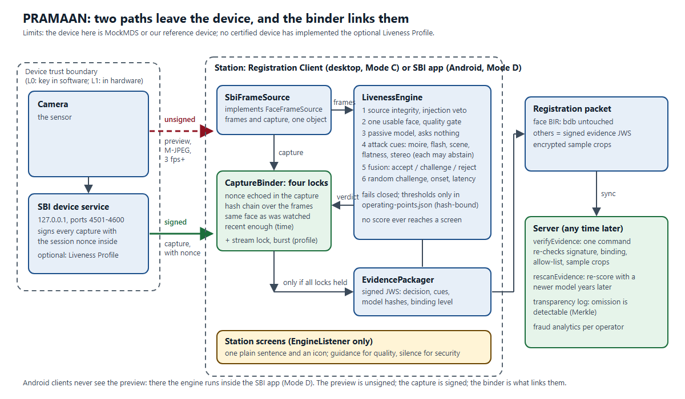
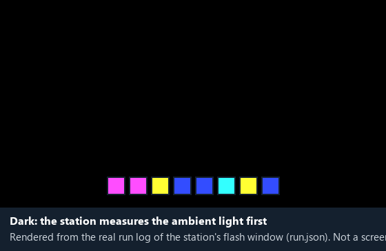

<div align="center">

# PRAMAAN (प्रमाण)

**Proof, not a verdict**

*Face liveness and presentation-attack detection for the MOSIP Registration Client, with signed evidence a server can re-check*

**MOSIP Decode 2026 · Problem Statement 04 · Bhavya Garg**

[](https://github.com/GargBhavya-tech/pramaan/actions/workflows/build.yml)
 

</div>

---

## Overview

A liveness check today ends in a pass or a fail, made on the station, that nobody can check afterwards. *Pramaan* is Sanskrit for
"proof": PRAMAAN is a face liveness and presentation-attack detection engine for MOSIP's Desktop and Android Registration Clients that
leaves **proof**. It checks the live face, **binds it to the signed capture that is actually stored**, and packages the result as signed
evidence that a server can re-verify, or re-score with a better model years later. The same Java engine runs on the desktop and, as a
library, inside the Android SBI device app.

It answers seven questions, in order, before it accepts a face:

1. Is the stream from a real sensor, not a virtual camera or injected video?
2. Is there exactly one usable face, of good enough quality?
3. Does it look alive, without asking the person to do anything?
4. Does it carry the marks of an attack: a print, a screen, a flat surface?
5. What do all the cues say together: accept, challenge or reject?
6. Did a live person answer a challenge nobody could have predicted?
7. Is the face that is stored provably the face that passed?

## Features

| Capability | Description |
|---|---|
| Passive first, active when needed | A passive model asks nothing of the resident; a challenge is added only when confidence is not enough |
| Random challenge | Blink, smile, turn, gaze, plus a flash-colour code: 6 colours × 8 steps = **20.7 bits**, with a random start, at most 3 colour changes a second |
| Cues that fail differently | Passive model, moiré, flash reflection, scene and light consistency, stereo depth, stream fingerprint; each can abstain, and an abstention is never a failure |
| Capture binding | Four locks (nonce, frame hash chain, same face, time) tie the preview that was checked to the signed capture that is stored |
| Signed evidence | A JWS in the face BIR `others` map (the `bdb` is untouched), a one-command server re-check, re-scoring, and a Merkle transparency log |
| Injection detection | Device identity, the OS camera registrations (so OBS is seen), and a JPEG stream fingerprint |
| Inclusion by design | Blink, pulse and pupil cues only ever vote *for* life; Hindi, icons, speech, accessibility profiles, infant mode, a dual-control exception flow |
| Policy per workflow | Resident, operator and supervisor profiles; thresholds in a table bound to each model's SHA-256; signed offline bundles with anti-rollback; fails closed |
| Insider-fraud analytics | Per-operator z-scores against the centre's baseline; a capture matching the signed-in operator's own face is blocked |
| Evaluation harness | Per-attack APCER and BPCER with confidence intervals, a synthetic attack factory, red-team fuzzers; ACER is not reported (ISO/IEC 30107-3 deprecated it) |
| Station UI | JavaFX screens with a progress row, a liveness indicator, Hindi, larger-text and high-contrast modes |
| Android | The same engine as an AAR (deployment Mode D), with low-resource tuning and optional hardware acceleration (the models were timed on one real phone, 2026-10-25: [`docs/performance.md`](docs/performance.md); no full liveness session on a phone yet) |

---

## A judge in three minutes

| Minute | Do this | What you will see |
|---|---|---|
| 1 | Read [`docs/submission/PRAMAAN-solution-2page.pdf`](docs/submission/PRAMAAN-solution-2page.pdf), or the 7-slide [pitch](docs/submission/PRAMAAN-pitch-7slides.pdf) | The problem, the idea (**proof, not a verdict**), and the limits stated first |
| 2 | `./gradlew :desktop:showcase` (or look at [`docs/media/`](docs/media/)) | The real station screens, driven by a simulated session: resident capture, challenge, Hindi, accessibility modes, fails closed |
| 2 | `./gradlew :harness:test --tests '*BindingAttacksTest'` | The capture-swap attack is a test, and each swap is rejected; `./gradlew build` runs everything |
| 3 | Read [`docs/claim-sheet.md`](docs/claim-sheet.md) | Every claim, its number, its reproduction command, and what we do **not** claim |

What is **not** here, so you do not have to look for it: no measured error rate on real attacks (no corpus exists), nothing run
on a live device or phone yet, and the desktop app is a scaffold, not the Registration Client. The design is in
[`docs/PRAMAAN_Final_Bible.md`](docs/PRAMAAN_Final_Bible.md) and the build order in [`docs/PRAMAAN_Build_Map.md`](docs/PRAMAAN_Build_Map.md).
Both are long; the claim sheet is the short route in.

## The problem

National ID enrolment (MOSIP) captures a resident's face through a certified biometric device (SBI). Liveness checks
are expected to stop prints, screens and replays held up to the lens. Three gaps make that weaker than it looks:

1. **The preview is unsigned and the capture is signed, and nothing links them.** An attacker who controls the
   preview stream can pass liveness on one face and submit another. On Android the client never even sees the
   preview frames.
2. **Injected video and virtual cameras** (OBS, deepfake pipelines) are outside ISO/IEC 30107, which covers
   presentation attacks only.
3. **A verdict cannot be audited.** A pass/fail made on the client today cannot be re-checked by the server
   tomorrow, or re-scored when better models exist.

## Problem statement (MOSIP Decode 2026 · PS04)

PS04 asks for face liveness and PAD for the Desktop and Android Registration Clients: passive checks first, an automatic active
challenge when needed, for residents, operators and supervisors, online and offline, configurable, with UI and tests. Where each
requirement stands:

| PS04 requirement | What PRAMAAN delivers | Status |
|---|---|---|
| Face frame streaming interface and a liveness/PAD interface | `FaceFrameSource` and `LivenessEngine` | Built; exercised against the reference device |
| Passive liveness against a configurable threshold, then an automatic challenge | Fused probability against operating points in `config/`; zones accept, challenge, reject | Built; thresholds provisional |
| PAD for prints, screens and replays | Passive model, moiré, flash, scene, stereo cues | Built; **no real attack corpus, so no measured APCER or BPCER** |
| Dynamic, unpredictable, system-chosen challenge | Random pool incl. a 20.7-bit flash code, random onset | Built and tested |
| Resident, operator and supervisor flows | Per-workflow policy (stricter for operators, strictest for supervisors); exception flow | Built in the engine and the scaffold |
| Online and offline | Core runs locally; signed offline bundle updates | Built |
| Configuration (enable, thresholds, challenge types, count, timeout, retries, per workflow, repeated failure) | `config/pramaan-policy.yaml`, strict parser | Built |
| Error handling and retry | Error taxonomy; quality problems never use an attempt | Built |
| UI/UX | Station screens, Hindi, accessibility modes, generic message on PAD failure | Built as a scaffold; **no user has tried it** |
| L0/L1 device integration | SBI client, reference device that speaks the Liveness Profile | Built against the protocol; **not run on a certified device or a live camera** |
| Changes in the Desktop and Android Registration Clients | A patch against MOSIP's `registration-client` 1.2.0.2 (`integration/registration-client/`: four hooks, a no-op by default), a scaffold, and an AAR | **Partly done**: the services module compiles with the patch and the PRAMAAN adapter (`regclient-adapter/`) is written and tested against the reference device, but nothing has run inside the real client, its UI has no screen for challenge prompts, and the Android client is not patched |
| Evaluate against ISO/IEC 30107 | Harness with per-PAIS APCER and BPCER and intervals | Method built; **no data** |
| Bonus: mock device, attack tests, interoperability, model versions, offline updates, low-resource Android | Reference device, red team, signed bundles; Android tuning and acceleration code | Built; **Android: the models ran on one phone and both accelerators worked, but no full liveness session on a phone** |
| Good-to-have: metrics, diagnostic mode, capability discovery | Metrics module (`docs/metrics.md`), audited diagnostic mode, device discovery | Built |

## Why this is different: six ideas

| # | The usual shortcut | PRAMAAN |
|---|---|---|
| 1 | Judge the preview, store a separate capture | **Bind them**: four locks prove the signed capture is the face that was watched |
| 2 | The client says pass or fail; the server must trust it | **Signed evidence** a server can re-check or re-score later |
| 3 | One model, or a blink check | **Cues that fail differently**, fused; a cue that cannot run abstains |
| 4 | A fixed challenge a recording can follow | A **random** one: a 20.7-bit flash code and a random onset |
| 5 | Camera only; injected video is invisible | Device identity, OS camera registrations, stream fingerprint |
| 6 | Blink and pulse checks that fail elderly, disabled and darker-skinned residents | Those cues **only ever vote for life**; Hindi, speech, a dual-control exception path |

The first idea matters most. On Android the client never sees preview frames (the SBI app shows the stream in its own UI), and the
stream that desktop clients do get is unsigned, so without binding, whoever controls the preview can pass liveness with one face and
have another enrolled. Each swap attack is a test (`BindingAttacksTest`, 8 cases).

## Architecture



The same, as text. The sequence diagrams for each flow are in [`docs/architecture/sequence-diagrams.md`](docs/architecture/sequence-diagrams.md).

```
            ┌──────────── desktop (JavaFX scaffold, ADR 0003) ────────────┐
 camera ──► │ SBI client (sbi) ──► LivenessSession (core) ──► evidence    │ ──► signed face BIR
 (SBI/MDS)  │   M-JPEG preview      cues → fusion → decision    JWS + log │      (server re-checks)
            └──────────────────────────────────────────────────────────────┘
                                         ▲
 core     headless engine: face/landmarks (ONNX), passive PAD, challenges, flash/stereo/scene/pupil cues,
          risk fusion with per-cue abstention, capture binding, policy bundles, transparency log, fraud analytics
 sbi      MOSIP SBI 1.0 client + Liveness Profile (key agreement, frame tags, illuminate, captureBurst)
 harness  corpus runner, APCER/BPCER with intervals, DET plots, synthetic attack factory, red-team fuzzers,
          conformal calibrator, evidence verifier / re-scorer
 desktop  registration scaffold: capture screen, operator login, supervisor approval, diagnostics
 android  the same engine as an AAR for deployment Mode D (inside the SBI app)
 integration/registration-client  a patch for MOSIP's registration-client (four hooks, a no-op by default); regclient-adapter is
          the PRAMAAN side that implements them, regclient-stub the compile-time stand-ins (never shipped)
```

Every fusion number lives in `config/operating-points.json`, bound to the SHA-256 of each loaded model. If you
swap a model, the engine refuses to start until the table is regenerated.

## Results (what is measured, and what is not)

**There is no real attack corpus yet, so there are no measured APCER or BPCER figures.** Every threshold is
provisional. `docs/claim-sheet.md` lists every claim with the command that reproduces it, and the limits come
first.

What *is* measured and reproducible:

| | Number | Reproduce |
|---|---|---|
| Test suite | **718 JVM tests, 0 failures**, green on GitHub Actions (Ubuntu and Windows). 14 skipped after `python tools/setup.py` has fetched the models; 20 on a bare clone without them (those two counts were measured at 703 tests; the 15 tests added since need no models). The rest need the MockMDS fixtures, a corpus or a device. A clean clone built with `tools/setup.py` in 3 min 57 s (2026-10-25) | `python tools/setup.py`, or `./gradlew build` |
| Flash-challenge unpredictability | 6 colours × 8 steps = 1,679,616 sequences = **20.7 bits** | `./gradlew :core:test --tests '*ChallengeGeneratorTest'` |
| Challenge uniformity | χ² over 100,000 draws, every parameter, p = 0.001 critical value | same |
| Photosensitivity | ≤ 3 colour changes/s, steps ≥ 333 ms, checked on 900 sequences | `./gradlew :core:test --tests '*FlashScheduleTest'` |
| Insider-fraud signal | 6 PAD failures in 40 sessions at a 2 % baseline gives **z ≈ 5.87** (flagged) | `./gradlew :core:test --tests '*FraudAnalyticsTest'` |
| Transparency log | Merkle heads and proofs match the Certificate Transparency test vectors | `./gradlew :core:test --tests '*MerkleLogTest'` |
| Stereo cue (synthetic) | real-face relief ≈ 25 mm vs flat print ≈ 0 mm (±4 mm) | `./gradlew :core:test --tests '*StereoDepthCueTest'` |
| Flash cue against a real replay (E1) | the author's test on a second laptop and phone separated live from replay as the design predicts (about 0.8 against below 0.3); the measured values moved by about 0.1 to 0.15 with screen brightness and distance, so they are a range, not a single number. The recordings are not in the repository (they show a face) | [`docs/e1-results.md`](docs/e1-results.md) |
| Pipeline latency (one laptop, CPU) | per frame at the median: face detection about 30 to 45 ms, passive liveness about 45 ms, JPEG decode about 17 to 24 ms, so roughly 9 to 14 frames per second of headroom against the 3 fps the SBI stream guarantees, **for those three stages only**: the whole engine (with landmarks and the embedding) took about 390 ms a frame on the first real-webcam run, 183 ms after the fixes. **Not a phone** | `./gradlew :harness:pipelineBench`; [`docs/performance.md`](docs/performance.md) |

Everything run so far, with what each number measures (real hardware, a simulated screen, or a generated corpus), is in
[`docs/evidence-report.md`](docs/evidence-report.md).

The repo also records its own red-team findings honestly. For example, R-03 in `docs/red-team-log.md` shows that
without a flash cue, attacker-controlled cues can sum to an accept on a synthetic screen replay. It is fixed for operators and
supervisors (an accept needs a live flash or stereo vote, else a challenge). For residents the same rule is built, tested and safe for
accessibility profiles (it stands down for them) but **off by default**, because it would send every resident at a station without a
flash light through a challenge, a friction that cannot be priced without real data.

## Status

Phases 0–11 are built: the liveness engine (`core`), the SBI client (`sbi`), the evaluation toolkit (`harness`)
and the registration scaffold (`desktop`). The Android AAR (Phase 12) builds, and its on-device tests and benchmark ran on one real phone (a Xiaomi 22071219AI, Android 14); it has **not run a full liveness session on a phone**.
The Phase 13 differentiators (flash reflection, stereo depth, scene and illumination consistency, pupil light reflex,
the SBI Liveness Profile) are wired into the engine. Each one switches on only when the station has the hardware it
needs. They are tested with fakes and synthetic data, because **no station with the extra hardware, and no device
that speaks the profile, exists yet**. The CI workflow runs on GitHub (Ubuntu and Windows) and is green. The desktop screens have a designed
theme, a step rail, Hindi, larger-text and high-contrast modes; they are checked by offscreen renders and tests, and **no
operator or resident has used them yet**.

## Installation and usage

Developed on Windows 11 with JDK 24. GitHub Actions builds and tests on Windows and on Ubuntu (under `xvfb` for the JavaFX tests),
and both are green; macOS is untried. No API keys, accounts or environment secrets are needed anywhere.

### 1. What you need

| Need | Version | For |
|---|---|---|
| JDK | **24** (CI uses Temurin 24); the code compiles to Java 11 bytecode | everything |
| Git | any | cloning |
| A graphics display | any (on Linux: `xvfb`) | the JavaFX screens and their tests; without one those tests skip |
| ffmpeg with libx264 | any | optional: a few harness tests and the flash-experiment recorder |
| Windows PowerShell 5.1, Microsoft Edge, ffmpeg | | optional: `tools/video/make_video.ps1` (the demo video) |
| Android SDK | compileSdk 34 | optional: the Android library only |

Gradle comes with the repository (`./gradlew`); the first run downloads its dependencies.

### 2. Get it and build it

```bash
git clone https://github.com/GargBhavya-tech/pramaan.git
cd pramaan
./gradlew build          # compiles with -Xlint:all -Werror, runs every test; about 4 to 9 minutes the first time
```

**One command instead (needs Python 3):** it fetches and verifies the models, then runs the same build.

```bash
python tools/setup.py                                  # models, then ./gradlew build
python tools/setup.py --task :desktop:showcase         # models, then the station screens
```

YuNet and SFace come from OpenCV's public zoo and are checked against the SHA-256 in `config/operating-points.json`. The other four
models are our own conversions and are **not in this repository** (a model binary is never committed here: see
`docs/licences.md`). They are published as one zip on the repository's
[`models-v1` release](https://github.com/GargBhavya-tech/pramaan/releases/tag/models-v1), whose link is in `config/models-bundle-url.txt`;
the script takes them from there, checks every file's SHA-256, and says which are missing. SFace is not in that zip (it is
development use only): the script gets it from OpenCV's zoo. With a model missing it still
builds, the tests that need one skip themselves, and the showcase and the reference device need none.

Expect `BUILD SUCCESSFUL`. On a bare clone that is **718 tests, 0 failures, 20 skipped** (the skip counts were last measured at 703 tests); after `python tools/setup.py` has placed
the models it is **14 skipped**. The skipped ones need the face models, MockMDS fixtures, a corpus or a device (see section 4).
Details: `docs/test-report.md`.

### 3. Five minutes, with nothing else (no camera, no models, no device)

```bash
./gradlew :desktop:showcase                 # the real station screens with a SIMULATED session: SPACE pauses, arrows step
./gradlew :harness:fusedRedTeam             # our red team against the whole decision (SYNTHETIC data, not a measured rate): 4 of 85 pitches accepted without a flash cue, 0 with
./gradlew :harness:test --tests '*BindingAttacksTest'      # each capture-swap attack is a test, and each is rejected
./gradlew :harness:runProfileDevice --args="--port 4533 --frame any.jpg"    # a device that speaks the Liveness Profile; any JPEG will do
bash docs/api/examples/try-the-device.sh    # in a second terminal: calls every endpoint of it and decodes the signed answers
```

### 4. Run the registration scaffold against a device

You need the **models** and a **device**.

1. **Models.** `python tools/setup.py --no-build` fetches and verifies all six (section 2). By hand, [`models/README.md`](models/README.md)
   gives each file's size, SHA-256, source and licence, and how to regenerate the four we converted. Without them the engine
   refuses to start.
2. **A device**, either:
   - MOSIP's **MockMDS** on `127.0.0.1:4501` (setup: `docs/hardware-testing-guide.md`, section 2.2). It replays an image file,
     and its stock face never passes the quality gate, so the screen stays on guidance ("Please move closer"); give it a
     larger, evenly lit face for a full run (`docs/sbi-notes.md`); or
   - **our reference device**: `./gradlew :harness:runProfileDevice --args="--port 4533 --frame some-face.jpg"` prints the CA
     file to use, then in another terminal
     `./gradlew :desktop:runScaffold --args="--device-ca build/profile-device/device-ca.cer --ports 4533"`.
3. **Run:** `./gradlew :desktop:runScaffold` (add `--args="--lang hi --speech true"` for Hindi and spoken prompts, `--flash-screen
   primary` to use the resident's own screen as the flash light, `--backdrop file` for a stored empty-room fingerprint). All
   options: `docs/api/README.md`, section C.

A **certified device** has not been tried, and neither has a real camera behind an SBI device service (`docs/claim-sheet.md`,
L5, L13, L17). In the window: sign in with the operator ID (first time: "Enrol my face"), scan the resident, approve. Larger
text, high contrast and the language switch are in the header; diagnostics and the backdrop re-take are under "Station tools".
Default test IDs: `docs/test-data.md`.

### 5. Verify, evaluate, calibrate

Each is one Gradle task with documented arguments (`docs/api/README.md`, section C): `:harness:verifyEvidence` (the server
re-check of a stored evidence record), `:harness:evaluate` (ISO/IEC 30107-3 report with intervals), `:harness:calibrate` (a
proposal split by person; it never edits the table). Without a real corpus none of the numbers they would print is a measured
error rate.

### 6. Android (Mode D)

A separate build that needs the Android SDK (`android/local.properties` with `sdk.dir`, or `ANDROID_HOME`):

```bash
./gradlew -p android :pramaan-android:check               # unit tests, lint, core's Android API check
./gradlew :core:publish && ./gradlew -p android :pramaan-android:publish   # AAR + core to build/repo
./gradlew -p android :pramaan-android:connectedDebugAndroidTest            # on a phone or emulator
```

The `check` passes, and on 2026-10-25 `connectedDebugAndroidTest` passed on a real phone (3 tests, with per-frame latency and accelerator parity: `docs/performance.md`); it has **not** run a full liveness session on a phone.

### 7. If something goes wrong

| You see | Cause and fix |
|---|---|
| `Error: JavaFX runtime components are missing` | start the app through the Gradle task (`:desktop:runScaffold`, `:desktop:showcase`), not `java -jar` or by running an `Application` class directly |
| `UnsatisfiedLinkError ... onnxruntime.dll: A dynamic link library (DLL) initialization routine failed` | ONNX Runtime is pinned to 1.20.0 on purpose; do not bump it. Why and how to check: `tools/versions.md` |
| The scaffold shows "Face verification is not available" | the policy, the operating-point table or a model did not verify. Check `--config` and `--models`, and the six hashes in `models/README.md`; the console has the details |
| "Camera not connected. Please check the device." | no device answered on the ports in `--ports`. Start MockMDS or the reference device |
| The scan stays on "Please move closer" | the stock MockMDS face is too small and unevenly lit for the quality gate; that is guidance working, not a fault |
| About 20 tests skipped (14 after `tools/setup.py`) | expected without the models and fixtures; a skip is never counted as a pass |
| Hindi shows empty boxes | the machine lacks a Devanagari font (Nirmala UI ships with Windows) |
| `WARNING: A restricted method in java.lang.System has been called` | Gradle's own native library on JDK 24; harmless |
| `Address already in use` | pick another `--port` for the reference device |

## Tech stack

Java 24 · Gradle (Kotlin DSL) · ONNX Runtime 1.20 (pinned, see `tools/versions.md`) · JavaFX 11 (matching the MOSIP
Registration Client) · Jackson · JUnit 5 · Android AAR · Python tooling for model export and fixtures · MOSIP SBI 1.0

## Screenshots / demo

These screens are **rendered offscreen from the real JavaFX code** (`StationViewRenderTest`), so they show the layout,
words and states exactly, but **no live camera or device** is behind them: the camera area shows its placeholder.

| | |
|---|---|
|  |  |
| Resident capture: step rail, one instruction, the scaffold labelled as a scaffold | Hindi (drafted by machine, checked by the author) |
|  |  |
| Operator sign-in | Fails closed: nothing can be registered, and it says what to check |
|  |  |
| Exception flow (supervisor approval, dual control) | An audited action asks for administrator and reason in one form |

More: `docs/media/hindi-large-text.png`, `docs/media/hindi-high-contrast.png`, `docs/media/supervisor-approval.png`,
`docs/media/resident-done.png`.

The flash challenge, as the station plays it. This is **rendered from the real run log** (`run.json`) of the station's flash window
playing its 8-step random code, not a screen capture, and there is no face or camera in it:



Hardware evidence checklist (each item needs hardware or people, so none is faked):

- [x] `docs/media/injection-veto.png`: OBS Virtual Camera selected and vetoed (done 2026-10-25, from the real camera list)
- [x] `docs/media/evaluation-report.png`: the harness HTML report. It is built from a **generated corpus** and the image says so
- [x] A live-camera run of the scaffold, with the author's consent (2026-10-25). It found four faults, now fixed, and the sign-in did **not** pass: the moire cue reads this webcam's live face as a screen. See [`docs/evidence-report.md`](docs/evidence-report.md), section 1.3
- [x] The flash experiment (E1) on a second laptop and phone, reported by the author; the recordings are not published: [`docs/e1-results.md`](docs/e1-results.md)
- [ ] A short real clip of the scaffold signing a person in on a live webcam (blocked by the moire cue on an uncalibrated camera)
- [ ] The moire threshold calibrated per camera on live faces and on screen replays from the same camera

The demo video's script is `docs/submission/07-demo-video-script.md` and `tools/video/make_video.ps1` rebuilds it (4 min 5 s,
1080p, captions). It is provided with the submission; its voice is synthetic and its station scenes are labelled "simulated session".

## Submission (MOSIP Decode 2026, problem statement 04)

Where each deliverable the Decode submission guidelines name is:

| Deliverable | Where |
|---|---|
| Source code | this repository |
| Git repository with version history | this repository |
| Working prototype or demo | `./gradlew :desktop:showcase` (the real screens, a simulated session, no hardware); the reference device and tools in "Installation and usage" section 3; the registration scaffold in section 4 |
| Pitch deck (7 slides) | [`docs/submission/PRAMAAN-pitch-7slides.pdf`](docs/submission/PRAMAAN-pitch-7slides.pdf) and an editable [PowerPoint](docs/submission/PRAMAAN-pitch-7slides.pptx) with speaker notes (plus a [10-slide version](docs/submission/PRAMAAN-pitch-full-10slides.pptx) with a three-slide appendix) (rebuilt by `tools/pptx/make_pitch_pptx.py`) |
| Solution document (2 pages) | [`docs/submission/PRAMAAN-solution-2page.pdf`](docs/submission/PRAMAAN-solution-2page.pdf) |
| Video demo | provided with the submission; its script is [`docs/submission/07-demo-video-script.md`](docs/submission/07-demo-video-script.md) and it is rebuilt by `tools/video/make_video.ps1` from the real screens, with a synthetic voice and an on-screen "simulated session" label |
| Usage and installation instructions | "Installation and usage" above |
| API documentation | [`docs/api/README.md`](docs/api/README.md) (Java API, the device interface over HTTP with real captured exchanges, tools and files) |
| Architecture diagram | [`docs/architecture/README.md`](docs/architecture/README.md) |
| Sequence diagrams (resident, operator, supervisor, binding, offline and updates, errors) | [`docs/architecture/sequence-diagrams.md`](docs/architecture/sequence-diagrams.md) |
| Android low-resource tuning and hardware acceleration (timed on one real phone) | [`docs/android-low-resource.md`](docs/android-low-resource.md) |
| Anonymised operational metrics (processing time, challenge time, retry and failure rate) | [`docs/metrics.md`](docs/metrics.md) |
| Performance, measured on one laptop (per-stage latency; Android unmeasured) | [`docs/performance.md`](docs/performance.md) |
| Design mockups and wireframes | [`docs/design/README.md`](docs/design/README.md) (the screens, the flow, tokens, accessibility) |
| Test data | [`docs/test-data.md`](docs/test-data.md) |
| Test cases and results | [`docs/test-report.md`](docs/test-report.md), generated from the JUnit results by `tools/test_report.py` |

## Documents

- `docs/PRAMAAN_Final_Bible.md`: the design, with the reasoning, the math, the threat model and the research log (Parts 0–48).
- `docs/PRAMAAN_Build_Map.md`: the build, as 100 tickets in strict order, each with Build / Watch out / Test / Done when.
- `docs/claim-sheet.md`: every claim, with its number, reproduction command and matching limitation.
- `docs/red-team-log.md`, `docs/sbi-liveness-profile.md`, `docs/adr/`: findings, the standard proposal, and decisions.
- `docs/api/`, `docs/architecture/`, `docs/design/`, `docs/test-report.md`, `docs/test-data.md`, `models/README.md`: the reference
  documents named in the table above.
- `CONTRIBUTING.md`: how to build, the rules that are easy to get wrong, and what must never be committed.

## Licence

MPL-2.0, matching MOSIP's own repositories.
