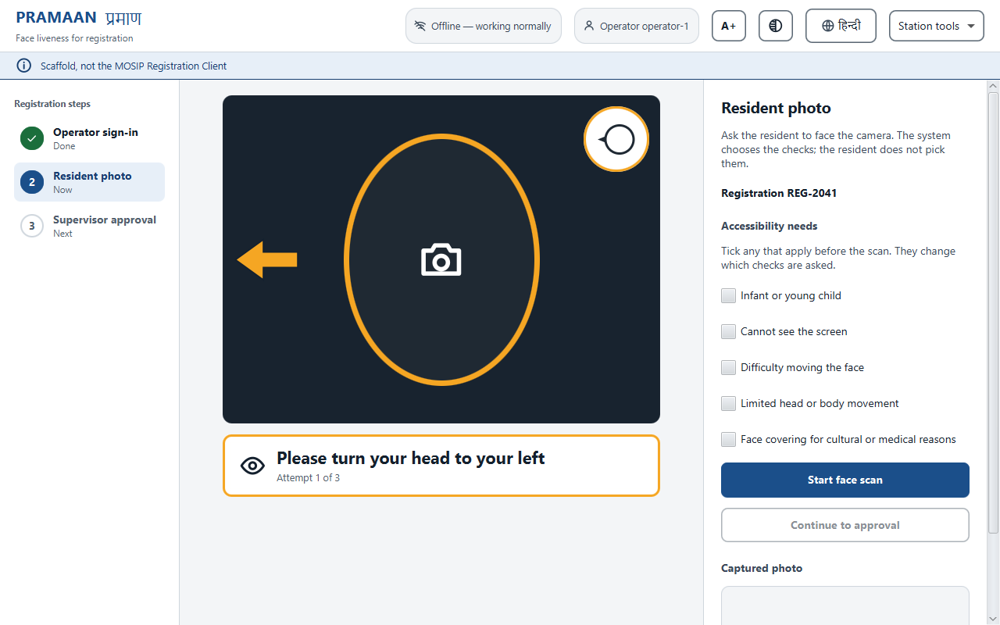
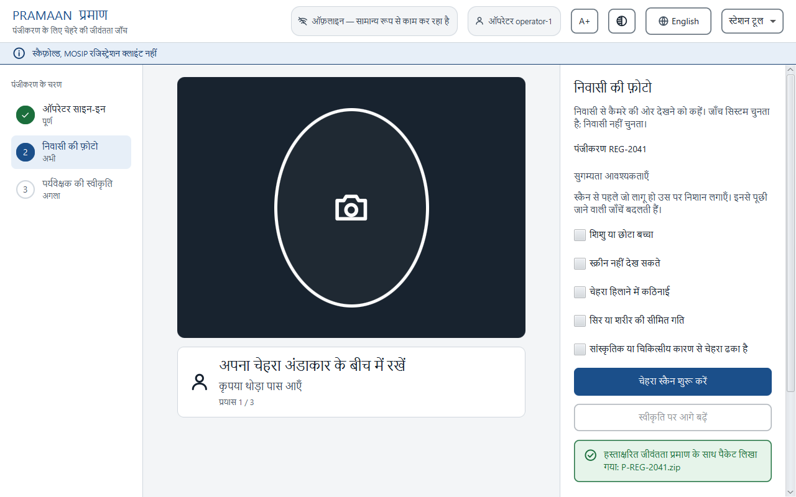
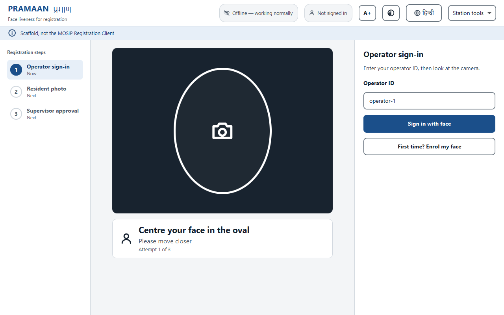
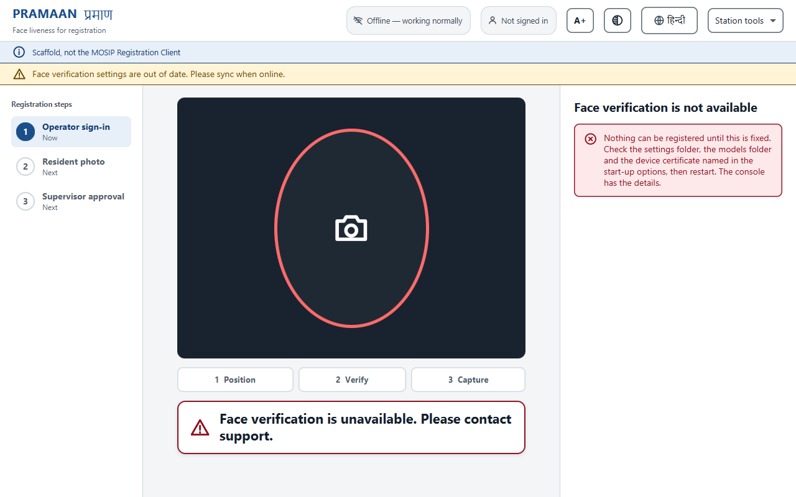
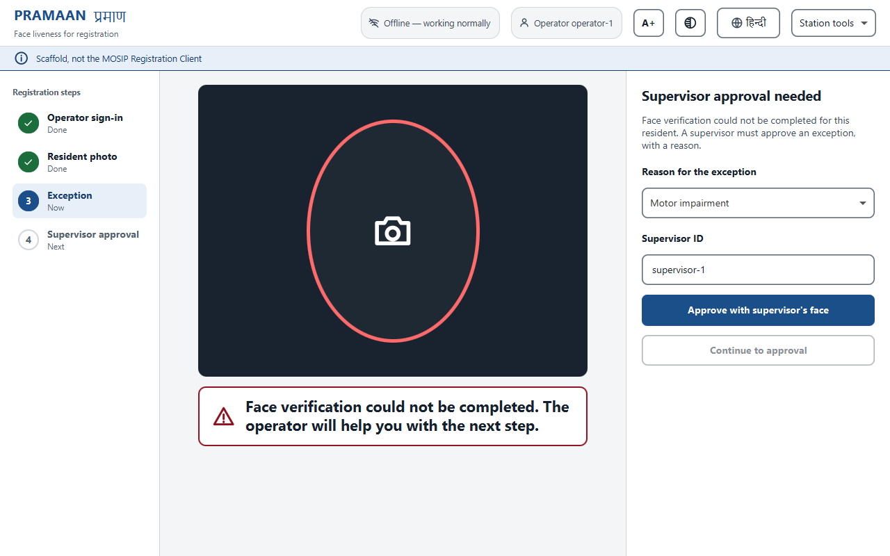
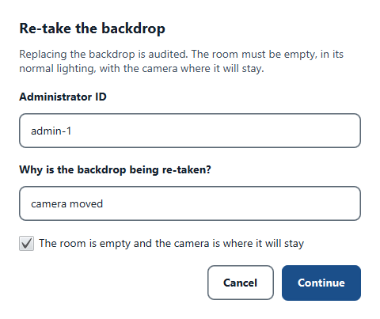

# PRAMAAN (प्रमाण)

**Face liveness and presentation-attack detection for the MOSIP Registration Client that produces signed,
re-checkable evidence instead of a one-off pass/fail.**

Built for MOSIP Decode 2026, problem statement 04. *Pramaan* is Sanskrit for "proof".

[](https://github.com/GargBhavya-tech/pramaan/actions/workflows/build.yml)
 

## The problem

National ID enrolment (MOSIP) captures a resident's face through a certified biometric device (SBI). Liveness checks
are expected to stop prints, screens and replays held up to the lens. Three gaps make that weaker than it looks:

1. **The preview is unsigned and the capture is signed, and nothing links them.** An attacker who controls the
   preview stream can pass liveness on one face and submit another. On Android the client never even sees the
   preview frames.
2. **Injected video and virtual cameras** (OBS, deepfake pipelines) are outside ISO/IEC 30107, which covers
   presentation attacks only.
3. **A verdict cannot be audited.** A pass/fail made on the client today cannot be re-checked by the server
   tomorrow, or re-scored when better models exist.

## What PRAMAAN does

- **Passive checks first.** Unpredictable challenges are added only when needed, and physics checks that ask
  nothing of the resident (flash reflection, stereo depth, scene consistency, pupil reflex) are preferred over
  asking people to perform.
- **Injection detection.** Virtual cameras are vetoed using the device's reported identity and the OS camera
  registrations. On Windows that includes DirectShow, so software cameras like OBS are seen.
- **Capture binding.** A session nonce, a frame hash chain, identity continuity and the SBI signature chain are
  all checked before an `ACCEPT`, so a capture swap is caught.
- **Signed evidence package.** The liveness evidence travels as a JWS in the face BIR. The server can re-verify
  it later with one command, or re-score the stored encrypted crops with a stronger model.
- **Inclusion by design.** Physiological cues (blink, pulse, pupil reflex) never count *against* a resident,
  because elderly, disabled and darker-skinned residents fail them for innocent reasons. There are Hindi, icon and
  text-to-speech modes, and an infant mode.
- **Insider-fraud analytics.** Per-operator z-scores are computed against the centre's own baseline. A resident
  capture that matches the logged-in operator's face is hard-blocked.
- **Signed policy and model bundles with anti-rollback**, so an operator cannot edit a threshold or replay an
  expired bundle offline. The engine fails closed.
- **An evaluation harness** that reports APCER and BPCER per attack type, with confidence intervals and DET plots.
  ACER is deliberately not reported, because ISO/IEC 30107-3 deprecated it.
- **An SBI Liveness Profile proposal**: an extension to the device standard that closes the preview/capture gap
  at the source, with a client and two reference devices that implement it.

## Architecture

```
            ┌──────────── desktop (JavaFX scaffold, ADR 0003) ────────────┐
 camera ──► │ SBI client (sbi) ──► LivenessSession (core) ──► evidence    │ ──► signed face BIR
 (SBI/MDS)  │   M-JPEG preview      cues → fusion → decision    JWS + log │      (server re-checks)
            └──────────────────────────────────────────────────────────────┘
                                         ▲
 core     headless engine: face/landmarks (ONNX), passive PAD, challenges, flash/stereo/scene/pupil cues,
          risk fusion with per-cue abstention, capture binding, policy bundles, transparency log, fraud analytics
 sbi      MOSIP SBI 1.0 client + Liveness Profile (key agreement, frame tags, illuminate, captureBurst)
 harness  corpus runner, APCER/BPCER with intervals, DET plots, synthetic attack factory, red-team fuzzers,
          conformal calibrator, evidence verifier / re-scorer
 desktop  registration scaffold: capture screen, operator login, supervisor approval, diagnostics
 android  the same engine as an AAR for deployment Mode D (inside the SBI app)
```

Every fusion number lives in `config/operating-points.json`, bound to the SHA-256 of each loaded model. If you
swap a model, the engine refuses to start until the table is regenerated.

## Results (what is measured, and what is not)

**There is no real attack corpus yet, so there are no measured APCER or BPCER figures.** Every threshold is
provisional. `docs/claim-sheet.md` lists every claim with the command that reproduces it, and the limits come
first.

What *is* measured and reproducible:

| | Number | Reproduce |
|---|---|---|
| Test suite | **673 JVM tests, 0 failures.** 2 skipped on the author's machine; **20 skipped on a fresh clone**, because the face models and the MockMDS fixtures are not in the repository and the tests that need them skip themselves. Full uncached build from a fresh clone: 8 min 36 s | `./gradlew build` |
| Flash-challenge unpredictability | 6 colours × 8 steps = 1,679,616 sequences = **20.7 bits** | `./gradlew :core:test --tests '*ChallengeGeneratorTest'` |
| Challenge uniformity | χ² over 100,000 draws, every parameter, p = 0.001 critical value | same |
| Photosensitivity | ≤ 3 colour changes/s, steps ≥ 333 ms, checked on 900 sequences | `./gradlew :core:test --tests '*FlashScheduleTest'` |
| Insider-fraud signal | 6 PAD failures in 40 sessions at a 2 % baseline gives **z ≈ 5.87** (flagged) | `./gradlew :core:test --tests '*FraudAnalyticsTest'` |
| Transparency log | Merkle heads and proofs match the Certificate Transparency test vectors | `./gradlew :core:test --tests '*MerkleLogTest'` |
| Stereo cue (synthetic) | real-face relief ≈ 25 mm vs flat print ≈ 0 mm (±4 mm) | `./gradlew :core:test --tests '*StereoDepthCueTest'` |

The repo also records its own red-team findings honestly. For example, R-03 in `docs/red-team-log.md` shows that
without a flash cue, attacker-controlled cues can sum to an accept on a synthetic screen replay.

## Status

Phases 0–11 are built: the liveness engine (`core`), the SBI client (`sbi`), the evaluation toolkit (`harness`)
and the registration scaffold (`desktop`). The Android AAR (Phase 12) builds but has **not yet run on a device**.
The Phase 13 differentiators (flash reflection, stereo depth, scene and illumination consistency, pupil light reflex,
the SBI Liveness Profile) are wired into the engine. Each one switches on only when the station has the hardware it
needs. They are tested with fakes and synthetic data, because **no station with the extra hardware, and no device
that speaks the profile, exists yet**. The CI workflow has not yet run on GitHub. The desktop screens have a designed
theme, a step rail, Hindi, larger-text and high-contrast modes; they are checked by offscreen renders and tests, and **no
operator or resident has used them yet**.

## Installation and usage

Tested on Windows 11 with JDK 24. The CI workflow also targets Linux (Ubuntu, under `xvfb` for the JavaFX tests), but it has
**never run**, so treat Linux and macOS as untried. No API keys, accounts or environment secrets are needed anywhere.

### 1. What you need

| Need | Version | For |
|---|---|---|
| JDK | **24** (CI uses Temurin 24); the code compiles to Java 11 bytecode | everything |
| Git | any | cloning |
| A graphics display | any (on Linux: `xvfb`) | the JavaFX screens and their tests; without one those tests skip |
| ffmpeg with libx264 | any | optional: a few harness tests and the flash-experiment recorder |
| Windows PowerShell 5.1, Microsoft Edge, ffmpeg | | optional: `tools/video/make_video.ps1` (the demo video) |
| Android SDK | compileSdk 34 | optional: the Android library only |

Gradle comes with the repository (`./gradlew`); the first run downloads its dependencies.

### 2. Get it and build it

```bash
git clone https://github.com/GargBhavya-tech/pramaan.git
cd pramaan
./gradlew build          # compiles with -Xlint:all -Werror, runs every test; about 9 minutes the first time
```

Expect `BUILD SUCCESSFUL`. On a fresh clone that is **673 tests, 0 failures, 20 skipped**: the skipped ones need the face
models or MockMDS fixtures, which are not in the repository (see section 4). Details: `docs/test-report.md`.

### 3. Five minutes, with nothing else (no camera, no models, no device)

```bash
./gradlew :desktop:showcase                 # the real station screens with a SIMULATED session: SPACE pauses, arrows step
./gradlew :harness:fusedRedTeam             # our red team against the whole decision (synthetic): 4 of 85 pitches accepted without a flash cue, 0 with
./gradlew :harness:test --tests '*BindingAttacksTest'      # each capture-swap attack is a test, and each is rejected
./gradlew :harness:runProfileDevice --args="--port 4533 --frame any.jpg"    # a device that speaks the Liveness Profile; any JPEG will do
bash docs/api/examples/try-the-device.sh    # in a second terminal: calls every endpoint of it and decodes the signed answers
```

### 4. Run the registration scaffold against a device

You need the **models** and a **device**.

1. **Models.** Place the six files listed in [`models/README.md`](models/README.md) in `models/` (it gives each file's size,
   SHA-256, source and licence, and how to regenerate the two we converted). Without them the engine refuses to start.
2. **A device**, either:
   - MOSIP's **MockMDS** on `127.0.0.1:4501` (setup: `docs/hardware-testing-guide.md`, section 2.2). It replays an image file,
     and its stock face never passes the quality gate, so the screen stays on guidance ("Please move closer"); give it a
     larger, evenly lit face for a full run (`docs/sbi-notes.md`); or
   - **our reference device**: `./gradlew :harness:runProfileDevice --args="--port 4533 --frame some-face.jpg"` prints the CA
     file to use, then in another terminal
     `./gradlew :desktop:runScaffold --args="--device-ca build/profile-device/device-ca.cer --ports 4533"`.
3. **Run:** `./gradlew :desktop:runScaffold` (add `--args="--lang hi --speech true"` for Hindi and spoken prompts, `--flash-screen
   primary` to use the resident's own screen as the flash light, `--backdrop file` for a stored empty-room fingerprint). All
   options: `docs/api/README.md`, section C.

A **certified device** has not been tried, and neither has a real camera behind an SBI device service (`docs/claim-sheet.md`,
L5, L13, L17). In the window: sign in with the operator ID (first time: "Enrol my face"), scan the resident, approve. Larger
text, high contrast and the language switch are in the header; diagnostics and the backdrop re-take are under "Station tools".
Default test IDs: `docs/test-data.md`.

### 5. Verify, evaluate, calibrate

Each is one Gradle task with documented arguments (`docs/api/README.md`, section C): `:harness:verifyEvidence` (the server
re-check of a stored evidence record), `:harness:evaluate` (ISO/IEC 30107-3 report with intervals), `:harness:calibrate` (a
proposal split by person; it never edits the table). Without a real corpus none of the numbers they would print is a measured
error rate.

### 6. Android (Mode D)

A separate build that needs the Android SDK (`android/local.properties` with `sdk.dir`, or `ANDROID_HOME`):

```bash
./gradlew -p android :pramaan-android:check               # unit tests, lint, core's Android API check
./gradlew :core:publish && ./gradlew -p android :pramaan-android:publish   # AAR + core to build/repo
./gradlew -p android :pramaan-android:connectedDebugAndroidTest            # on a phone or emulator
```

The `check` passes; it has **not** run a liveness session on a phone.

### 7. If something goes wrong

| You see | Cause and fix |
|---|---|
| `Error: JavaFX runtime components are missing` | start the app through the Gradle task (`:desktop:runScaffold`, `:desktop:showcase`), not `java -jar` or by running an `Application` class directly |
| `UnsatisfiedLinkError ... onnxruntime.dll: A dynamic link library (DLL) initialization routine failed` | ONNX Runtime is pinned to 1.20.0 on purpose; do not bump it. Why and how to check: `tools/versions.md` |
| The scaffold shows "Face verification is not available" | the policy, the operating-point table or a model did not verify. Check `--config` and `--models`, and the six hashes in `models/README.md`; the console has the details |
| "Camera not connected. Please check the device." | no device answered on the ports in `--ports`. Start MockMDS or the reference device |
| The scan stays on "Please move closer" | the stock MockMDS face is too small and unevenly lit for the quality gate; that is guidance working, not a fault |
| About 20 tests skipped | expected without the models and fixtures; a skip is never counted as a pass |
| Hindi shows empty boxes | the machine lacks a Devanagari font (Nirmala UI ships with Windows) |
| `WARNING: A restricted method in java.lang.System has been called` | Gradle's own native library on JDK 24; harmless |
| `Address already in use` | pick another `--port` for the reference device |

## Tech stack

Java 24 · Gradle (Kotlin DSL) · ONNX Runtime 1.20 (pinned, see `tools/versions.md`) · JavaFX 11 (matching the MOSIP
Registration Client) · Jackson · JUnit 5 · Android AAR · Python tooling for model export and fixtures · MOSIP SBI 1.0

## Screenshots / demo

These screens are **rendered offscreen from the real JavaFX code** (`StationViewRenderTest`), so they show the layout,
words and states exactly, but **no live camera or device** is behind them: the camera area shows its placeholder.

| | |
|---|---|
|  |  |
| Resident capture: step rail, one instruction, the scaffold labelled as a scaffold | Hindi (machine-drafted, not yet reviewed) |
|  |  |
| Operator sign-in | Fails closed: nothing can be registered, and it says what to check |
|  |  |
| Exception flow (supervisor approval, dual control) | An audited action asks for administrator and reason in one form |

More: `docs/media/hindi-large-text.png`, `docs/media/hindi-high-contrast.png`, `docs/media/supervisor-approval.png`,
`docs/media/resident-done.png`.

Still to capture (each needs hardware or a real run, so they are not faked):

- [ ] `docs/media/flash-challenge.gif`: the flash colour challenge playing on the resident's screen (`--flash-screen primary`)
- [ ] `docs/media/injection-veto.png`: OBS Virtual Camera selected and vetoed
- [ ] `docs/media/evaluation-report.png`: the harness HTML report (needs a corpus; synthetic rows would be labelled)
- [ ] A demo video: `docs/submission/07-demo-video-script.md` (3 min) or the live script `docs/demo-script.md`

## Submission (MOSIP Decode 2026, problem statement 04)

Where each deliverable the Decode submission guidelines name is:

| Deliverable | Where |
|---|---|
| Source code | this repository |
| Git repository with version history | this repository |
| Working prototype or demo | `./gradlew :desktop:showcase` (the real screens, a simulated session, no hardware); the reference device and tools in "Installation and usage" section 3; the registration scaffold in section 4 |
| Pitch deck (7 slides) | [`docs/submission/PRAMAAN-pitch-7slides.pdf`](docs/submission/PRAMAAN-pitch-7slides.pdf) |
| Solution document (2 pages) | [`docs/submission/PRAMAAN-solution-2page.pdf`](docs/submission/PRAMAAN-solution-2page.pdf) |
| Video demo | provided with the submission; its script is [`docs/submission/07-demo-video-script.md`](docs/submission/07-demo-video-script.md) and it is rebuilt by `tools/video/make_video.ps1` from the real screens, with a synthetic voice and an on-screen "simulated session" label |
| Usage and installation instructions | "Installation and usage" above |
| API documentation | [`docs/api/README.md`](docs/api/README.md) (Java API, the device interface over HTTP with real captured exchanges, tools and files) |
| Architecture diagram | [`docs/architecture/README.md`](docs/architecture/README.md) |
| Design mockups and wireframes | [`docs/design/README.md`](docs/design/README.md) (the screens, the flow, tokens, accessibility) |
| Test data | [`docs/test-data.md`](docs/test-data.md) |
| Test cases and results | [`docs/test-report.md`](docs/test-report.md), generated from the JUnit results by `tools/test_report.py` |

## Documents

- `PRAMAAN_Final_Bible.md`: the design, with the reasoning, the math, the threat model and the research log (Parts 0–48).
- `PRAMAAN_Build_Map.md`: the build, as 100 tickets in strict order, each with Build / Watch out / Test / Done when.
- `docs/claim-sheet.md`: every claim, with its number, reproduction command and matching limitation.
- `docs/red-team-log.md`, `docs/sbi-liveness-profile.md`, `docs/adr/`: findings, the standard proposal, and decisions.
- `docs/api/`, `docs/architecture/`, `docs/design/`, `docs/test-report.md`, `docs/test-data.md`, `models/README.md`: the reference
  documents named in the table above.
- `CONTRIBUTING.md`: how to build, the rules that are easy to get wrong, and what must never be committed.

## Licence

MPL-2.0, matching MOSIP's own repositories.
