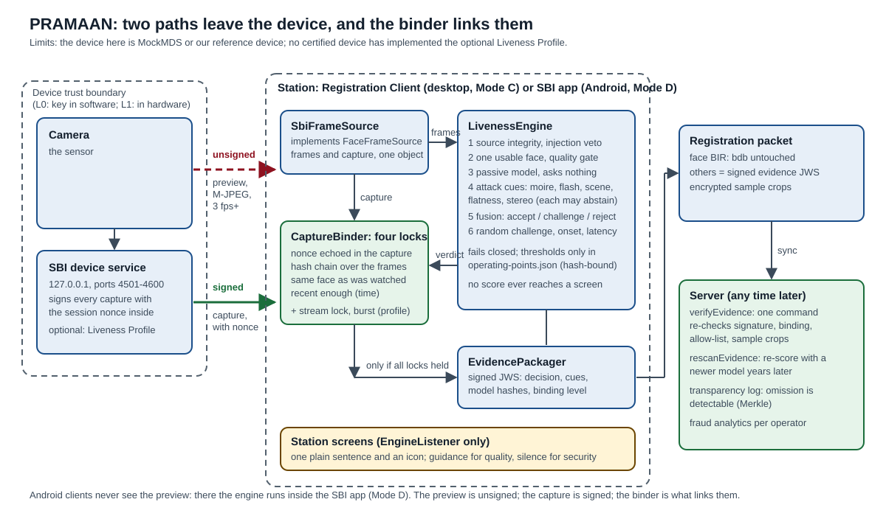

# Architecture

*Source: [`architecture.svg`](architecture.svg) (PNG copy: [`architecture.png`](architecture.png)). The full design, with the
reasoning and the maths for every layer, is `PRAMAAN_Final_Bible.md` (Parts 0 to 48).*

Limits first: the device in this diagram is MOSIP's MockMDS or our own reference device. No certified device implements the
optional Liveness Profile, the desktop app is a scaffold and not the MOSIP Registration Client, and the Android library has
not run a session on a phone (`docs/claim-sheet.md`, L12, L13, L17).

## The one idea

On a desktop the SBI preview stream is **unsigned** and the capture that is stored is **signed**, and nothing links them. On
Android the client never sees the preview at all. PRAMAAN keeps the two as separate paths, analyses the preview, and makes
`CaptureBinder` prove that the signed capture is the face that was watched before anything is accepted.

## Modules

| Module | What it is | Size (this repository, 2026-10-24) |
|---|---|---|
| `core` | The headless engine, Java 11 bytecode, no UI and no wall clock. Packages: `source` (the device abstraction and injection guard), `pipeline`, `detect`, `gate`, `landmarks`, `quality`, `passive`, `pad` (the attack cues), `challenge`, `fusion`, `binding`, `evidence`, `policy`, `session`, `engine`, `auth`, `audit`, `transparency`, `crypto`, `image`, `inference` | 200 source files, 55 test files |
| `sbi` | The MOSIP SBI client: discovery, stream, capture, signature verification, and the Liveness Profile (key agreement, frame tags, illuminate, burst) | 9 + 8 |
| `harness` | The evaluation toolkit and the references: corpus runner, ISO/IEC 30107-3 report with intervals, red-team fuzzers, calibrator, evidence verifier and re-scorer, the mock and the reference device | 45 + 37 |
| `desktop` | The JavaFX registration scaffold and the station UI, plus the no-hardware showcase and the flash-experiment recorder | 37 + 13 |
| `android` (separate build) | The same engine as an Android library for Mode D | 4 source files, plus its own instrumentation tests |

## The engine, layer by layer

| # | Question | Where | Notes |
|---|---|---|---|
| 1 | Is the stream from a real sensor? | `core.source` | device identity chain, OS camera registrations (OBS is found through DirectShow), JPEG stream fingerprint, timing statistics (recorded, never acted on) |
| 2 | One usable face of adequate quality? | `core.gate`, `core.quality` | quality problems become guidance, never a rejection |
| 3 | Does it look alive without asking? | `core.passive` | MiniFASNet models, hashes bound in the table |
| 4 | Marks of an attack instrument? | `core.pad` | moire, colour texture, flatness, flash reflection, scene and light consistency, stereo depth; each **abstains** when it cannot run, and an abstention is never a failure |
| 5 | What do all the cues say together? | `core.fusion` | log-odds fusion; accept / challenge / reject zones; physiological cues never count against a resident |
| 6 | Did a live person answer an unpredictable challenge? | `core.challenge` | random order, onset and parameters; 20.7 bits for the flash code; photosensitivity limits |
| 7 | Is the stored face the one that passed? | `core.binding` | the four locks below |
| | Proof for later | `core.evidence`, `core.transparency` | a signed JWS in the face BIR `others` map; a Merkle log that makes omission detectable |

## The four locks (and two optional ones)

| Lock | Checks | Works on plain SBI? |
|---|---|---|
| 1 nonce | the session nonce comes back **inside** the device-signed capture (as `transactionId`) | yes |
| 2 chain | a hash chain over the analysed frames links into the SBI `previousHash` chain | yes |
| 3 identity | the face embedded from the signed capture matches the face tracked in the preview | yes |
| 4 time | the capture is recent relative to the last verified frame | yes |
| stream (optional) | the signed capture names the head of the authenticated stream chain the client computed | needs the Liveness Profile |
| burst (optional) | several signed frames taken after the capture all show the same face | needs the Liveness Profile |

With the optional locks the binding level is `CRYPTOGRAPHIC`; without them it is `HEURISTIC`, and the evidence says which.

## Data flow and what is signed

| Data | Path | Signed? | Used for |
|---|---|---|---|
| Preview frames (M-JPEG) | device to `SbiFrameSource` to `LivenessEngine` | **no** (with the profile: a per-frame HMAC chain and device-signed checkpoints) | analysis only; never stored |
| Capture (ISO/IEC 19794-5 face record) | device to `SbiFrameSource` to `CaptureBinder` | **yes**, RS256 JWS with the nonce inside | the stored biometric |
| Verdict | engine to `EvidencePackager` | signed by the client's evidence key | the evidence in the packet |
| Evidence and sample crops | packet to server | signed; crops encrypted | re-check and re-score later |
| Station screens | engine to UI | not applicable | `EngineListener` carries no score, zone, cue or threshold |

## Deployment modes

| Mode | Where the engine runs | Frames it sees | When |
|---|---|---|---|
| **C** (Client) | the Registration Client | the unsigned SBI stream, 3 fps guaranteed | desktop (this repository's scaffold) |
| **D** (Device) | inside the SBI device app | the sensor's own frames | **Android**, where the client never sees the preview |
| **H** (Hybrid) | split | both, cross-checked | the strongest option; not built |

## Trust assumptions

- The device's signing key is trusted as far as the device certification (L0: a key in host software; L1: in secure hardware).
  A fully compromised L0 host can sign anything; PRAMAAN does not claim otherwise.
- The client trusts a **pinned CA** from configuration, never a certificate a device sends.
- Malware inside the client process can forge anything the client holds; the profile protects the path between device and
  client, not the client itself (threat T7 in `docs/sbi-liveness-profile.md`).
- Every threshold lives in `config/operating-points.json`, bound to the models' SHA-256; a signed bundle with anti-rollback
  stops an operator editing it offline. All of those numbers are **provisional** until there is a real corpus.

## Where to read more

`docs/adr/` (three decisions: deployment modes, landmarks, integration depth), `docs/sbi-notes.md` (what SBI guarantees, from
the spec and from real responses), `docs/sbi-liveness-profile.md` (the extension proposal and its threat table),
`docs/api/README.md` (the interfaces), `docs/red-team-log.md` (what we found wrong with our own cues).
