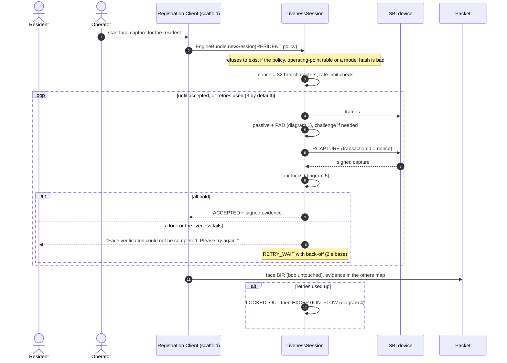
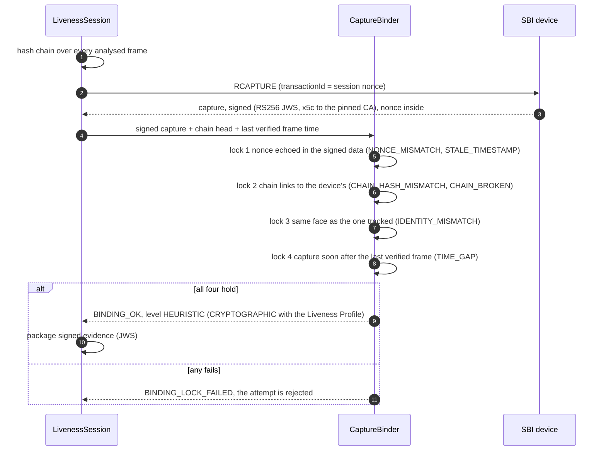

# Sequence diagrams

PS04 asks for sequence diagrams of the integration flows. These are drawn from the code's own state machine
(`SessionState`: `IDLE → ACQUIRING → PASSIVE → DECIDED → CHALLENGING → CAPTURING → BINDING → ACCEPTED`, with `FAILED`,
`RETRY_WAIT`, `LOCKED_OUT`, `EXCEPTION_FLOW`) and the audit events it emits. They render on GitHub (Mermaid). The numbers in
the notes are the configured defaults in `config/pramaan-policy.yaml`; every one of them is a setting, not a constant.

Honest scope: these describe what the **engine and the scaffold** do. They have been run against the reference device and
simulated sessions, not against a certified SBI device or inside the real Registration Client.

## 1. Passive-to-active decision flow (the core loop)

```mermaid
sequenceDiagram
    autonumber
    participant D as SBI device
    participant S as SbiFrameSource
    participant E as LivenessEngine
    participant F as Fusion
    participant U as Station screen

    S->>D: STREAM (frames, 3 fps guaranteed)
    D-->>S: unsigned preview frames
    S->>E: frame (timestamped)
    E->>E: source integrity, one usable face, quality gate
    alt no face / several faces / poor quality
        E-->>U: guidance only ("Please improve the lighting"); no attempt used
    else usable
        E->>E: passive model asks nothing of the person
        E->>F: passive probability + attack cues (each may ABSTAIN)
        F-->>E: zone ACCEPT / CHALLENGE / REJECT
    end
    alt ACCEPT (confident, enough cues agree)
        E->>E: go to CAPTURING (binding follows, diagram 5)
    else CHALLENGE (confidence not enough)
        E->>E: pick challenge steps at random from the pool
        E-->>U: one prompt ("Please turn your head to the left")
        E->>E: verify the action on the following frames, re-evaluate liveness
    else REJECT
        E-->>U: generic message only; detail goes to the audit log
    end
```

## 2. Resident registration



## 3. Operator authentication

```mermaid
sequenceDiagram
    autonumber
    actor O as Operator
    participant C as Registration Client
    participant L as LivenessSession (OPERATOR policy)

    O->>C: biometric login
    C->>L: new session (stricter: 2 to 3 challenge steps, 3 cues)
    L->>L: passive, PAD, challenge, binding
    alt liveness and binding hold
        L-->>C: verified live face
        C->>C: match against the enrolled operator
        C-->>O: signed in
    else fails
        L-->>C: not verified
        C-->>O: generic message; 3 attempts, then a 15-minute lock and a LOCKOUT_ALERT
    end
    Note over C,L: later, a resident capture that matches the signed-in operator's own face is blocked (the operator-face guard)
```

Liveness here is the *additional control* PS04 describes: it proves the matched face is a live person, in addition to the
match itself. Offline, the same session runs from the local bundle (diagram 6).

## 4. Supervisor authentication and the exception flow

```mermaid
sequenceDiagram
    autonumber
    actor R as Resident
    actor O as Operator
    actor V as Supervisor
    participant C as Registration Client
    participant L as LivenessSession

    Note over L: resident locked out after the maximum attempts
    L-->>C: EXCEPTION_FLOW (the only way on)
    O->>C: request an exception, with a reason
    C->>V: supervisor must be physically present
    V->>C: biometric login
    C->>L: new session (SUPERVISOR policy: strictest, 3 challenge steps, challenge always)
    L->>L: passive, PAD, challenge, binding
    alt supervisor verified live
        L-->>C: SupervisorVerdict (good for 10 minutes, once)
        C->>L: approve the exception capture
        L-->>C: EXCEPTION_APPROVED, capture proceeds with dual control
        Note over C: limits: 5 per operator and 20 per centre per day; every step audited
    else not verified
        L-->>C: EXCEPTION_BLOCKED
    end
```

## 5. Capture binding: the four locks



## 6. Online and offline, and secure model updates

```mermaid
sequenceDiagram
    autonumber
    participant S as Server (signs bundles)
    participant C as Registration Client
    participant E as EngineBundle
    participant A as Audit log

    Note over C,E: Offline: nothing below is needed to enforce liveness
    C->>E: load local policy + operating points + models
    E->>E: policy valid? table covers it? every model hash matches?
    alt anything missing, extra or altered
        E-->>C: EngineUnavailableException (fails closed, no capture without liveness)
    else
        E-->>C: engine ready
    end
    Note over C,S: Online, when connectivity returns (the transport is the Registration Client's own sync)
    S-->>C: new bundle + signed manifest (a JWS over policy, table and every model hash, with a version)
    C->>E: verify the manifest signature, then every file hash, then version > highest run so far
    alt valid
        E-->>C: new bundle is used from the next session; the version is recorded only after every model loaded
    else tampered, partial or older
        E-->>A: refused; the current bundle keeps running
    end
    Note over C: a bundle older than 30 days still works; the screen says so and the evidence is marked stale
```

Producing a signed bundle: `harness` `SignBundle`. Verifying and loading it: `EngineBundle` with `BundleManifest.verify`.

## 7. Error handling and recovery

```mermaid
sequenceDiagram
    autonumber
    participant D as Device / camera
    participant S as SbiFrameSource
    participant L as LivenessSession
    participant U as Station screen
    participant A as Audit log

    alt device unavailable / disconnected / communication failure
        D--xS: no answer
        S-->>L: source error
        L-->>U: "Device not available. Check the cable and try again." (no attempt used)
    else camera unavailable
        S-->>U: tell the operator to check the camera
    else face not detected / several faces / poor quality / invalid frame
        L-->>U: actionable guidance, no attempt used
    else liveness below threshold / PAD failure / challenge failed or timed out
        L-->>U: generic "could not be completed, try again" (attempt used)
        L->>A: detailed reason (diagnostic or audit access only)
    else maximum retries exceeded
        L-->>U: tell the user the capture could not be completed and name the recovery path
        L->>L: LOCKED_OUT, then the exception flow (diagram 4)
    else engine error (model fails to load or run)
        L-->>U: unavailable; nothing can be registered
        L->>A: LIVENESS_ERROR (fails closed; never skips liveness)
    end
```

Quality and device problems never consume an attempt; security problems do and say nothing an attacker could adapt to. The
rule is `FailureReason.consumesAttempt()`.
