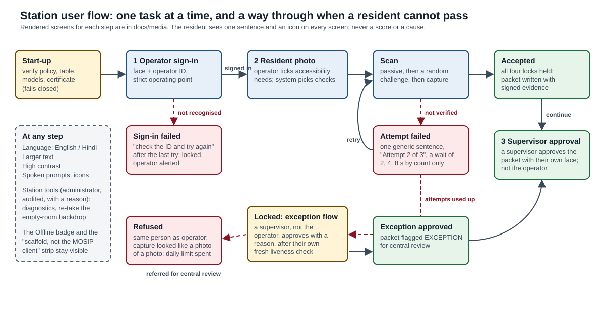
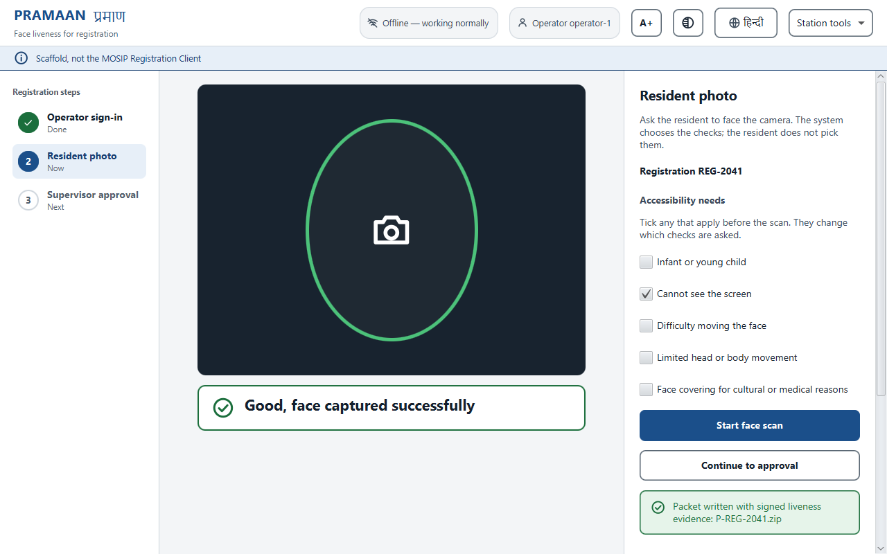
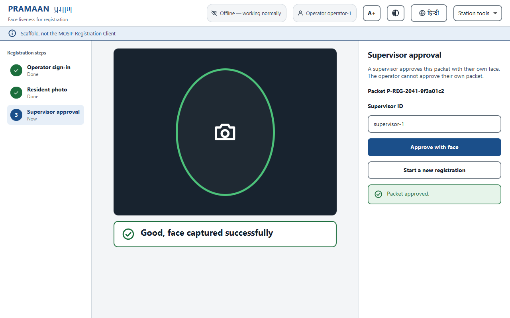
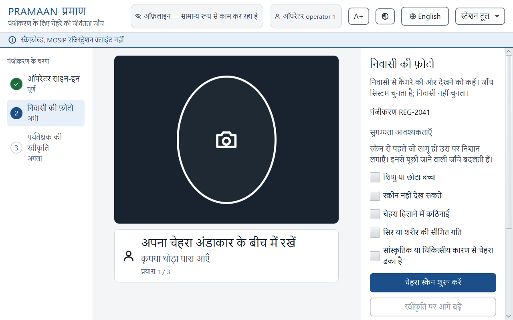
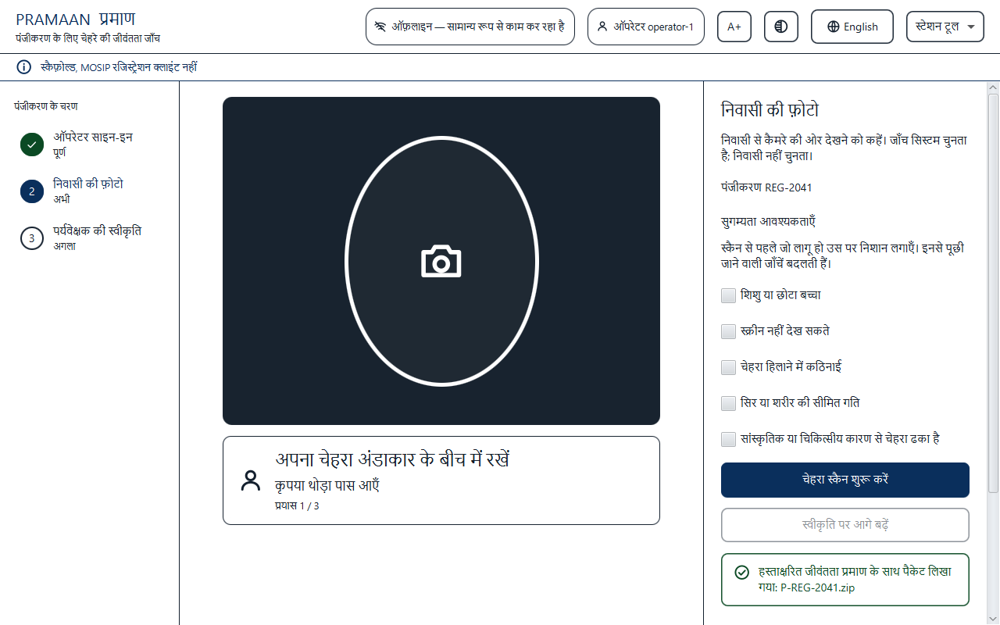

# Design: screens, flow, tokens and accessibility

Every screen below is **rendered offscreen from the real JavaFX code** (`StationViewRenderTest`, `UiShowcase`), so these are
the implemented screens, not mock-ups of intended ones. There is no live camera behind them: the camera area shows its
placeholder. Limits first: **no operator or resident has used these screens**, no screen reader was tried, and the Hindi is
machine-drafted and not yet reviewed by a native speaker (`docs/claim-sheet.md`, L14, L22).

## Direction

A tool an operator uses all day and a resident reads once, so: calm, high contrast, plain language. One accent colour (amber)
means exactly one thing, "an action is being asked of you now". Every state is an **icon and a word as well as a colour**.
The resident sees one sentence and an icon on every screen: never a score, never the reason a check failed
(Bible Part 19.1). Quality problems get guidance; security problems get a generic sentence.

## Layout wireframe

```
+--------------------------------------------------------------------------------------------+
| PRAMAAN प्रमाण   Face liveness for registration      [Offline] [Operator ID] [A+] [◐] [हिन्दी] [Station tools v] |
+--------------------------------------------------------------------------------------------+
| (i) Scaffold, not the MOSIP Registration Client                       (always visible)       |
+--------------+---------------------------------------------+-------------------------------+
| STEPS        |        CAPTURE AREA (what the resident sees)|   TASK PANEL (the operator)   |
| 1 Sign-in    |   +-------------------------------------+   |   Title                       |
| 2 Resident   |   |   camera preview, mirrored          |   |   one line of instruction     |
| 3 Approval   |   |   room dimmed around the face oval  |   |   fields, buttons             |
|              |   |   arrow / icon only for a prompt    |   |                               |
| Done / Now / |   +-------------------------------------+   |   [ primary action ]          |
| Next, in     |   [icon] one headline                       |   [ secondary ]               |
| words        |          one line of guidance               |   answer banner: icon + words,|
|              |          attempt 1 of 3                     |   says what to do next        |
+--------------+---------------------------------------------+-------------------------------+
```

At 1280 x 800 the three columns fit without scrolling for most steps; the task panel scrolls when its content is taller, and
its background always fills the column.

## The flow



*Source: [`user-flow.svg`](user-flow.svg) (PNG copy: [`user-flow.png`](user-flow.png)).*

## The screens

| | |
|---|---|
|  |  |
| **1 Operator sign-in.** One field, one primary button, an enrolment route for the first time | **2 Resident photo, mid-challenge.** The prompt has an icon, an arrow that points to the screen's left (the preview is mirrored) and a spoken line |
|  |  |
| **Accepted.** The answer banner sits directly under the buttons, so the operator does not scroll to learn whether the scan worked | **Exception.** A supervisor, not the operator, approves with a reason (dual control) |
|  |  |
| **3 Supervisor approval.** The operator cannot approve their own packet | **Fails closed.** If the policy, the table, a model or the certificate does not verify, nothing can be registered, and the screen says what to check |
|  |  |
| **Hindi** on every screen, switched in one click; what was typed and answered stays | **An audited action** asks for administrator and reason in one form, and stays off until it can be accepted |
|  |  |
| **Larger text** (18 px base instead of 14 px) | **High contrast** (borders and text at their strongest, backgrounds white) |

You can click through all of this on any machine, with no camera, device or models:

```bash
./gradlew :desktop:showcase          # a simulated session; SPACE pauses, the arrow keys step
```

## Design tokens (`desktop/src/main/resources/pramaan/desktop/ui/pramaan.css`)

Colours are tokens on `.root`; the two accessibility modes only redefine tokens and the base size. Contrast ratios were
measured with a WCAG calculator on the palette (WCAG AA needs 4.5:1 for normal text):

| Pair | Foreground / background | Ratio |
|---|---|---:|
| Secondary text on the page | `#3b4a5a` on `#f3f5f7` | 8.31 |
| Primary button text | `#ffffff` on `#1b4f8a` | 8.29 |
| Success banner | `#1b6e3c` on `#e6f4ea` | 5.53 |
| Warning banner | `#6b4500` on `#fff4d6` | 7.74 |
| Error banner | `#8e1220` on `#fde8ea` | 7.93 |
| Information banner | `#173f70` on `#e7eff8` | 9.13 |
| Text on the camera area | `#ffffff` on `#1f2933` | 14.76 |
| Tertiary text on white | `#52606d` on `#ffffff` | 6.46 |

The palette was checked, not a monitor: real displays, glare and colour-vision deficiencies were not tested.

| Token group | Value |
|---|---|
| Typeface | the system font (Segoe UI), with Nirmala UI for Devanagari (Segoe UI has no bold Devanagari and draws empty boxes) |
| Sizes | base 14 px (18 px in larger-text mode); headline 1.55 em; panel title 1.4 em |
| Targets | at least 44 px tall (WCAG 2.2, 2.5.8); the focus ring is 3 px (2.4.11) |
| Radius | 8 px controls, 10 px strips and banners, 14 px chips |
| Motion | one looping animation, the turn arrow, only while a turn is asked; none otherwise. There is no reduced-motion setting yet |

## Accessibility rules the screens follow

- A status is never colour alone: the banner, the step rail and the capture strip each carry an icon and a word.
- Every control has a label and an accessible text; each panel puts focus on its first field; a dialog closes on Escape.
- Larger text and high contrast are one click each, available at every step; the choice survives changing screen.
- A missing blink, pulse or pupil reflex is "unknown", never "spoof": physiological cues only ever vote for life.
- Spoken prompts (the platform's speech synthesizer) and icons for every challenge, for a resident who cannot read either language.
- Operator accessibility profiles (infant, cannot see the screen, difficulty moving the face, limited movement, face covering)
  change which checks are asked; the operator's use of them is counted as a fraud signal, not hidden.

## Not done

- Trying the screens with real operators and residents, and with a screen reader.
- A native-speaker review of the Hindi; bold Hindi falls back to regular weight with the font on the author's machine, so
  headings in Hindi rely on size.
- A reduced-motion setting; Android screens (the Android screens belong to the SBI device app, not to this repository).
